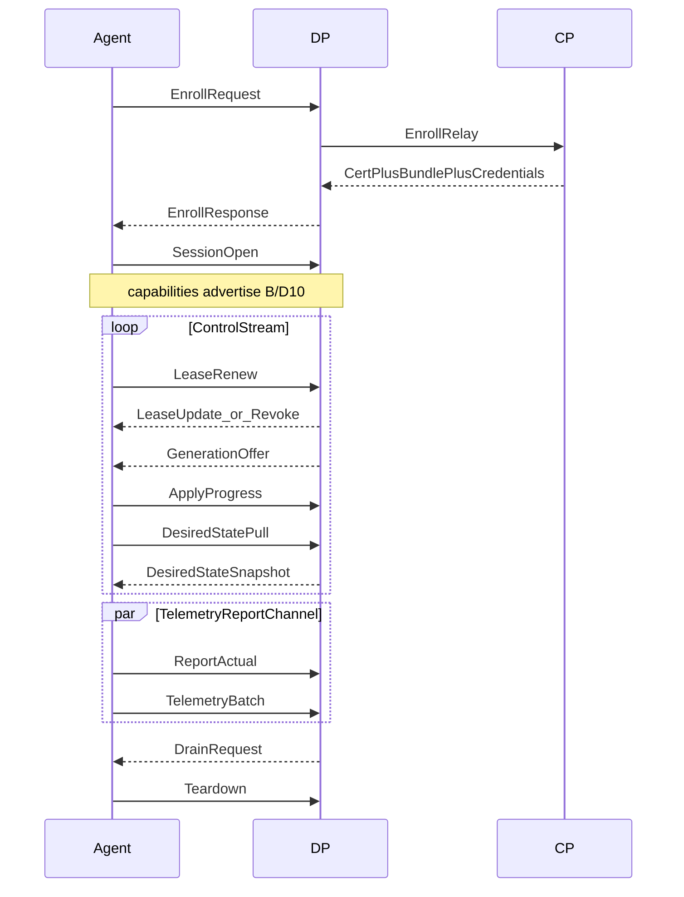

# P2 — Agent↔DP wire-contract assumptions (v1 host-local)

**Date:** 2026-09-02  
**Status:** DRAFT · **ASSUMPTIONS** (non-binding)  
**Scope:** Full v1 `host-local` protocol sketch (workplan P2, scope C)  
**Authority:** Backend DP owner remains single-writer for the real contract under `contracts/`. **When a `.proto` lands, it supersedes this document.**  
**Related:** [`workplan.md`](workplan.md) · [`design.md`](design.md) · [`../../docs/design/DECISIONS.md`](../../docs/design/DECISIONS.md) (SM-D24, SM-D28, B/D16) · [`../../docs/design/common/contracts/README.md`](../../docs/design/common/contracts/README.md)

> This is **not** an implementation plan and **not** a ratified wire format. It exists to serve as **negotiation input** for the backend workshop before the DP owner publishes the authoritative `.proto`. It is NOT sufficient to complete `AG-D2`.
>
> **Adversarial audit:** [`p2-wire-assumptions-audit.md`](p2-wire-assumptions-audit.md) (2026-09-01; dispositions updated 2026-09-02). Original verdict was workshop-only; CRITICAL/MAJOR items were addressed in-doc — see audit disposition. Still not an authoritative `.proto`.
>
> **Working baseline (surrogate `.proto` until backend):** [`p2-baseline.md`](p2-baseline.md) → this file.

---

## 1. Legend

| Tag | Meaning |
|---|---|
| **LOCKED** | Already recorded in ratified cross-cutting decisions. Restated here for convenience. |
| **PROPOSED** | Recorded in pending design docs (e.g., SM-D24, SM-D28). Must not be treated as ratified law until the doc locks. |
| **ASSUMED** | Working guess for wire shape. Backend may reject or rename freely. Every ASSUMED item must be confirmed or replaced before `contracts/` is authoritative. |
| **DEFERRED** | Acknowledged but out of scope for the current vertical slice. |

**How backend replaces an assumption:** mark the ASSUMED row superseded in review notes (or delete it when the `.proto` lands); do not silently diverge while agents still cite this file.

**001 subset:** rows marked **(001)** are required for the first vertical slice. Other rows are v1 host-local but post-001.

---

## 2. Transport

| Item | Tag | Notes |
|---|---|---|
| Agent-initiated outbound channel to DP | PROPOSED | B/D16 re-homed by SM-D24 |
| gRPC / HTTP2 bidi over mTLS on 443 | LOCKED | |
| Message set transport-agnostic | LOCKED | |
| HTTP/1.1 long-poll fallback | DEFERRED | Out of v1 install; h2 is prerequisite |
| Auto cert rotation | DEFERRED | Manual cert rotation for v1; lease bounds authority |
| Protobuf package name `sm.agent.v1` | ASSUMED | |
| gRPC service name `AgentSession` | ASSUMED | |
| Unary `Enroll` RPC + separate bidi `Connect` stream | ASSUMED | Enroll before mTLS client cert exists; steady-state on bidi |
| Separate telemetry/report ingest channel | ASSUMED | Separate HTTP or gRPC stream to prevent head-of-line blocking on the main lease bidi |
| DP address & trust bootstrap | ASSUMED | Out-of-band installation (e.g., config file) |

---

## 3. Phases and message kinds



### 3.1 Kind catalogue

| Direction | Kind | Tag | Phase | 001 |
|---|---|---|---|---|
| Agent→DP | `EnrollRequest` | ASSUMED name | Enroll | yes |
| DP→Agent | `EnrollResponse` | ASSUMED name | Enroll | yes |
| Agent→DP | `SessionOpen` | ASSUMED name | Session | yes |
| DP→Agent | `SessionAccept` | ASSUMED name | Session | yes |
| Agent→DP | `LeaseRenew` | ASSUMED name | Steady | yes |
| DP→Agent | `LeaseUpdate` | ASSUMED name | Steady | yes |
| DP→Agent | `Revoke` | PROPOSED in-band revoke exists; ASSUMED message name | Steady | yes |
| DP→Agent | `GenerationOffer` | ASSUMED name | Steady | yes |
| Agent→DP | `ApplyProgress` | ASSUMED name | Steady | yes |
| Agent→DP | `ReportActual` | ASSUMED name | Steady | yes |
| Agent→DP | `TelemetryBatch` | ASSUMED name | Steady | yes |
| DP→Agent | `CapabilityMismatch` | ASSUMED name | Session/Steady | yes |
| Agent→DP | `DesiredStatePull` | ASSUMED name | Steady (Recovery) | yes |
| DP→Agent | `DesiredStateSnapshot` | ASSUMED name | Steady (Recovery) | yes |
| Agent→DP | `ReplicaProgress` | ASSUMED name | Steady | no (multi-replica) |
| DP→Agent | `TrustBundleUpdate` | ASSUMED name | Steady | no |
| Agent→DP | `Teardown` | ASSUMED name | Teardown | yes |
| DP→Agent | `DrainRequest` | ASSUMED name | Teardown | yes |
| DP→Agent | `Error` | ASSUMED name | any | yes |

PROPOSED phase names (B/D16): **Enroll → Session → Steady state → Teardown**.

---

## 4. Field sketches

### 4.1 `EnrollRequest` (001) — Agent→DP

| Field | Tag | Notes |
|---|---|---|
| Bootstrap trust model | ASSUMED | Server auth relies on system CA or pinned DP cert. Client auth via single-use enrollment token in gRPC metadata. |
| Single-use target-bound enrollment token | LOCKED | B/D16 |
| CSR (DER or PEM) | ASSUMED encoding | Agent generates key locally |
| Agent-advertised `capabilities[]` enum | LOCKED concept (B/D10); ASSUMED closed enum | Closed, versioned enum (e.g. `CAP_APPLY_CONFIG`). No free strings. |
| Optional `agent_software_version` | ASSUMED | For min-agent-version checks (B/D10) |
| `protocol_version` | ASSUMED | |

Enrollment routing agent→DP→CP: **PROPOSED** (SM-D28).

### 4.2 `EnrollResponse` (001) — DP→Agent

| Field | Tag | Notes |
|---|---|---|
| CP-CA-signed client certificate | LOCKED | |
| Trust bundle (one or more CA certs) | LOCKED | Overlapping validity for rotation: LOCKED |
| Report-only credential | PROPOSED | Same `revocation_epoch` as apply path. |
| Report-only presentation | ASSUMED | Issued as a bearer token in EnrollResponse, presented in gRPC metadata for telemetry/report RPCs. |
| Initial lease (or “obtain via first `LeaseUpdate` after SessionOpen”) | ASSUMED which message carries first lease | Claims themselves PROPOSED |
| `dp_instance_id` (audience) | PROPOSED claim; ASSUMED field name | |
| Clock skew tolerance (duration) | ASSUMED | Agent needs CP/DP stated tolerance for `CLOCK_SUSPECT` |

### 4.3 `SessionOpen` / `SessionAccept` (001)

| Field | Tag | Notes |
|---|---|---|
| mTLS identity = session binding | LOCKED | Lease bound to mTLS public key, not textual agent_id |
| `capabilities[]` re-assert | LOCKED concept | B/D10 |
| `SessionAccept.assigned_target_id` | ASSUMED | Must match lease `target_id` |
| `SessionAccept.required_capabilities[]` | ASSUMED | DP echoes what this Target needs |
| `CapabilityMismatch` if agent lacks required set | ASSUMED wire | Surfaces “agent upgrade required” before apply |

### 4.4 Lease (`LeaseRenew` / `LeaseUpdate`) (001)

**PROPOSED claims** (SM-D28) — must appear on the wire in some encoding:

```
agent_id, target_id, binding_ids[], agent_revocation_epoch, fleet_revocation_epoch,
issued_at, expires_at, audience, nonce/jti, capabilities[]
```

| Item | Tag | Notes |
|---|---|---|
| Duration 1h; renew at 50% elapsed | PROPOSED | |
| Absolute UTC timestamps | LOCKED (B/D15) | |
| Per-agent + fleet revocation epochs | PROPOSED | Both sent as `agent_revocation_epoch` + `fleet_revocation_epoch` |
| Admission verb ceilings & margins | ASSUMED | Carried in LeaseUpdate; Agent uses this to compute if restart fits in remaining lease. |
| `LeaseRenew` carries prior `nonce` consumed + agent clock offset | ASSUMED | Offset reporting PROPOSED |
| `LeaseUpdate` carries new lease + DP wall time | ASSUMED | DP time = reference clock for skew |
| Renewal backoff/jitter | ASSUMED | Open for `AG-D2`; not fixed here beyond “exponential with jitter” |
| In-band `Revoke` discards cached desired | PROPOSED behaviour; ASSUMED message | |

### 4.5 `GenerationOffer` (001)

| Field | Tag | Notes |
|---|---|---|
| Monotonic `generation` number | LOCKED | Never wall-clock ordering |
| `idempotency_key` | LOCKED | |
| `binding_id` | LOCKED scope | Must be in lease `binding_ids[]` (B/D8) |
| Rendered config bytes or content-addressed blob ref | ASSUMED | Prefer ref + hash if large; ASSUME `config_sha256` + `payload` oneof |
| Secret render locus | ASSUMED | THREAT: Agent memory/disk exposure. Specify whether DP resolves secret refs and sends plaintext values, or sends refs for Agent to resolve locally. |
| Declared restart strategy / verbs for this generation | ASSUMED | Platform verb ceilings PROPOSED; packaging ASSUMED |
| `supersedes_generation` | ASSUMED | Cleanup of superseded partials (B/D16) |

Agent accepts **no new generation** in `RENEW_DEGRADED`: **PROPOSED**.

### 4.6 `ApplyProgress` (001)

| Field | Tag | Notes |
|---|---|---|
| `generation`, `idempotency_key` | LOCKED | |
| Status enum: `ACCEPTED` · `PREFLIGHT_FAILED` · `STAGED` · `RESTARTING` · `SUCCEEDED` · `FAILED` · `APPLY_INDETERMINATE` · `ADMISSION_BLOCKED` | ASSUMED names; PROPOSED that indeterminate + admission-blocked exist | `ADMISSION_BLOCKED` is an apply status here, not a distinct authority state. |
| `step_deadline` (absolute UTC) | PROPOSED concept | `min(step_start+max_step_duration, expires_at)` |
| `reason` / `detail` string | ASSUMED | No secrets |
| Crash-safe resume from persisted local state | PROPOSED | Layout = `AG-D2` (not specified here) |

### 4.7 `ReportActual` (001)

| Field | Tag | Notes |
|---|---|---|
| Observed config file hash (SM-written file) | LOCKED concept | |
| `restart_observed` bool + process identity evidence | LOCKED concept | Convergence gate uses restart-observed |
| Version observe: `OK` / `VERSION_DRIFT` / `VERSION_UNKNOWN` / `MISSING…` | PROPOSED states (SM-D14); ASSUMED field encoding | |
| `untrusted` bool | PROPOSED behaviour | Must be true (or DP labels) when agent in `LEASE_EXPIRED` / `REVOKED` / `CLOCK_SUSPECT` |
| Multi-replica detail | ASSUMED | Prefer [`ReplicaProgress`](#49-replicaprogress-v1-post-001); do not duplicate per-replica rows here |

### 4.8 `TelemetryBatch` (001 — Cache HTTP path)

| Field | Tag | Notes |
|---|---|---|
| Normalized envelope samples | LOCKED concept (B/D2 / SM-D4) | Exact envelope schema = common telemetry contract (partially specified) |
| Dedupe keys, freshness/staleness markers, gap markers | LOCKED | |
| `source_key` / replica discriminator | PROPOSED in storage model; ASSUMED on wire | |
| Batch max size / compression | ASSUMED | |
| `solace_event` payloads | Out of scope | Phase 2 / `AG-D5` |

### 4.9 `ReplicaProgress` (v1, post-001)

| Field | Tag | Notes |
|---|---|---|
| `replica_id` / `source_key` | ASSUMED | |
| Per-replica: staged generation, restart-observed | PROPOSED need for `CONFIG_DIVERGED` (SM-D15); ASSUMED message | |
| Coordination signal | ASSUMED | DP→Agent: `StageBarrierWait`, `StageBarrierProceed`, `RestartWave`. Control role reports; DP owns divergence state |

### 4.10 `TrustBundleUpdate` (v1, optional mid-session)

| Field | Tag | Notes |
|---|---|---|
| New/old CA set with overlapping validity | LOCKED behaviour | ASSUMED push vs pull-on-renew |

### 4.11 `Teardown` / `DrainRequest` (001)

| Field | Tag | Notes |
|---|---|---|
| Reason: `OPERATOR` · `RE_ENROLL` · `SHUTDOWN` | ASSUMED | |
| DP-forced drain | ASSUMED | DP sends `DrainRequest` to gracefully terminate agent before agent sends `Teardown`. |
| Agent stops apply; may send final untrusted reports if lease bad | PROPOSED constraints apply | |

### 4.12 `DesiredStatePull` / `DesiredStateSnapshot` (001)

| Field | Tag | Notes |
|---|---|---|
| Last applied generation cursor | ASSUMED | Agent requests current desired state after crash resume or `LEASE_EXPIRED` recovery |
| Snapshot payload | ASSUMED | DP returns the full current `GenerationOffer` equivalent |

### 4.13 `Error` (001)

| Field | Tag | Notes |
|---|---|---|
| Code | ASSUMED | Standard gRPC/HTTP status code equivalent |
| Message | ASSUMED | Human-readable string |

---

## 5. Agent-visible authority states ↔ legal messages

Authority states are **PROPOSED** (SM-D28). Wire enum names are **ASSUMED** (`AuthorityState`).

| State | May send | May accept | Notes |
|---|---|---|---|
| `ACTIVE` | `LeaseRenew`, `ApplyProgress`, `ReportActual` (trusted), `TelemetryBatch`, `ReplicaProgress`, `Teardown`, `DesiredStatePull` | `LeaseUpdate`, `GenerationOffer`, `DesiredStateSnapshot`, `Revoke`, `TrustBundleUpdate` | Full reconcile |
| `RENEW_DEGRADED` | renew, apply **cached** only, report, telemetry | `LeaseUpdate` (recovery), `Revoke`; **ignore new `GenerationOffer`** | PROPOSED |
| `LEASE_EXPIRED` | report/telemetry with **untrusted**; local atomic cleanup only | renew success → fetch `DesiredStateSnapshot` before apply | PROPOSED |
| `REVOKED` | untrusted report only; discard cached desired | re-enroll path | PROPOSED |
| `CLOCK_SUSPECT` | treat as expired; report offset; untrusted reports | DP timestamps in `LeaseUpdate` for recovery | PROPOSED |
| `RE_ENROLL_REQUIRED` | `EnrollRequest` / teardown | `EnrollResponse` | PROPOSED |

---

## 6. Out of scope (this assumptions doc)

| Excluded | Why |
|---|---|
| Authoritative `.proto` under `contracts/` | Backend single-writer; this file is ASSUMED only |
| `dp-remote` apply protocol | Separate open item; not agent↔DP |
| HTTP/1.1 fallback; auto cert rotation | Deferred |
| `solace_event` / broker collector | `AG-D5`; phase 2 |
| `scheduled` workloads | Cut from v1 (lease incompatibility) |
| K8s DaemonSet / leader-election **packaging** | `AG-D3` later; not wire kinds |
| DP lease store schema | Backend sub-spec |
| Exact `AG-D2` on-disk layout | Follows real proto |
| Full telemetry JSON Schema | Common contracts (partially specified) |

---

## 7. Handoff checklist for backend DP owner

Confirm or replace each ASSUMED item before treating the wire as specified:

1. Service/package names and unary-enroll vs bidi-only.
2. Where the **first lease** is delivered (`EnrollResponse` vs first `LeaseUpdate`).
3. Encoding of lease claims + dual revocation epochs + nonce rotation.
4. `GenerationOffer` payload: inline bytes vs blob ref; secretRef resolution locus (DP render vs agent).
5. Exact status enums for apply. (`ADMISSION_BLOCKED` is an **apply status**, not an authority state — confirm or replace.)
6. How `untrusted` reports are labelled in the store (agent flag vs DP derivation from session state).
7. Telemetry/report **separate channel** shape (second gRPC stream vs HTTP ingest) and framing.
8. Multi-replica: confirm `ReplicaProgress` + barrier/wave signals (not folded into `ReportActual`).
9. `protocol_version` / `buf breaking` policy and min-agent negotiation (B/D10).
10. Clock tolerance value and whether tolerance is in enroll response or lease update.
11. Secret render locus choice (DP plaintext vs agent-resolved refs) and threat acceptance.
12. Report-only bearer metadata scheme and revocation alignment.

**Done when (workplan P2):** versioned `.proto` + transport state machine published under contracts; this document marked superseded or reduced to a historical annex.

---

## 8. Mapping to workplan 001

| 001 step | Primary kinds |
|---|---|
| Enroll | `EnrollRequest` / `EnrollResponse` |
| mTLS session + lease | `SessionOpen` / `SessionAccept`, `LeaseRenew` / `LeaseUpdate` |
| One apply | `GenerationOffer`, `ApplyProgress` |
| report-actual | `ReportActual` |
| Cache HTTP scrape push | `TelemetryBatch` |
| Expiry / revoke | `Revoke`, untrusted `ReportActual`, state table §5 |

---

## Changelog

| Date | Change |
|---|---|
| 2026-09-01 | Initial full v1 host-local ASSUMED sketch for P2 (scope C). |
| 2026-09-02 | Audit remediation (C1–C6, M1–M9, N1): retags; enroll/report credential; secret locus; ceilings; desired-state pull; separate telemetry channel; replica barriers; dual epochs; closed caps; Error; DrainRequest; OOB bootstrap. Residual cleanup: diagram, ReportActual multi-replica, §7 checklist. |
