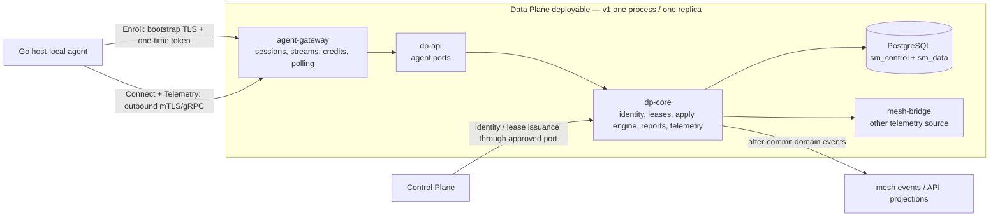
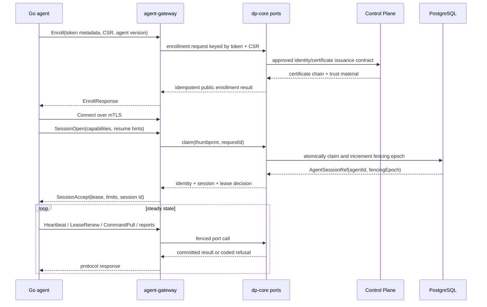
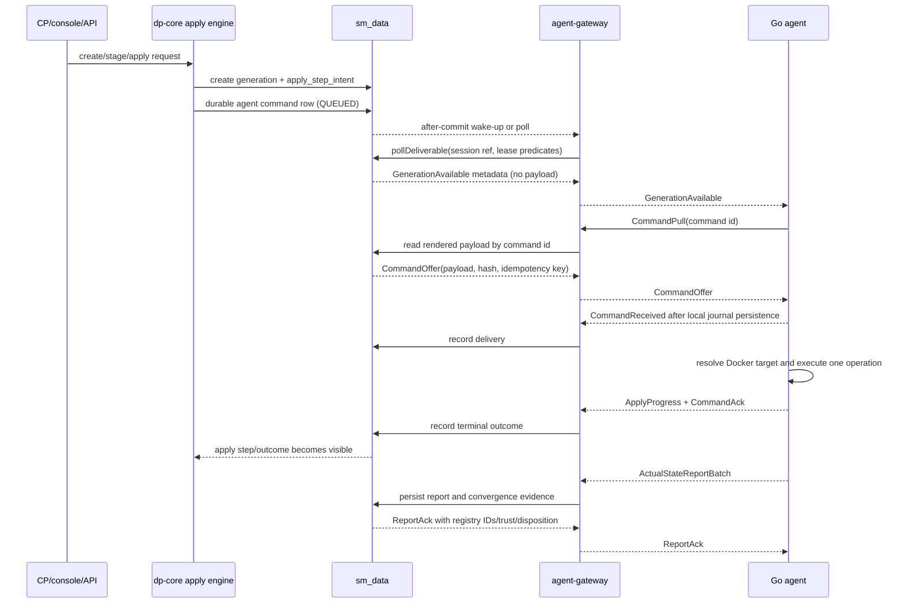

# Data Plane ↔ `host-local` agent — production integration design

> **History, taken verbatim from `origin/dp-agent-integration` @ `87e338e1` by plan 015 T0.1 (2026-10-08).** Its §16 review is empty (plan 015 [An §1.8]); it is input to [plan 015](../../../../plans/backend/015-agent-gateway.md), not authority. Apart from this note, only the links to the renamed history plans were edited.

| | |
|---|---|
| **Component** | `agent-gateway` + `dp-core` integration |
| **Date** | 2026-10-05 |
| **Status** | **IMPLEMENTATION BASELINE — branch-local decisions recorded; not externally ratified or production-approved** |
| **Companion design** | [`../design.md`](../design.md) |
| **Implementation plan** | [`015-history-implementation.md`](../../../../plans/backend/015-history-implementation.md) |
| **Execution plan** | [`015-history-execution.md`](../../../../plans/backend/015-history-execution.md) |
| **Requirements** | [`REQ-005`](../../../../requirements/REQ-005-three-runtimes.md), [`REQ-007`](../../../../requirements/REQ-007-six-month-metrics.md) |

## 0. Purpose and status boundary

This document defines how the Data Plane replaces the in-process fake gateway with a production Java
`agent-gateway` that communicates with the existing Go `host-local` agent.

The fake gateway currently proves the agent control loop. It is not a source of production state, authorization,
lease truth, command generations or telemetry persistence. In the production path:

- `agent-gateway` terminates the agent-facing gRPC/mTLS connection and owns connection-local state only.
- `dp-core` remains the authority for identity, tenant/target scope, leases, generations, command outcomes,
  reports and telemetry persistence.
- The existing apply engine remains the business workflow. The agent path is a runtime transport behind its
  `RuntimeAdapter` seam; it is not a second apply engine.
- `fake-gateway` remains in the repository as a protocol test double and developer harness.

This is a companion integration design, not a silent rewrite of [`../design.md`](../design.md). The companion
design and its `AGW-D*` decisions define the intended module boundary and message/state model. This document
turns that boundary into a production delivery shape and names the work still blocked by open decisions.

The repository now has a branch-local implementation baseline. The existing agent-gateway design and decision family
remain `PROPOSED`; this document records implementation choices made under the task authorization, not external
ratification. CP-backed enrollment/lease adapters, placement resolution, durable command completion and canonical
telemetry projection now exist in the branch. The production listener remains disabled until deployment supplies the
CA keystore, TLS material, database mappings and the remaining release validation evidence.

## 1. Goals

### 1.1 In scope

1. Replace fake-gateway command offers with production delivery from durable Data Plane state.
2. Enroll and authenticate Go agents using the approved certificate and trust-bundle flow.
3. Maintain a fenced agent session and lease without allowing a stale gateway/session to act.
4. Deliver `preflight`, `apply`, `restart` and `stop` through the existing apply engine.
5. Receive actual-state reports and make them durable, replay-safe and usable by convergence checks.
6. Receive agent telemetry through the same normalized Data Plane ingestion contract as other telemetry sources.
7. Preserve at-least-once delivery and crash/reconnect safety across gateway and agent restarts.
8. Keep the gateway replaceable by a later independently deployed gateway without moving business logic.

### 1.2 Explicitly out of scope

- Changing the Go agent's runtime behavior except where the ratified wire contract requires compatibility work.
- Making the agent author configuration, validate schemas, deploy artifacts or modify MI code.
- Adding a second business apply state machine inside `agent-gateway`.
- Moving `sm_data` access, Flyway migrations or tenant resolution into `agent-gateway`.
- Kubernetes support, scheduled workloads, agent self-upgrade or the HTTP/1.1 fallback.
- Human RBAC for agent commands. Human authorization remains in the CP/DP command-creation path.
- Multi-replica production deployment in v1. The design must not block it, but v1 ships one DP/gateway replica.

## 2. Current-to-target change

| Concern | Current fake-gateway path | Production path |
|---|---|---|
| Agent enrollment | Fake CA and in-memory token table | DP enrollment endpoint backed by approved identity/CP issuance contract |
| Lease | Scenario YAML | DP-owned lease projection and renewal ledger |
| Command source | Scripted offers or stdin | `dp-core` apply intent rows and durable command-delivery poll |
| Configuration bytes | Scenario payload | DP-rendered generation payload, retrieved only after `CommandPull` |
| Authorization | Fake scenario capability list | Identity → target/binding scope → active lease → capability/admission checks |
| Command result | Printed transcript | `dp-core` apply outcome, audit, events and operator/API projection |
| Actual state | Fake report handler | Durable report intake, registry IDs, freshness and convergence projection |
| Telemetry | Fake acknowledgements | `TelemetryIngestPort` → normalized `sm_data` persistence → commit acknowledgement |
| HA | One test process | One v1 replica; poll/fence semantics tested for later extraction |
| Observability | stdout transcript | health/readiness, structured logs, metrics, audit records and evidence tests |

## 3. Production topology

### 3.1 Ownership rule

`agent-gateway` may own:

- gRPC server lifecycle and mTLS connection state;
- session phase, connection-local send queues and telemetry credit windows;
- gateway polling timers and reconnect/drain handling;
- translation between generated gRPC messages and versioned `dp-api` port types;
- connection-local metrics and bounded buffers.

`agent-gateway` may not own:

- a database connection, repository, JPA entity, Flyway migration or datasource lookup;
- tenant identity supplied by the wire;
- lease issuance, lease extension or generation ordering;
- command outcome truth, actual-state truth, telemetry normalization or durable audit;
- a broker connection or event publication.

All durable decisions are made by `dp-core` and are reached through `dp-api` ports. The ArchUnit and Maven
dependency rules in the companion design are acceptance criteria, not documentation-only conventions.

## 4. Port boundary

The gateway consumes interfaces from `dp-api`; `dp-core` implements them. Each mutation-bearing port must have an
idempotent durable arbiter and an explicit `COMMITTED`/failure result before this design can be approved.

| Port | Called by gateway | `dp-core` responsibility |
|---|---|---|
| `AgentEnrollmentPort` | `Enroll` | Validate token/CSR replay, map target scope, request/return certificate material, rate-limit and audit enrollment |
| `AgentIdentityPort` | session open and authorization checks | Resolve certificate thumbprint to agent, target, bindings, capabilities and revocation state; never accept tenant from wire |
| `AgentSessionPort` | `SessionOpen`, teardown, heartbeat | Claim/reclaim the agent with a monotonic fencing epoch; return an opaque `AgentSessionRef` |
| `AgentLeasePort` | session open and `LeaseRenew` | Read/renew the lease, preserve the single-use nonce, validate certificate binding and epoch |
| `AgentCommandPort` | poll, pull, received, terminal ack | Reserve and re-notify deliverables, enforce lease/capability/admission predicates, map delivery/outcome to apply rows |
| `ActualStatePort` | actual-state report batch | Persist per-item identity/fingerprint/freshness/trust/disposition, mint registry IDs and advance canonical projection |
| `TelemetryIngestPort` | telemetry batch | Validate producer scope/labels, commit normalized samples and gaps, return watermark and credits only after commit |
| `AgentAuditPort` | security and refusal events | Persist append-only or otherwise explicitly durable security audit records with request-id idempotency |

### 4.1 Port rules

- Every agent-bound mutation carries the DP-issued `AgentSessionRef`; no wire field supplies tenant scope.
- Every replayable mutation has a deterministic request ID and a durable arbiter. A timeout is never resolved by
  guessing whether the first transaction committed.
- Read-only lookups are re-evaluated on replay and are not incorrectly presented as durable command outcomes.
- `agent-gateway` receives ports by constructor injection. It never looks up Spring beans dynamically.
- Port contracts are transport-independent. The same contract tests must run against in-process adapters and the
  future remote adapter.

## 5. Enrollment and session lifecycle

### 5.1 Session rules

1. Enrollment is the only certificate-less RPC and is served only on the bootstrap TLS surface.
2. The token is single-use but replaying the same token and same CSR returns the original public result when the
   enrollment ledger says it is a replay. A different CSR is refused.
3. A successful `SessionOpen` creates or reclaims one owning session with a fencing epoch. A new owner makes the
   old session stale; the old session receives a coded supersession/revocation response where possible.
4. All writes after claim carry the returned session reference. The gateway never reconstructs it from a wire ID.
5. `SessionAccept` is sent only after a valid lease is available. An expired lease is renewed through the approved
   lease path; it is not silently re-issued.
6. Heartbeat responses carry DP/server clock information. The agent remains the enforcement point for clock-suspect
   and lease-expiry behavior; the gateway must not reinterpret agent-local safety states.
7. Planned gateway restart uses `Drain`, staggered reconnect timing and readiness gating. Abrupt failure relies on
   the next claim/fencing epoch and durable redelivery.

## 6. Command delivery and apply integration

### 6.1 End-to-end command flow

### 6.2 Runtime adapter mapping

The production agent adapter must implement the existing runtime-neutral seam. It must not create a parallel
`agent_apply` state machine.

| `RuntimeAdapter` operation | Agent command | Completion source |
|---|---|---|
| `replicas` | none | DP placement/registry read |
| `prepare` | `preflight` | terminal `CommandAck` with structured preflight result |
| `materializeConfig` | `apply` | terminal `CommandAck` + persisted actual-state report |
| `startOrUpdate` | `restart` | terminal `CommandAck` + observed newer start time/report |
| `stop` | `stop` | terminal `CommandAck` + observed stopped state/report |
| `status` | none | current DP projection from trusted reports |
| rollback assessment/restore | no direct agent wire verb in v1 | the implementation must follow the `BE-D12`/`BE-D13` ruling for the runtime-neutral seam; it must not silently claim that a host-local agent can perform a rollback the wire does not define |

The agent-backed adapter still has to satisfy the complete Java `RuntimeAdapter` interface. The implementation
task must therefore choose, with the backend owners, the explicit seam behavior for rollback methods before the
adapter is certified: a supported agent protocol extension, a coded unsupported result that leaves the DP in its
documented recovery state, or routing to a different runtime adapter. Throwing an unclassified exception from an
interface method is not an acceptable production behavior.

The exact Java return type for an agent operation must follow the `BE-D12`/`BE-D13` owners' ruling on `IN_FLIGHT`,
awaiting completion and resume. The gateway must not mark an apply complete merely because it delivered a command.

### 6.3 Ordering and duplicate rules

- Per binding, generations are delivered in ascending order.
- Delivery acknowledgement (`CommandReceived`) is not an operation outcome.
- A duplicate notice or pull returns the durable command result or the current delivery state; it does not execute a
  second operation.
- `idempotency_key + config_sha256` mismatch is a coded protocol failure, not a retryable transport failure.
- `SUPERSEDED`, stale-generation and capability refusals are durable DP outcomes.
- `stop` may interleave with an outstanding apply only where the apply-engine decision explicitly permits it.
- Payload bytes are never logged by the gateway and are not copied into gateway-owned durable state.

## 7. Actual-state reports

Reports are the bridge between an agent operation and the DP's convergence view. They must be durable before the
gateway acknowledges them.

The intake transaction must:

1. resolve the agent from the authenticated session, not from a caller-supplied tenant;
2. validate binding scope, replica grammar and incarnation grammar;
3. derive trust from current lease/session/epoch state;
4. deduplicate by the approved `(agent_id, item_id)` identity and fingerprint;
5. apply per-activation freshness ordering and reporter handoff rules;
6. mint or reuse DP-owned stable replica and incarnation IDs;
7. advance the canonical current projection only for an accepted trusted report;
8. persist trust and disposition even when the report is refused or untrusted;
9. return a replay-safe `ReportAck` with no position-based correlation.

Until `AGW-20` closes, this section is a required design gate, not an implementation assumption. The production
plan may build the gateway shell and the non-report ports, but it may not claim convergence or `status()` support
from an unspecified report store.

## 8. Telemetry ingestion

The agent's telemetry stream is a transport into the existing normalized Data Plane telemetry path.

- The gateway validates the session, stream and message-size limits.
- `TelemetryBatch` is passed to `TelemetryIngestPort` without changing metric meaning.
- The DP derives tenant and producer identity from the session and lease; the agent does not choose tenant labels.
- The port commits samples and gap markers before the gateway sends `TelemetryAck` or replenishes credits.
- The gateway never drops samples to recover memory. It stops granting credits; the agent's bounded disk buffer
  records the resulting gap if its own caps are exceeded.
- `TelemetryReject` is coded and observable. It does not acknowledge a batch as committed.
- Agent, Cache-pull and broker-derived sources use one normalized ingestion contract, with source-specific identity
  rules as defined by `AGW-D9`.

## 9. Security and secret handling

- The agent-facing listener is mTLS after enrollment; enrollment uses bootstrap server trust plus a single-use token.
- The certificate thumbprint is the agent identity binding. Wire tenant fields are ignored or rejected.
- Lease capabilities are checked in `dp-core` before command notification and again on pull/ack/report paths.
- Session fencing and revocation checks occur in the durable write predicate, not only in an in-memory pre-check.
- Config payloads are opaque to the gateway and never written to gateway logs, metrics, events or audit text.
- Audit records contain coded outcomes and identifiers, not secrets or rendered config bytes.
- The gateway has no datasource, JPA, Flyway, broker or bean-lookup escape hatch.
- TLS private keys and trust bundles are supplied by deployment configuration; this plan does not invent a secret
  storage mechanism. The deployment design must name the existing secret provider before implementation.

## 10. Reliability and failure behavior

| Failure | Required behavior | Evidence |
|---|---|---|
| Agent disconnects before delivery | Command remains deliverable and is re-noticed after reclaim | reconnect/redelivery integration test |
| Agent disconnects after `CommandReceived` | DP keeps command non-terminal; outcome is still required | delivery-vs-outcome test |
| Gateway loses reply from DP | Retry same request ID; return original durable result | port arbiter test |
| Two gateway/session owners race | One fencing epoch wins; stale writes affect zero rows | split-brain test |
| Lease expires during operation | Agent enforces its local safety state; DP records the resulting coded outcome/report trust | lease-expiry integration test |
| Duplicate `CommandAck` | Idempotent no-op with original terminal result | duplicate-ack test |
| Duplicate report | Return original report result; do not mint another registry identity | report replay test |
| Telemetry DB unavailable | Do not grant new credits; reconnect/retry without false acknowledgement | ingest failure test |
| Gateway planned restart | Drain, close, release connection-local credits, then reclaim | drain test |
| DP process restart | Reconstruct state from DB; agent reconnects and resumes from its hints | restart E2E test |
| Migration/bootstrap failure | Deployment is not ready; no agent claims are accepted | startup/readiness test |

## 11. Observability contract

The production implementation must expose, at minimum:

- active sessions, claims, fencing epochs and session reclaims;
- enrollment attempts, accepted/replayed/refused outcomes and rate-limit refusals;
- lease state, renewals, expiry, revocation and stale-epoch refusals;
- command notices, pulls, received acknowledgements, terminal outcomes and age of oldest deliverable;
- command delivery latency separate from operation latency;
- report intake totals by trust/disposition/reason and registry-cap refusals;
- telemetry batches received, committed, rejected, bytes in flight and credits available;
- per-port latency/error counters and transaction-commit failures;
- gateway readiness, drain state and bounded-queue saturation.

Logs must carry correlation IDs, agent ID and command/report IDs where available, but never tenant values supplied
by the wire, enrollment tokens, private keys, certificate material or config/telemetry payload contents.

## 12. Versioning and deployment

1. The agent-facing `.proto` is first published as an authoritative contract under the repository's contract
   ownership rules. The current `go-agent/proto/.../v1draft` is input, not the production contract.
2. Generated Java and Go code is produced from that one contract. Handwritten adapters map generated messages to
   `dp-api`/`internal/msg` types.
3. The compatibility window is `[N-1, N]`; fields are append-only and unknown fields are ignored safely.
4. The DP advertises the supported protocol range and rejects unsupported agents with a coded `UPGRADE_REQUIRED`.
5. The v1 deployable runs one gateway replica. A later extraction keeps the same port contracts, wire contract and
   contract-test kit; only transport/configuration adapters change.
6. The listener is readiness-gated on migrations, key material, certificate trust configuration and all required
   port beans. It must not accept an agent session while the DP is still recovering durable state.

## 13. Rollout and rollback shape

### 13.1 Rollout

1. Land contract and prerequisite decisions.
2. Build gateway and port contracts behind a disabled production feature flag.
3. Run unit, PostgreSQL, protocol, fake-gateway compatibility and real-agent integration tests.
4. Enable the listener in a local one-DP environment with a disposable agent and Docker target.
5. Run one canary target through enrollment, preflight, apply, restart, stop, report and telemetry.
6. Enable production traffic for a small target cohort; monitor command/report/telemetry SLO evidence.
7. Expand only after reconnect, restart, lease-expiry, duplicate and rollback drills pass.

### 13.2 Rollback

- Stop issuing new agent commands by disabling the agent transport admission flag; do not delete command rows.
- Drain existing sessions and let in-flight operations reach a durable outcome or the existing reconciliation state.
- Roll back the DP image only to a version that understands the same command/report rows and protocol window.
- Keep the fake gateway available for development tests; never route production agents to it.
- If a migration is not backward-compatible, block rollback at the deployment gate and use the migration-specific
  recovery procedure; do not downgrade schema state with an ad-hoc SQL command.

## 14. Prerequisite gates and open items

The implementation plan is intentionally gated by the companion design's Group A items. In particular:

- the `B/D16` versus `SM-D24`/`SM-D28` session-home ruling;
- the authoritative `.proto` / `AG-1` / open item 6;
- `AGW-17` replica identity verification;
- `AGW-18` CP lease issuance idempotency;
- `AGW-19` report cadence prerequisite for liveness retirement;
- `AGW-20` actual-state persistence contract;
- `AGW-21` durable agent-security audit contract;
- backend open items 38 and 39 for migration bootstrap authority and maintenance-job ownership;
- the `BE-D12`/`BE-D13` ruling for the agent `IN_FLIGHT`/resume seam;
- measured capacity constants and an operational secret/TLS distribution decision.

Closing a gate must update the owning decision/design artifact. The implementation plan must not close a gate by
adding an undocumented local interpretation.

## 15. Acceptance criteria

The production integration is complete only when all are true:

- the authoritative contract is generated and both language bindings pass compatibility checks;
- the gateway has no direct database/broker/CP dependency and all boundary tests pass with planted violations;
- enrollment, claim, lease, delivery, report and telemetry port contract kits pass;
- one real Go agent can enroll against the Java DP and reach `ACTIVE`;
- preflight, apply, restart and stop complete through the existing apply engine against a real Docker target;
- duplicate, reconnect, DP restart, stale epoch, lease expiry and gateway drain scenarios pass;
- actual-state reports are durable and convergence uses only the approved trusted projection;
- telemetry is committed before acknowledgement and resumes from watermarks after restart;
- audit and metrics expose every refusal and terminal outcome without leaking secrets;
- the canary runbook, rollback procedure and capacity evidence are reviewed and executed.

## 16. Review record

This section is intentionally empty until the design receives the required self-review and independent adversarial
review. Review findings must be recorded with a disposition: fix now, route to a named owner/open item, or accept as
an explicit capability limit.

---

**Forward pointer, open items (plan 015 T0.1, 2026-10-08).** The "backend open items 38 and 39" cited above are the Agent Gateway's numbering; since 2026-10-08 they are central open items **46** (closed, moot) and **47** (the map is in [`DECISIONS.md`](../../../DECISIONS.md) after the open-items table). The text above is unedited.
