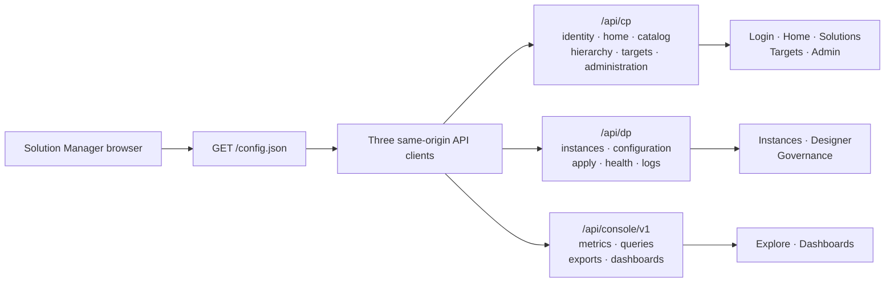

# Solution Manager API reference — screen-by-screen request and response guide

> **Audience:** frontend developers, backend implementers, QA engineers, architects, and anyone trying to understand
> what a Solution Manager screen sends or receives.
>
> **Coverage:** `/config.json` plus **66 HTTP operations** used by the current console.
>
> **Contract status:** **AS-BUILT, NOT RATIFIED.** This is the most complete human-readable reference for the current
> frontend, but it is not a substitute for the OpenAPI contract that still needs to be written and reviewed.

**What this is.** The complete HTTP surface the Solution Manager console already calls, derived **from the frontend's
own call sites** on branch `dev/frontend` — not proposed, not designed forward. Each operation below exists today as a
`PlaneClient` call in a repository module, except the streaming export, which is deliberately a same-origin browser
navigation. The MSW layer answers 65 of the 66 API operations; streaming export is the sole operation that requires a
real HTTP response even in development. This document is the blueprint for replacing those in-browser handlers with a
real HTTP server backed by predefined JSON, so the console runs end-to-end over the network instead of over a service
worker.

**Implementation guarantee and limit.** A server that uses the exact prefixes, methods, query strings, JSON keys,
closed values, success statuses and empty-body behavior recorded here can be connected to the current frontend without
changing a repository method. That statement is mechanically scoped to what the frontend sends and reads. Wherever
the frontend has not defined behavior, this document says **UNSPECIFIED** or **CONTRACT: TBD**; it does not fill the gap
with a guessed field, endpoint, pagination scheme, status, upload format or authentication mechanism.

**Status: AS-BUILT, NOT RATIFIED.** This describes what the client sends and expects, faithfully. It does **not**
ratify anything. Per `I4`, `SM-D*` decisions remain `PROPOSED`; per the [contracts README](README.md), the
machine-readable OpenAPI document is still not written and remains the deliverable that closes this contract gap.
Where the frontend's own module headers say `CONTRACT: TBD`, this document repeats that verdict rather than resolving
it — the shapes here are what the client is coded against, which is a different and weaker claim than "this is the
ratified product contract".

**Derived from** (read these when a detail here is ambiguous — they are the source, this is the digest):

| Source | Role |
|---|---|
| [`frontend/src/features/*/\*Repository.ts`](../../../../frontend/src/features) | Eleven feature repository seams. Every feature request/response type below is one of theirs. |
| [`frontend/src/shared/hierarchy/hierarchyRepository.ts`](../../../../frontend/src/shared/hierarchy/hierarchyRepository.ts) | The twelfth repository seam and the exact three-call declaration cascade. |
| [`frontend/src/shared/auth/localSessionAdapter.ts`](../../../../frontend/src/shared/auth/localSessionAdapter.ts) | The auth seam — the thirteenth caller, outside `features/`. |
| [`frontend/src/shared/api/`](../../../../frontend/src/shared/api) | The one request path: `http.ts`, `planeClientFactory.ts`, `types.ts`, `errorCodes.ts`, `retry.ts`, `queryKeys.ts`. |
| [`frontend/src/shared/testdoubles/`](../../../../frontend/src/shared/testdoubles) | The MSW handlers and the fixture JSON that seed this backend. |
| [`frontend/contracts/`](../../../../frontend/contracts) | `view-model/types.ts` (the Solution Package), `metrics/types.ts` (the query response), `packages/*/package.json` (real package files). |
| [`../../frontend/design.md`](../../frontend/design.md) §13, §14, §16 | The binding *rules* (shape, routing, error classes) this surface obeys. |

---

## Start here

This document is deliberately organised around **what a person does on screen**, not around internal decision IDs.
Use this short map first; the numbered sections then define every parameter, request field, response field, status,
error and consuming component in detail.

### API in one picture



The diagram shows URL ownership only. The `console` prefix is an as-built frontend boundary, **not** a ratified third
architectural plane; §3.1 explains that distinction.

### Find the answer you need

| If you want to… | Start at |
|---|---|
| See every method and URL in one place | [§4 Endpoint index](#4-endpoint-index) |
| Implement authentication, cookies, correlation IDs or errors | [§3 Cross-cutting rules](#3-cross-cutting-rules) |
| Implement one screen | The screen map below, then that screen's numbered section |
| Understand every request/response field | The endpoint's **Request**, **Success**, and field-purpose tables |
| Know which values are closed enums | The field table directly below the payload example |
| Build a dummy or test backend | [§18 State model](#18-state-model--what-the-dummy-backend-must-actually-hold) |
| Keep related endpoints consistent | [§19 Cross-endpoint consistency](#19-cross-endpoint-consistency) |
| Check whether an apparently missing API is intentional | [§22 Deliberate absences](#22-deliberate-absences--what-has-no-endpoint-and-why) |
| Confirm that all screens and API calls are covered | [§23 Coverage cross-check](#23-coverage-cross-check) |

### Screen-to-API map

| Screen or UI area | What the operator does | Reads | Writes | Detailed section |
|---|---|---|---|---|
| App boot | Load deployment-specific browser settings | `/config.json` | — | §4.1 |
| Login and session | Sign in, restore identity, sign out | `/cp/auth/identity` | `/cp/auth/login`, `/cp/auth/logout` | §5 |
| Home | See counts and work needing attention | `/cp/home/summary`, `/cp/home/attention` | — | §6 |
| Solutions | Browse or load solution packages | `/cp/solutions` | `/cp/solutions/load` | §7 |
| Instance inventory | Filter, inspect, declare or undeclare instances | hierarchy cascade, solution instances, instance detail | declare and undeclare | §8 |
| Application shell | Render identity, permissions and solution navigation | identity and solutions | logout | §9–§10 |
| Targets | Inspect where solutions can run or be observed | `/cp/targets` | — | §12 |
| Admin — Roles | View permissions and manage roles | permission catalog and roles | save role | §13.1–§13.3 |
| Admin — Assignments and Access | Grant/revoke roles and explain effective access | principals, scope tree, assignments, effective permissions | create/revoke assignment | §13.4–§13.8 |
| Admin — Users and Groups | Manage local identities and memberships | users, groups, members, group assignments | user/group/member mutations | §13.9–§13.20 |
| Designer | Load, edit, save, reconcile, apply and roll back configuration | instance Designer document and optional history/observations | config, secrets, actions, apply and rollback | §14 |
| Governance | Inspect health/config state and work with logs | health, config ladder, log level and log lines | set log level | §15 |
| Monitoring — Explore | Select metrics and instances, query, export and save a widget | capabilities, entity types, instances, metrics and labels | queries, metric typing, save widget | §16 |
| Monitoring — Dashboard | Render widgets and manage dashboard layout/defaults | dashboard document and metric queries | widgets, layout, visibility and reset | §17 |

### How each endpoint is documented

Every endpoint entry uses the same reading order:

1. **Purpose** — the functional reason the endpoint exists.
2. **Screen and component** — where the response is consumed or the request is triggered.
3. **Path/query parameters** — exact name, type, source and encoding rule.
4. **Request example and field table** — what each field means, when it is sent and why it exists.
5. **Success example and field table** — what each returned field drives on screen.
6. **Errors and statuses** — how the current frontend reacts.
7. **Dependencies and consistency rules** — which other endpoint supplies or consumes the same identifiers.

Payload examples are valid JSON unless explicitly labelled **abbreviated**. A field marked optional may be omitted;
`null` is a value only where the type explicitly permits it. Closed values are written as code, for example
`active | deactivated`. The document never treats an obvious-looking field name as self-explanatory when it changes
screen behaviour.

---

## 1. Scope

**In scope.** Thirteen routed screen groups, **66 API operations** across three same-origin prefixes, plus the static
boot document. A method/path pair counts as one operation, so `GET` and `POST` on the same path count separately. Every
operation any screen or repository reaches is included: loading, creating, updating, deleting, validation, actions,
state changes, filtering, and configuration.

**Out of scope, deliberately.**

- **Endpoints outside the current repository surface.** No search endpoint is specified for a filter the client applies
  in memory; no list route is invented for a resource the client addresses by a deterministic id. A few repository
  methods marked **NO CALLER** are included because their HTTP calls already exist, even though no screen invokes them.
  Where the UI does something without a server, §22 says so by name.
- **A ratified wire encoding of the Solution Package.** `design.md` §13 assigns that to the backend sub-spec. This
  document records the complete TypeScript/JSON shape the frontend currently consumes at
  `GET /dp/instances/{id}/designer`; it does not convert that as-built shape into the missing normative backend schema.
- **Real behaviour.** A dummy backend serves JSON. It reaches no MI host, opens no SSH session, and polls no actuator.

---

## 2. How to read an endpoint entry

Each entry gives: **Purpose · Path/query parameters · Request · Success · Errors · Frontend usage · Depends on.**
"Frontend usage" names the repository method, the React Query key from
[`queryKeys.ts`](../../../../frontend/src/shared/api/queryKeys.ts), and what the screen does with the answer — because
the cache key is what makes two screens share one request, and a backend that changes an id shape changes what the
cache collapses.

Three markers appear throughout:

| Marker | Meaning |
|---|---|
| **SPECIFIED** | A design document defines this to endpoint level. Only the Dynamic Metrics query surface (§16) is. |
| **CONTRACT: TBD** | The client invented the route and/or shape, confined to one repository file, and says so in its own header. Everything outside §16 is this. |
| **NO CALLER** | Declared in a repository interface, implemented in MSW, but no screen calls it today. Implement when a screen wires it; a backend without it is not broken *yet*. |

### Repeated path-parameter dictionary

All dynamic path values are passed through `encodeURIComponent`. Endpoint entries call out special rules; otherwise
these names have the same meaning everywhere:

| Parameter | Source and meaning |
|---|---|
| `organization` | Exact Organization name returned by the hierarchy root call. |
| `subOrganization` | Exact Sub-organization name returned for the selected Organization. |
| `solutionId` | Solution-card `id` from §7.1, not the `solution` family value. |
| `instanceId` | Instance `id` from §8.1/§8.2. It keys inventory detail, Designer, Governance and monitoring context. |
| `assignmentId` | Assignment `id` from §13.6 or §13.19. |
| `id` on an admin route | User or group id appropriate to that route, returned by its list/create operation. |
| `userId` | Local-user `id` from §13.9. |
| `fieldKey` | Fully qualified or package-declared configuration field key; dots remain data inside one encoded segment. |
| `actionKey` | Package-declared action `key` from the Designer response. |
| `component` | Package component name/type used by the Governance log viewer. |
| `entityType` | Entity-type `id` from §16.2. |
| `labelKey` | Label key advertised by the selected §16.4 metric. |
| `name` on a metric route | Metric catalog `name`; dots remain data inside one encoded segment. |
| `dashboardId` | Deterministic `db_{instanceId}` value described in §11. |
| `widgetId` | Widget `id` from the dashboard document. |

---

## 3. Cross-cutting rules

These hold for every operation. They are stated once here rather than repeated 66 times.

### 3.1 Transport and origin

- **One origin, three prefixes.** The SPA never holds a plane hostname (`FE-D19`). `assertRelativePath()` in
  [`planeClientFactory.ts`](../../../../frontend/src/shared/api/planeClientFactory.ts) throws on any absolute or
  protocol-relative URL, so a backend that hands back an absolute URL for the client to call will crash it.
- The prefix is `${apiBasePath}` from the boot document, then one of:

| Client | Prefix | Owns |
|---|---|---|
| `cpClient` | `${apiBasePath}/cp` | catalog, packages, identity, RBAC, targets, home |
| `dpClient` | `${apiBasePath}/dp` | configuration-of-record, apply, actions, health, logs, instance inventory |
| `consoleClient` | `${apiBasePath}/console/v1` | metrics catalog and query, dashboards |

  With the shipped `config.json` (`apiBasePath: "/api"`) those resolve to `/api/cp/*`, `/api/dp/*`, `/api/console/v1/*`.

- **`console` is not a ratified third plane.** [`consoleClient.ts`](../../../../frontend/src/shared/api/consoleClient.ts)
  says so on its face: whether it is genuinely a plane, a DP sub-route, or folds back into CP/DP is an open question
  upstream. A dummy backend may serve all three prefixes from one process; that is not an answer to the question.

### 3.2 Session and authentication

- Every request is issued with `credentials: 'same-origin'`. The session is an **httpOnly `SameSite=strict` cookie the
  server sets** — the SPA never reads, writes or stores it (`FE-D8`, `FE-D14`).
- A **401 on any request** fires `notifyUnauthorized()`, which `localSessionAdapter` translates into
  `AuthAdapter.onSessionExpired` → the app routes to `/login` with an "expired" arrival reason. A dummy backend that
  answers 401 anywhere will bounce the operator to login, correctly.
- **CSRF is a seam, not a mechanism** (`§16 Q3`). `configureCsrf({ headerName, getToken })` exists in `http.ts` and is
  wired to nothing. If the dummy backend requires a CSRF header, that hook is where it gets supplied; until then,
  **do not require one** or every mutation fails.
- **Organization authority is never taken from the client** (`I5`, `D20` 🔒). There is no client-supplied
  `organizationId` field. `Identity.organization` is a display string returned for the app-bar chip, and the backend
  derives the authenticated actor's authority from the session. Some create requests do carry a desired ownership
  name (`organization` for a user/group; `org` for an instance); those are resource data the server must authorize and
  validate against the session, never proof that the caller may act there.

### 3.3 Correlation ids

- The client sends `X-Correlation-Id` on every request (a UUID).
- **The response's id is authoritative** (`FE-D13`). `readCorrelationId()` prefers the response header and falls back
  to the sent id only when the server echoed none.
- **Every mutation whose UI shows a success toast should use the server's id** (`FE-D13`). The following 14 HTTP
  operations go through `postWithCorrelation`, `patchWithCorrelation` or `deleteWithCorrelation`:

  > declare instance · undeclare instance · load package · save config · save role · create assignment · create user ·
  > create group · update group · deactivate group · reactivate group · add group members · set log level · save widget

  The HTTP helper falls back to the id sent on the request if the response header is absent, so omitting the response
  header does not crash the frontend. A conforming server nevertheless returns `X-Correlation-Id` on all 14 responses
  because the response id is the authoritative server/audit id.
- **Two as-built exceptions are explicit:** removing a group member and revoking a group assignment use plain
  `delete()` and the current `GroupDetails` screen fabricates a display-only toast id. A server response header is
  ignored on those two calls. This is existing frontend behavior, not a backend requirement and not something this
  document silently repairs.

### 3.4 Error body

One shape, for every non-2xx, from [`http.ts`](../../../../frontend/src/shared/api/http.ts)'s `parseErrorBody`:

```json
{
  "code": "GENERATION_CONFLICT",
  "message": "Someone else saved a newer configuration.",
  "…": "any further fields are carried through as `details`"
}
```

- `code` and `message` are read only when they are **strings** at the top level. The whole parsed object also becomes
  `ApiError.details`, so extra fields (e.g. the `409`'s `current` generation) survive.
- **A non-JSON or empty error body must not break the client** — `parseErrorBody` swallows the parse failure and the
  UI falls back to a generic message. Returning an empty 500 is safe, just uninformative.
- **The UI switches on `code`, never on `message`** ([`errorCodes.ts`](../../../../frontend/src/shared/api/errorCodes.ts)).
  For a code in the registry the operator sees the console's own copy; for an **unknown** code the server's `message`
  is shown verbatim. So: an unrecognised `code` with no `message` renders "An unexpected error occurred."

**The registry.** Five codes are SPECIFIED (`dynamic-metrics` §5.8) and five are named-but-shapeless (`§16 Q9`):

| Code | Status | HTTP | Where |
|---|---|---|---|
| `SERIES_CAP_EXCEEDED` | SPECIFIED | 422 | metrics query — prevented client-side today |
| `AGGREGATION_NOT_APPLICABLE` | SPECIFIED | 422 | metrics query — **the one 422 reachable through the live UI** |
| `GROUP_BY_REQUIRES_AGGREGATION` | SPECIFIED | 422 | metrics query — prevented client-side today |
| `STAT_REQUIRES_AGGREGATION` | SPECIFIED | 422 | metrics query — prevented client-side today |
| `METRIC_UNTYPED` | SPECIFIED | 422 | metrics query — prevented client-side today |
| `CONFIG_DIVERGED` | TBD | — | no body shape exists |
| `APPLY_INDETERMINATE` | TBD | — | expressed as an outcome `kind`, not an HTTP error |
| `VERSION_DRIFT` | TBD | — | expressed as `ObservedState.versionState`, not an HTTP error |
| `VERSION_UNKNOWN` | TBD | — | expressed as `ObservedState.versionState`, not an HTTP error |
| `CONFIG_CONFLICT` | TBD | — | the save `409`; the fixture sends `generation_conflict`, see §14.3 |

### 3.5 Status codes

| Status | Client behaviour |
|---|---|
| `200` | Body parsed as JSON and cast to the caller's type. **Unknown fields are ignored, never stripped** — no schema validator runs. |
| `201` | Same parsing behaviour as 200. Used by declare-instance and by the current fixture's save-widget response. |
| `204` | `data` resolves as `undefined` with **no JSON parse attempted**. An empty body on any status is also tolerated. |
| `400` | Inline validation failure. Not retried. Dialog stays open. |
| `401` | Fires the session-expired listener → `/login`. Not retried. |
| `403` | Not-authorized surface. Not retried. |
| `404` | Route-level not-found: `InstancesRepository.get` and the Designer load both render an error surface. |
| `409` | Conflict. Declare → duplicate-name inline error. Save config → the conflict dialog (§14.3). Not retried. |
| `422` | Business refusal, rendered inline from the typed `code`. **Never retried.** |
| `5xx` | Retried by `shouldRetry`: **queries only**, up to 3 attempts, backoff 500 ms → 1 s → 2 s → 4 s (cap 5 s). |
| `501` | Explicitly excluded from retry — a "not implemented" is not a transient fault. |

**Mutations are never retried automatically and never optimistic** (`FE-D20`). The `QueryClient` sets
`mutations.retry: false`. A dummy backend does not need idempotency keys for the client's sake — but see §22 on why
apply still cannot claim success.

### 3.6 Caching and request behaviour

- `refetchOnWindowFocus: false` — re-focusing the tab issues no request.
- `placeholderData: keepPreviousData` — a range/filter change dims stale data rather than blanking it. A slow endpoint
  degrades gracefully.
- Every `useQuery` passes an `AbortSignal`. **A superseded request is aborted client-side**; the server may see a
  dropped connection mid-response, which is normal, not an error.
- Two screens asking the same question share one cache entry and one in-flight request — e.g. `AppShell`'s drawer and
  `SolutionsPage` both read `queryKeys.solutions.list()`, so `GET /cp/solutions` is issued once.

### 3.7 Secrets

`I6` and `G7` are binding on this surface:

- A **secret value never appears in a response.** Diff rows carry the literal mask token `"•••••••• (secret)"` on both
  sides. Config history, exports and archives carry references, never values.
- A secret value crosses the wire **exactly once**, client → server, on `POST …/config/secrets/{fieldKey}` (§14.5),
  which answers with an opaque `ref`.
- **Package actions send no values at all** — only `instanceId` and the action `key` (§14.9). A `test-connection`
  action must not resend a secret through the browser; the compile-time proof is
  `actionsRepository.typecheck.test.ts`.

### 3.8 Organization field names — exact as built

The frontend does not currently use one spelling everywhere. This table records the wire keys literally; a backend
must not normalize them unless the frontend changes in the same release.

| Payload | Exact key(s) | Meaning |
|---|---|---|
| Auth identity, local user, group, group principal | `organization` | Organization display/name string. |
| Hierarchy cascade paths | `{organization}`, `{subOrganization}` | URL-encoded names returned by the parent cascade call. |
| Instance declaration and instance rows | `org`, `subOrg`, `env` | Organization, Sub-organization and Environment names. |
| RBAC assignment | `scope: string[]` | `[]` is synthetic All organizations; otherwise `[Organization, Sub-organization?, Environment?, Instance?]`. |

There is no `tenant`, `tenantId` or `tenant_id` field in this REST surface. There is also no client-supplied
`organizationId`: authorization scope is derived from the authenticated session. The `org`/`subOrg` abbreviations are
an existing instance-wire seam, explicitly documented rather than silently renamed here.

---

## 4. Endpoint index

66 API operations. `✱` marks the ones a dummy backend must hold mutable state for (§18).

### Control plane — `${apiBasePath}/cp` (33)

| # | Method | Path | Screen | § |
|---|---|---|---|---|
| 1 | `GET` | `/auth/identity` | app boot / shell | 5.1 |
| 2 | `POST` | `/auth/login` | `/login` | 5.2 |
| 3 | `POST` | `/auth/logout` | account menu, idle lock | 5.3 |
| 4 | `GET` | `/home/summary` | `/` | 6.1 |
| 5 | `GET` | `/home/attention` | `/` | 6.2 |
| 6 | `GET` | `/solutions` | `/solutions`, shell drawer, instances page | 7.1 |
| 7 | `POST` | `/solutions/load` ✱ | load-package dialog | 7.2 |
| 8 | `GET` | `/hierarchy/organizations` | declare-instance cascade | 8.0.1 |
| 9 | `GET` | `/hierarchy/organizations/{organization}/sub-orgs` | declare-instance cascade | 8.0.2 |
| 10 | `GET` | `/hierarchy/organizations/{organization}/sub-orgs/{subOrganization}/environments` | declare-instance cascade | 8.0.3 |
| 11 | `GET` | `/targets` | `/targets` | 12.1 |
| 12 | `GET` | `/admin/permission-catalog` | `/admin/roles`, `/admin/access` | 13.1 |
| 13 | `GET` | `/admin/roles` | `/admin/roles` | 13.2 |
| 14 | `POST` | `/admin/roles` ✱ | role editor | 13.3 |
| 15 | `GET` | `/admin/principals` | `/admin/assignments`, `/admin/access` | 13.4 |
| 16 | `GET` | `/admin/scope-tree` | `/admin/assignments`, `/admin/access` | 13.5 |
| 17 | `GET` | `/admin/assignments` | `/admin/assignments` | 13.6 |
| 18 | `POST` | `/admin/assignments` ✱ | new-assignment dialog | 13.7 |
| 19 | `DELETE` | `/admin/assignments/{assignmentId}` ✱ | group role-assignments panel | 13.7a |
| 20 | `GET` | `/admin/effective-permissions` | `/admin/access` | 13.8 |
| 21 | `GET` | `/admin/users` | `/admin/users` | 13.9 |
| 22 | `POST` | `/admin/users` ✱ | add-user dialog | 13.10 |
| 23 | `PATCH` | `/admin/users/{id}` ✱ | users table | 13.11 |
| 24 | `GET` | `/admin/groups` | `/admin/groups` | 13.12 |
| 25 | `GET` | `/admin/groups/{id}` | group detail panel | 13.13 |
| 26 | `POST` | `/admin/groups` ✱ | add-group dialog | 13.14 |
| 27 | `PATCH` | `/admin/groups/{id}` ✱ | edit-group dialog | 13.15 |
| 28 | `POST` | `/admin/groups/{id}/deactivate` ✱ | groups table | 13.16 |
| 29 | `POST` | `/admin/groups/{id}/reactivate` ✱ | groups table | 13.16 |
| 30 | `GET` | `/admin/groups/{id}/members` | members panel | 13.17 |
| 31 | `POST` | `/admin/groups/{id}/members` ✱ | add-members dialog | 13.17 |
| 32 | `DELETE` | `/admin/groups/{id}/members/{userId}` ✱ | members panel | 13.18 |
| 33 | `GET` | `/admin/groups/{id}/assignments` | group role-assignments panel | 13.19 |

### Data plane — `${apiBasePath}/dp` (19)

| # | Method | Path | Screen | § |
|---|---|---|---|---|
| 34 | `GET` | `/solutions/{solutionId}/instances` | instances grid | 8.1 |
| 35 | `POST` | `/solutions/{solutionId}/instances` ✱ | declare dialog | 8.2 |
| 36 | `GET` | `/instances/{instanceId}` | instance header | 8.3 |
| 37 | `DELETE` | `/instances/{instanceId}` ✱ | undeclare dialog | 8.4 |
| 38 | `GET` | `/instances/{instanceId}/designer` | Designer | 14.1 |
| 39 | `POST` | `/instances/{instanceId}/config` ✱ | save bar | 14.2 |
| 40 | `GET` | `/instances/{instanceId}/config/history` | **NO CALLER** | 14.4 |
| 41 | `POST` | `/instances/{instanceId}/config/secrets/{fieldKey}` | **NO CALLER** | 14.5 |
| 42 | `POST` | `/instances/{instanceId}/config/accept-runtime` | accept-runtime dialog | 14.6 |
| 43 | `POST` | `/instances/{instanceId}/config/restore-runtime` | restore-runtime dialog | 14.7 |
| 44 | `POST` | `/instances/{instanceId}/apply` | strategy picker → restart confirm | 14.8 |
| 45 | `GET` | `/instances/{instanceId}/apply/observe` | **NO CALLER** | 14.10 |
| 46 | `POST` | `/instances/{instanceId}/apply/rollback` | rollback dialog | 14.11 |
| 47 | `POST` | `/instances/{instanceId}/actions/{actionKey}` | package actions card | 14.9 |
| 48 | `GET` | `/instances/{instanceId}/health` | Governance | 15.1 |
| 49 | `GET` | `/instances/{instanceId}/config-ladder` | Governance | 15.2 |
| 50 | `GET` | `/instances/{instanceId}/log-levels/{component}` | log viewer | 15.3 |
| 51 | `POST` | `/instances/{instanceId}/log-levels/{component}` ✱ | log viewer | 15.4 |
| 52 | `GET` | `/instances/{instanceId}/logs/{component}` | log viewer | 15.5 |

### Console — `${apiBasePath}/console/v1` (14)

| # | Method | Path | Screen | § |
|---|---|---|---|---|
| 53 | `GET` | `/capabilities` | every monitoring screen | 16.1 |
| 54 | `GET` | `/entity-types` | Explore | 16.2 |
| 55 | `GET` | `/entity-types/{entityType}/instances` | instance selector | 16.3 |
| 56 | `GET` | `/metrics/catalog` | metric selector | 16.4 |
| 57 | `GET` | `/labels/{labelKey}/values` | group-by control | 16.5 |
| 58 | `POST` | `/query/range` | Explore result, every widget | 16.6 |
| 59 | `POST` | `/query/instant` | single-stat / gauge | 16.7 |
| 60 | `GET` | `/export/range` | widget CSV export | 16.8 |
| 61 | `POST` | `/metrics/catalog/{name}/type` ✱ | type-metric dialog | 16.9 |
| 62 | `GET` | `/dashboards/{dashboardId}` | dashboard | 17.1 |
| 63 | `POST` | `/dashboards/{dashboardId}/widgets` ✱ | save-widget dialog | 17.2 |
| 64 | `PUT` | `/dashboards/{dashboardId}/layout` ✱ | dashboard grid | 17.3 |
| 65 | `PATCH` | `/dashboards/{dashboardId}/widgets/{widgetId}` ✱ | hide / restore default | 17.4 |
| 66 | `POST` | `/dashboards/{dashboardId}/reset` ✱ | reset defaults | 17.5 |

### Boot — static (1)

| # | Method | Path | Screen | § |
|---|---|---|---|---|
| 0 | `GET` | `/config.json` | app boot, before everything | 4.1 |

#### 4.1 `GET /config.json` — the boot document

**Purpose.** Deploy-time configuration, fetched once before the app renders. Not under `apiBasePath` — it is what
*supplies* `apiBasePath`, so its own path is fixed.

**Success** `200 OK`

```json
{ "apiBasePath": "/api", "idleTimeoutMinutes": 30, "channel": "stable" }
```

| Field | Type / required | What it is used for |
|---|---|---|
| `apiBasePath` | non-empty string, required | Public same-origin prefix used to build the CP, DP and console clients (`/api/cp`, `/api/dp`, `/api/console/v1` in this example). It is a path, never a plane hostname and never a secret. |
| `idleTimeoutMinutes` | number, optional | Minutes of inactivity before `RequireAuth` locks the session. Omission defaults to `30`; a non-number makes boot fail visibly. |
| `channel` | non-empty string, required | Public release-channel label such as `stable` or `test`. It is validated and made available through runtime config, but no current screen renders it. It does not choose an API host or grant access. |

**Errors.** A fetch or parse failure renders a **visible boot error page in place of the app** — never a silent
default ([`RuntimeConfig.tsx`](../../../../frontend/src/app/boot/RuntimeConfig.tsx)). A dummy backend that fails to
serve this produces a blank-but-explained console, not a broken one.

**Frontend usage.** `RuntimeConfigBoot` → `useRuntimeConfig()`. `apiBasePath` is passed to all three plane-client
factories; `idleTimeoutMinutes` drives `RequireAuth`'s idle lock. Served today as a static asset from
`frontend/public/config.json`; a real deployment may serve it dynamically, but the shape is fixed.

---

## 5. Screen — `/login` and the session

**Components.** `LoginPage` → `LoginForm` + `LoginArrivalAlert`. `RequireAuth` guards every other route;
`AccountMenu` signs out.

**Flow.** On boot `AuthProvider` calls `getIdentity()`. A 401 leaves the app unauthenticated and `RequireAuth`
redirects to `/login`. `LoginArrivalAlert` distinguishes two arrivals — a deliberate sign-out and an **idle lock**
(`FE-D24`, `idleTimeoutMinutes` from the boot document) — from the reason `AuthProvider` recorded, not from anything
the server sends.

### 5.1 `GET /cp/auth/identity`

**Purpose.** Who is signed in, and what the console may render for them. **CONTRACT: TBD** (`§16 Q3`).

**Request.** None. The session cookie is the whole credential.

**Success** `200 OK`

```json
{
  "name": "Devon Ramirez",
  "email": "devon.ramirez@acme.example",
  "role": "Operator",
  "organization": "Acme Financial · self-hosted",
  "superAdmin": true,
  "permissions": [
    "solution.view", "package.load",
    "instance.view", "instance.create", "instance.bindTarget",
    "config.view", "config.edit", "config.apply",
    "instance.restart", "config.rollback", "config.overrideWarning",
    "health.view", "logs.read", "logs.setLevel",
    "metrics.query", "metrics.export", "metrics.forceRaw", "metric.declare",
    "dashboard.view", "dashboard.edit", "dashboard.reset",
    "target.view", "target.create", "target.use",
    "role.view", "role.edit", "role.assign",
    "user.view", "user.create", "user.deactivate",
    "group.view", "group.create", "group.edit", "group.deactivate", "group.member.manage"
  ]
}
```

| Field | Notes |
|---|---|
| `name` | Human-readable account name. Rendered in the account menu and used for the avatar label. |
| `email` | Account sign-in/contact identifier shown in the account menu. Display data in this response, not a credential. |
| `role` | Human-readable role summary shown in the account menu. **Not used for authorization**; `permissions` is the rendering overlay and the server authorizes every request. |
| `organization` | **Display only** (`I5`, `D20` 🔒, `FE-D53`). There is deliberately no client-supplied organization id — the type omits one so "send it back as authority" is impossible by accident. |
| `permissions` | Server-derived permission ids granted to this identity. Feeds `createPermissionApi(granted, catalog)` and must contain only ids from §13.1's locked 35-operation catalog. The array is a rendering overlay; every API call remains server-authorized. |
| `superAdmin` | Rendered as a badge. Not a bypass — the frontend overlay is cosmetic, never a security boundary. |

**Errors**

| Status | Meaning | Client behaviour |
|---|---|---|
| `401` | No/expired session | Unauthenticated; `RequireAuth` → `/login`. **This is a normal answer, not a failure.** |
| `5xx` | — | Retried up to 3×, then the boot surfaces unauthenticated. |

**Frontend usage.** `AuthAdapter.getIdentity()` via `localSessionAdapter`. Cached under `queryKeys.auth.identity()`.
`AppBar` reads `identity.organization`; `AccountMenu` reads `name`/`email`/`role`; the authz overlay reads `permissions`.

**Depends on.** Nothing. This is the first authenticated call.

### 5.2 `POST /cp/auth/login`

**Purpose.** Exchange local credentials for a session cookie. **CONTRACT: TBD** (`§16 Q3` — the endpoint, its shapes
and the CSRF mechanism are all unspecified; the route is the adapter's own naming).

**Request**

```json
{ "username": "devon.ramirez@acme.example", "password": "…" }
```

| Field | Type / required | What it is used for |
|---|---|---|
| `username` | non-empty string, required | Credential identifier typed into `LoginForm`. The sample uses an email address, but the frontend does not validate it as an email. |
| `password` | string, required | Write-only secret exchanged for the session. It must never be logged, echoed in the response, or persisted in browser storage. |

**Success** `200 OK` — the same `Identity` body as §5.1, and the server **must set the session cookie** on this
response (httpOnly, `SameSite=strict`).

**Optional `accessToken`.** `LoginResponse` extends `Identity` with an optional `accessToken`, used **only** when the
API cannot set cookies (design §15). It is held in a closure — never `localStorage`, never surviving a reload
(`FE-D14`). **A dummy backend should omit it** and set the cookie; sending it exercises a fallback path nothing else
uses.

**Errors**

| Status | Body | Client behaviour |
|---|---|---|
| `401` | `{ "code": "…", "message": "Invalid credentials." }` | Form shows the failure in place, stays open. |
| `400` | `{ "code": "…", "message": "…" }` | Same. |
| `429` | `{ "message": "Too many attempts." }` | Rendered from `message` — no typed code exists. |

**Frontend usage.** `AuthProvider.login()` → sets `identity`, clears the arrival reason, navigates to the intended
route.

**Depends on.** Nothing. Feeds every other endpoint (they all need the cookie).

### 5.3 `POST /cp/auth/logout`

**Purpose.** End the session. Called on deliberate sign-out **and** on idle lock.

**Request.** No body.

**Success** `204 No Content`. The server should clear the session cookie.

**Errors.** The client clears local state regardless; a failure here still signs the operator out of the UI.

**Frontend usage.** `AccountMenu` "Sign out" → `logout()`; `RequireAuth`'s idle timer → `logout('idle')`, which sets
the arrival reason `LoginArrivalAlert` renders.

---

## 6. Screen — `/` Home

**Components.** `HomePage` → `FirstRun` (when nothing is managed yet) · `StatStrip` (four counts) · `AttentionFeed`.

### 6.1 `GET /cp/home/summary`

**Purpose.** The four headline counts. **CONTRACT: TBD** (`§16 Q10` — the whole endpoint is unspecified; the route is
`homeRepository.ts`'s own naming).

**Success** `200 OK`

```json
{
  "solutionsManaged": 2,
  "instancesDeclared": 12,
  "needAttentionNow": 3,
  "configStagedNotApplied": 1,
  "partial": null
}
```

| Field | Type | Notes |
|---|---|---|
| `solutionsManaged` | `number \| null` | Number of cards returned by §7.1. Drives the Solutions headline and contributes to the first-run decision. **`null` means unknown** and renders `—`, never `0`. |
| `instancesDeclared` | `number \| null` | Total number of declared instances across solutions. Drives the Instances headline; when `partial` is present it renders with a `+1?` qualification. |
| `needAttentionNow` | `number \| null` | Number of §6.2 feed rows whose severity is `err`. Drives the urgent-attention headline. |
| `configStagedNotApplied` | `number \| null` | Number of instances whose `configState` is `staged`. Explains saved configuration still waiting to be applied. |
| `partial` | `{ "unreportingHost": string } \| null` (optional) | Present only when part of the fleet has not reported, so a count may be an undercount. `instancesDeclared` then renders with a `+1?` suffix and the page shows a banner naming the host. **INVENTED** — no schema field carries this. |

**How the fixture derives them** (a dummy backend should do the same so the numbers agree with the other screens):

```
solutionsManaged        = number of solution-package cards returned by `GET /cp/solutions`
instancesDeclared       = count of all instances
needAttentionNow        = attention items with severity "err"
configStagedNotApplied  = instances whose configState === "staged"
```

**Frontend usage.** `queryKeys.home.summary()`. Renders `StatStrip`. **`FirstRun` shows when the counts are all zero**
— so a backend seeding an empty fleet gets the first-run screen, which is correct.

**Depends on.** Consistency with §7.1 and §8.1 — see §19. A count here that disagrees with the grid it links to is the
exact bug `withInstanceCounts` was written to prevent.

### 6.2 `GET /cp/home/attention`

**Purpose.** The prioritised feed of things needing an operator. **CONTRACT: TBD** (`§16 Q10` — severity vocabulary,
ordering and dedupe rules have nothing behind them).

**Success** `200 OK` — a **bare array**, not a paged envelope.

```json
[
  {
    "id": "att-1",
    "severity": "err",
    "title": "cache-stage-01 · replica not responding",
    "detail": "1 of 2 replicas stopped answering health checks — TEST · Acme Financial / Trading.",
    "instanceId": "cache-stage-01",
    "href": "/solutions/cache/instances?focus=cache-stage-01"
  }
]
```

| Field | Notes |
|---|---|
| `id` | Stable feed-row identity used when rendering and updating the list. It is not an instance id. |
| `severity` | `"err" \| "warn" \| "info"`. Drives the row's tone **and** `needAttentionNow` in §6.1. |
| `title` | Short operator-facing summary used as the row heading. Server-composed and rendered verbatim. |
| `detail` | Longer explanation shown below the title. Server-composed and rendered verbatim. It must not contain secrets. |
| `href` | An **in-app route**, produced by the server. The `?focus=` query is what makes the instances grid scroll to and highlight the row (§8.1). A server that emits a href the router does not match yields a 404 screen. |
| `instanceId` | The subject. Not used for navigation today — `href` is — but carried so a future screen can group by instance. |

**Ordering.** The array order is rendered as-is; the client does not re-sort. Send `err` before `warn` before `info`.

**Frontend usage.** `queryKeys.home.attention()`. Renders `AttentionFeed`. An empty array renders an empty state, not
an error.

---

## 7. Screen — `/solutions` Catalog

**Components.** `SolutionsPage` → `SolutionCard` (one per package, with `ReviewMeter`) + `LoadPackageDialog`.

### 7.1 `GET /cp/solutions`

**Purpose.** Every solution package the console knows. **CONTRACT: TBD** (`§16 Q10`).

**Success** `200 OK` — a **bare array**.

```json
[
  {
    "id": "cache",
    "solution": "cache",
    "name": "Cache Engine",
    "color": "#015B82",
    "icon": "bolt",
    "kind": "Distributed cache · Spring Boot",
    "packageVersion": [6, 7],
    "appliesTo": ">=2.2 <2.5",
    "provenance": { "author": "solace", "signature": "3af9…c210" },
    "authoring": { "reviewedRows": 1494, "totalRows": 1494, "source": "curated + contract-tested" },
    "components": ["cache-engine", "management", "telemetry-http"],
    "instanceCount": 12,
    "entitled": true,
    "telemetryMode": "HTTP poll · actuator",
    "published": "2026-08-04",
    "devMode": false
  }
]
```

| Field | Notes |
|---|---|
| `id` | **The card id, and the id every route keys on.** `/solutions/{id}/instances` filters instances by `solutionId === id`. |
| `solution` | The solution *family*. Two cards may share one (`cache` and `cache-nightly` do). Never use this for counting — see below. |
| `name` | Operator-facing package name used as the card heading and instance-page title. |
| `color` | CSS colour used for the package's visual accent. Presentation only; never use it as identity. |
| `icon` | Icon token resolved by `SolutionCard`. Presentation only; an unknown token needs a safe fallback. |
| `kind` | Short, display-only description of the workload/runtime family. |
| `packageVersion` | **Array**, ascending, non-empty. Every version this one package file serves. The declare dialog's version select is populated from exactly this. |
| `appliesTo` | Human-readable supported runtime-version range shown on the card. It does not replace server-side compatibility validation. |
| `provenance.author` | Package author's display identifier. |
| `provenance.signature` | Optional signature fingerprint. Absent for an unsigned development package; never a private signing key. |
| `instanceCount` | **MUST be derived from the live instance list, keyed on the card `id`** — never a stored number. Deriving it any other way produces a card that disagrees with the grid it links to (`FE-120`). |
| `authoring.reviewedRows` | Reviewed configuration-row count used by `ReviewMeter`. **INVENTED** — no package schema field carries it. |
| `authoring.totalRows` | Total configuration-row count used as the `ReviewMeter` denominator. Must be at least `reviewedRows`. **INVENTED.** |
| `authoring.source` | Display text explaining where the package metadata came from. **INVENTED.** |
| `components` | Component keys included by the package. Used for package summary and must match the components in the full Designer package. |
| `entitled` | Drives the Entitled/Not entitled badge. **Current as-built gap:** `false` does not disable `SolutionCard`'s Open action, so the backend must still enforce entitlement on protected operations. |
| `telemetryMode` | Display-only summary of how telemetry reaches Solution Manager. It does not configure collection. |
| `published` | Publication-date string retained in the response model. **No current screen renders it.** The shape does not require a timestamp or timezone. |
| `devMode` | `true` marks an unsigned package (no Solace signature). Renders a distinct badge. Correlates with `provenance.signature` being absent. |

**Frontend usage.** `queryKeys.solutions.list()` — **one cache entry shared by three consumers**: `SolutionsPage`, the
`AppShell` drawer's solution list, and `InstancesPage` (for the page title and the declare dialog's version options).
One request serves all three. Non-blocking on the instances grid: a failure here still renders the grid, and only
disables the Declare button with a stated reason.

**Depends on.** §8.1 — `instanceCount` must be computed over the same list that endpoint serves.

### 7.2 `POST /cp/solutions/load`

**Purpose.** Verify a chosen package after the browser has validated its structure and metadata. **CONTRACT: TBD**
(`§16 Q10` — the real byte-upload wire format, whether verification is a step distinct from loading, and the result
shape are all unspecified).

**Frontend preflight before this request.** The `/solutions` dialog accepts a `.json` document, reads it locally,
and validates it against the canonical `contracts/solution-package.schema.json` plus the cross-reference gates in
`contracts/validation/validate-package.py`. A bad document never calls this endpoint. The dialog reports all schema
issues with JSON Pointer paths; a valid document gets a confirmation summary containing its solution, package-version
list, runtime range, components, field count, action count and metric count. This is fast feedback only, never a
security boundary: the future backend that receives bytes must run the same validation again.

**Request** — **metadata only, never the bytes.**

```json
{ "fileName": "db-designer.json", "fileSize": 48213 }
```

| Field | Type / required | What it is used for |
|---|---|---|
| `fileName` | string, required | Original browser-selected filename. The current fixture uses it to exercise signed versus unsigned branches; it is metadata, not a trusted package id. |
| `fileSize` | non-negative number, required | Browser-reported size in bytes, used only as admission metadata today. The request contains no file bytes. |

> The client deliberately sends no file body. The real upload format (multipart? chunked?) is unspecified, and
> inventing one here would assert a contract nobody ratified. A dummy backend therefore **cannot actually read the
> package** — it verifies metadata. In DEV the console parses the dropped file **client-side**
> ([`app/dev/parsePackage.ts`](../../../../frontend/src/app/dev/parsePackage.ts)) and holds the normalized package
> pending until the operator confirms; the bytes never leave the browser.

**Success** `200 OK`

```json
{
  "verified": true,
  "devMode": false,
  "signatureFingerprint": "3af9…c210",
  "message": "Signature verified · Solace-signed"
}
```

Unsigned variant — the admission path `UI-D19` gates:

```json
{
  "verified": false,
  "devMode": true,
  "message": "No Solace signature — admitted only in an explicit development mode."
}
```

| Field | Notes |
|---|---|
| `verified` | Signature check outcome. |
| `devMode` | `true` = no Solace signature. **Whether that is enough to admit the package is the operator's decision**, taken in the dialog — the server reports, it does not decide. |
| `signatureFingerprint` | Present only when verified. |
| `message` | Server-composed detail included in the success toast after confirmation. It is data, not UI copy. |

**Response header.** `X-Correlation-Id` **required** — the success toast quotes it.

**Errors**

| Status | Client behaviour |
|---|---|
| `400` / `415` | Dialog stays open, renders the failure inline. |
| `409` | Same — e.g. a package id already present. |

**Fixture rule worth keeping.** The MSW handler returns the unsigned result when the filename matches
`/dev|nightly|unsigned/i`. That is a naming convention the *handler* invented so the admission path is reachable from a
real drag-and-drop rather than only from an injected fake. A dummy backend should keep it — it is the only way to
exercise both branches without real signatures.

**Frontend usage.** `LoadPackageDialog` performs local validation first and calls `SolutionsRepository.load()` only
for a valid document. The **Confirm and load** action stays disabled until both format validation and the current
signature/admission response pass. On confirm, `SolutionsPage` invalidates `queryKeys.solutions.list()` so the new
card appears. `commitPending()`/`discardPending()` exist on the interface but are **absent from the HTTP repository**
— a `POST` is the whole interaction, with nothing held between calls; only the DEV client-side loader implements
them. The real backend contract must resolve this verify-versus-commit lifecycle before byte upload is implemented.

**Depends on.** §7.1 — a successful load must make the package appear there.

---

## 8. Screen — `/solutions/{solutionId}/instances` Instance inventory

**Components.** `InstancesPage` → `DataTable` grid (`columns.tsx`) · env `ToggleGroup` · `ReplicaDetailPanel` ·
`DeclareInstanceDialog` · `UndeclareInstancesDialog` · `BulkRestartDialog`.

### 8.0 Hierarchy cascade used by declaration

These three control-plane reads are the exact dependent cascade used by `DeclareInstanceDialog`. They are separate
loads, not one tree downloaded and filtered in the browser:

```text
Organization → Sub-organization → Environment
```

All three responses are bare JSON arrays of strings, preserve server order, and have no paging envelope. Path values
are passed through `encodeURIComponent`; names containing spaces or `/` therefore remain one path segment.

#### 8.0.1 `GET /cp/hierarchy/organizations`

**Request.** No query parameters and no body.

**Success** `200 OK`

```json
["Acme Financial", "Globex"]
```

**Frontend usage.** Loaded when the declaration dialog opens and cached as
`queryKeys.hierarchy.organizations()`.

#### 8.0.2 `GET /cp/hierarchy/organizations/{organization}/sub-orgs`

**Path parameter.** `organization` is one exact string returned by §8.0.1.

**Request.** No query parameters and no body.

**Success** `200 OK`

```json
["Payments", "Trading", "Risk", "Onboarding", "Logistics", "Sandbox"]
```

The current handler returns `[]` for an unknown Organization; it does not return `404`.

**Frontend usage.** Issued only after an Organization is selected and cached as
`queryKeys.hierarchy.subOrgs(organization)`.

#### 8.0.3 `GET /cp/hierarchy/organizations/{organization}/sub-orgs/{subOrganization}/environments`

**Path parameters.** `organization` is from §8.0.1 and `subOrganization` is from §8.0.2.

**Request.** No query parameters and no body.

**Success** `200 OK`

```json
["PROD", "TEST"]
```

The closed frontend element type is `DEV | TEST | PROD`. The array may contain any subset in server order. The
current handler returns `[]` for an unknown Organization/Sub-organization pair; it does not return `404`.

**Frontend usage.** Issued only after both parents are selected and cached as
`queryKeys.hierarchy.environments(organization, subOrganization)`.

**Exact join into declaration.** The selected values are sent unchanged in §8.2 under the current wire keys `org`,
`subOrg`, and `env`. Those abbreviated keys are what `DeclareInstanceInput` and `InstanceRow` use today; replacing
them with `organization` or `subOrganization` requires a coordinated frontend contract change. No Organization id is
sent as authority—the backend still derives and validates the caller's Organization from the session.

**What is URL state and what is not.** Selection (`?sel=a,b`) and focus (`?focus=id`) are URL state (`FE-D6`) so a link
reproduces what the sender saw. **The env filter and quick search are component state and are applied client-side** —
see §8.1.

### 8.1 `GET /solutions/{solutionId}/instances`

**Purpose.** Every instance declared against one solution. **CONTRACT: TBD** — route, paging model and the
not-found discriminator's wire name are all unspecified.

**Path parameters**

| Name | Notes |
|---|---|
| `solutionId` | The **card `id`** from §7.1, not `solution`. `cache` and `cache-nightly` are two different grids. |

**Query parameters** — supported by the client's `InventoryQuery`, **not sent by any screen today**:

| Name | Type | Status |
|---|---|---|
| `env` | `DEV \| TEST \| PROD` | `toQueryString()` will emit it; `InstancesPage` calls `repository.list(solutionId, {}, signal)` with an **empty query**, and filters the returned rows in memory. |
| `search` | string, non-empty | Same. The grid's quick search is `DataTable`'s own client-side filter. |

> A dummy backend **should implement both** (they are cheap, and the client contract already carries them), but must
> **not depend** on them being sent. Returning the full list is the behaviour every screen relies on today.

**Success** `200 OK` — the `Paged<T>` envelope. **CONTRACT: TBD** — offset/cursor/page-token is unspecified;
`{ items, total }` is the client's placeholder and there are no paging parameters.

```json
{
  "items": [
    {
      "id": "cache-prod-01",
      "name": "cache-prod-01",
      "solutionId": "cache",
      "packageVersion": 7,
      "env": "PROD",
      "org": "Acme Financial",
      "subOrg": "Payments",
      "driver": "k8s",
      "locus": "dp_remote",
      "replicas": [
        { "name": "ledger-0", "health": "healthy" },
        { "name": "ledger-1", "health": "healthy" },
        { "name": "ledger-2", "health": "inactive_replica" }
      ],
      "healthRollup": "healthy",
      "version": { "state": "ok", "observed": "2.3.0", "declared": "2.3.0" },
      "configState": "in_sync",
      "lastSeen": "12s ago"
    }
  ],
  "total": 12
}
```

**The vocabularies** — these are SPECIFIED (`shared/vocab`), unlike the fields carrying them:

| Field | Values |
|---|---|
| `healthRollup` | `healthy` · `not_responding` · `restart_expected` · `inactive_replica` · `not_applicable` · `notfound` |
| `notFoundReason` | required **only** when `healthRollup === "notfound"`: `unreachable` · `bootstrap` · `missing` · `not_exposed`. `notfound` defers to it — there is never one generic "missing" badge. |
| `version.state` | `ok` · `drift` · `unknown` · `unverified`. **`drift` and `unknown` make the Designer read-only** (§14.1). |
| `configState` | `in_sync` · `staged` · `rendered` · `diverged` · `drift` · `na` |
| `driver` | `docker` · `k8s` · `systemd` — **row data, never a UI branch** |
| `locus` | `dp_remote` · `host_local` · `observe_only` |
| `env` | `DEV` · `TEST` · `PROD` |
| `replicas[].health` | same vocabulary as `healthRollup`, minus `notfound` |

**Response field purpose**

| Field | Type / required | What it is used for |
|---|---|---|
| `items` | `InstanceRow[]`, required | Rows rendered in the inventory grid. The client applies environment and quick-search filters to this array today. |
| `total` | number, required | Total matching rows. With no real paging protocol it should equal `items.length`; it is still a separate placeholder field. |
| `items[].id` | string, required | Stable route/API identity used by detail, undeclare, Designer, Governance and Monitoring paths. |
| `items[].name` | string, required | Operator-facing name shown in the grid and instance header. Declaration currently makes it equal to `id`. |
| `items[].solutionId` | string, required | Joins the row to §7.1's card `id` and determines which solution inventory contains it. |
| `items[].packageVersion` | `number \| string`, required | Version the instance is **configured against**—the schema its Designer renders. Distinct from `version.declared`, the MI build it is expected to run. |
| `items[].env` | `DEV \| TEST \| PROD`, required | Environment badge and client-side environment filter. It comes from the hierarchy declaration cascade. |
| `items[].org` | string, required | Organization display/path segment. The backend must validate it against session authority; returning it does not turn it into client authority. |
| `items[].subOrg` | string, required | Sub-organization display/path segment beneath `org`. |
| `items[].driver` | closed string, required | Runtime driver metadata (`docker`, `k8s`, or `systemd`) shown in the inventory; never used to branch UI behavior. |
| `items[].locus` | closed string, required | Placement/observation mode (`dp_remote`, `host_local`, or `observe_only`) shown in the inventory. |
| `items[].replicas` | array, required | Current replica membership used by the detail panel and monitoring series-cap calculation. |
| `items[].replicas[].name` | string, required | Replica identity displayed in the replica panel. Unique within its instance. |
| `items[].replicas[].health` | `HealthKey`, required | Per-replica health badge; the lower-case vocabulary is listed above. |
| `items[].healthRollup` | closed string, required | Overall health badge and attention/health consistency input. `notfound` requires `notFoundReason`. |
| `items[].notFoundReason` | closed string, conditional | Explains `notfound` precisely (`unreachable`, `bootstrap`, `missing`, or `not_exposed`). Omit for every other rollup. |
| `items[].version.state` | closed string, required | Version verdict badge. `drift` and `unknown` make Designer configuration read-only. |
| `items[].version.observed` | string, required | Observed runtime version; `—` means unverified and `?` means unknown. |
| `items[].version.declared` | string, required | Runtime version declared by the operator. It is compared with `observed` and is not the package schema version. |
| `items[].configState` | closed string, required | Configuration-status badge; `staged` also contributes to Home's staged-not-applied count. |
| `items[].lastSeen` | string, required | **Pre-formatted relative value** (`12s ago`, `8m ago`, `never`), not a timestamp. `never` means not yet observed. |

**Errors.** `5xx` retried; `ErrorPanel` with retry. A `404` for an unknown `solutionId` is reasonable; the client
renders its generic error surface.

**Frontend usage.** `queryKeys.instances.list(solutionId)`. Invalidated after declare and after undeclare.

**Depends on.** §7.1 for `solutionId`; feeds §7.1's `instanceCount` and §6.1's `instancesDeclared`.

### 8.2 `POST /solutions/{solutionId}/instances` — declare

**Purpose.** Register SM's record of an instance. **CONTRACT: TBD** — `§16 Q10` defines no declare API, no field set
and no entitlement-check shape.

**Request** — **identity only**. Every observed fact is derived by the server, because those are reported by an
instance, never asserted by whoever declares it.

```json
{
  "name": "cache-prod-05",
  "packageVersion": 7,
  "env": "PROD",
  "org": "Acme Financial",
  "subOrg": "Payments",
  "driver": "k8s",
  "locus": "dp_remote",
  "replicas": ["ledger-a", "ledger-b"],
  "declaredVersion": "2.3.0"
}
```

| Field | Type / required | What it is used for |
|---|---|---|
| `name` | string, required | Operator-chosen instance identity. On success it also becomes the current `id` and route key. |
| `packageVersion` | `number \| string`, required | Version selected from §7.1 that determines the Designer schema. It is not the runtime build version. |
| `env` | `DEV \| TEST \| PROD`, required | Selected Environment from the hierarchy cascade; becomes inventory/scope data. |
| `org` | string, required | Selected Organization. It is desired ownership data that the server must authorize, never proof of authority. |
| `subOrg` | string, required | Selected Sub-organization beneath `org`. The server validates that the hierarchy edge exists. |
| `driver` | `docker \| k8s \| systemd`, required | Runtime integration driver recorded for the instance. |
| `locus` | `dp_remote \| host_local \| observe_only`, required | Where management/observation occurs; affects what operations can genuinely be performed. |
| `replicas` | non-empty string array, required | Declared replica identities. The success response expands each string into a replica row with not-yet-observed health. |
| `declaredVersion` | string, optional | Runtime build/version the operator expects. Omit when unknown; the backend must not guess it. |

**Server-side validation** — restate it server-side; a client check is a courtesy, never the guarantee
([`declaredInstance.ts`](../../../../frontend/src/shared/testdoubles/data/declaredInstance.ts) is the reference
implementation):

| Rule | Failure |
|---|---|
| `name` non-empty and matches `^[a-z0-9]([a-z0-9-]*[a-z0-9])?$` | `400` |
| `packageVersion` a non-empty string **or** a number. Required — **no default**, since a wrongly-defaulted version silently renders fields that do not exist for this instance | `400` |
| `env` ∈ `DEV·TEST·PROD`; `driver` ∈ `docker·k8s·systemd`; `locus` ∈ `dp_remote·host_local·observe_only` | `400` |
| `org`, `subOrg` non-empty | `400` |
| `replicas` a non-empty array of non-empty strings, **case-insensitively unique** | `400` |
| `declaredVersion` absent or a string. Omitted when the operator does not know it — never guessed | `400` |
| `name` not already taken, case-insensitively, **across the whole merged instance set** | `409` |

**Success** `201 Created` — the created `InstanceRow` (§8.1's shape), with every observable fact set to its
vocabulary's own *not-yet* member, never a plausible-looking default:

```json
{
  "id": "cache-prod-05",
  "name": "cache-prod-05",
  "solutionId": "cache",
  "packageVersion": 7,
  "env": "PROD", "org": "Acme Financial", "subOrg": "Payments",
  "driver": "k8s", "locus": "dp_remote",
  "replicas": [
    { "name": "ledger-a", "health": "not_applicable" },
    { "name": "ledger-b", "health": "not_applicable" }
  ],
  "healthRollup": "not_applicable",
  "version": { "state": "unverified", "observed": "—", "declared": "2.3.0" },
  "configState": "na",
  "lastSeen": "never"
}
```

> **`id` is the `name`.** The routes key on the id and the grid shows the name; making them one thing is what stops a
> declared instance from having two identities an operator must keep straight.
>
> **Why `unverified` and not `ok`.** `unverified` does *not* block editing, so the Designer stays usable on a fresh
> instance; `drift`/`unknown` would block it. `not_applicable` health is a normal condition, never an outage. An
> instance reading "never / unverified / na" right after declaring is **correct, not a fault**.

**Response header.** `X-Correlation-Id` required — the success toast quotes it.

**Errors**

| Status | Body | Client behaviour |
|---|---|---|
| `400` | `{ "code": "invalid", "message": "…" }` | Dialog stays open, error rendered in place. No `onError` closes it — the operator must not re-key from memory. |
| `409` | `{ "code": "duplicate", "message": "…" }` | Same, as a name-taken message. |

**Frontend usage.** On success: push a toast quoting the server id, invalidate `queryKeys.instances.list(solutionId)`,
close the dialog, and **navigate with `?focus={id}`** — a grid of twelve that silently grows to thirteen is a change
the operator has to hunt for.

**Depends on.** §7.1 (the version select is populated from `packageVersion[]`; the Declare button is disabled while
that query is pending). Feeds §8.1, §7.1's count, §6.1's count, and §14.1.

### 8.3 `GET /instances/{instanceId}`

**Purpose.** One instance, for the instance-shell header. Same `InstanceRow` shape as §8.1.

**Success** `200 OK` — one `InstanceRow`.

**Errors**

| Status | Client behaviour |
|---|---|
| `404` | `InstanceShell` renders its not-found surface. **Required** — an undeclared id must 404 here, or the header renders a ghost. |

**Frontend usage.** `queryKeys.instances.detail(instanceId)` in `InstanceShell`. Feeds `InstanceHeader` (name, env,
org/sub-org, health, version, config state) on all three category tabs.

### 8.4 `DELETE /instances/{instanceId}` — undeclare

**Purpose.** Remove SM's **record** of an instance. **Nothing else.**

> ⚠️ **This does not stop, pause, delete or otherwise touch the running workload.** That boundary is not a UI nicety:
> SM is a config/governance plane, and lifecycle control over an MI belongs to the customer's own CI/CD (`SM-D16`,
> `I1`). The four lifecycle verbs the architecture defines (`start·stop·restart·run-now`) are package-declared per
> runtime and the package contract cannot express them yet — so **none is offered**, rather than one being
> approximated.

**Request.** No body.

**Success** `204 No Content`, with `X-Correlation-Id` — the batch toast quotes the first successful removal's id.

**Errors**

| Status | Client behaviour |
|---|---|
| `404` | That one instance is reported as failed; the rest of the batch is unaffected. |

**Batch semantics.** The dialog can remove several at once. The client issues **one DELETE per instance** and uses
`Promise.allSettled`, never `all` — a failure on one must not hide the ones that succeeded, and the operator needs to
know exactly which are still declared. **There is no bulk-delete endpoint and none should be added.**

**Frontend usage.** Invalidates `queryKeys.instances.list(solutionId)`. A batch where nothing succeeded has no server
correlation id and reports as an error rather than a toast.

---

## 9. Cross-screen — the application shell

**Components.** `AppShell` → `AppBar` (organization chip, `AccountMenu`) · drawer (solution list) · breadcrumbs ·
`RequireAuth` (idle lock).

**No endpoints of its own.** The shell consumes:

| Need | Endpoint | Cache key |
|---|---|---|
| Organization chip, avatar, role, sign-out | §5.1 / §5.3 | `auth.identity()` |
| Drawer's solution list | §7.1 | `solutions.list()` — **shared with `/solutions`, so one request serves both** |
| Idle timeout minutes | §4.1 | not a query |

`/targets` and `/admin` are reachable from `AccountMenu`'s DEV-only preview links, not from v1 nav — per §14 of the
frontend design, those routes are not shown in the shell until they are v1 scope.

---

## 10. Cross-screen — the instance shell and its three tabs

**Components.** `InstanceShell` → `InstanceHeader` + a tab per category, routed by `:category` ∈
`designer | governance | monitoring`. An unknown `:category` renders not-found **in place** rather than falling
through.

**No endpoints of its own** beyond §8.3. Each tab's data is §14 (Designer), §15 (Governance) and §11/§17 (Monitoring).

---

## 11. Screen — the Monitoring tab and first run

**Components.** The `monitoring` category renders `DashboardView` with `landing: true` against the instance's default
dashboard — **there is no dashboards index and none is assumed.** The dashboard id is computed client-side:

```
defaultDashboardId(instanceId) === `db_${instanceId}`
```

> **INVENTED, and deliberately deterministic** (`§16 Q15`): the contract has no route to look up an instance's
> dashboard id, and `SM-D31` gives each instance exactly one dashboard. Computing it from `instanceId` alone is what
> lets Explore and the dashboard agree without either calling the other. **A dummy backend must accept
> `db_{instanceId}` as a real dashboard id** and create it on demand, or every monitoring tab 404s.

**First run.** `MonitoringFirstRun` renders when the dashboard document comes back with **no visible widgets**. So a
backend seeding `{ widgets: [], layout: [] }` for a fresh instance gets the first-run screen, which is correct.

Endpoints: §17.1 (dashboard document) and §16.1 (capabilities), then one §16.6/§16.7 query per widget.

---

## 12. Screen — `/targets` Target inventory

**Components.** `TargetsPreview`. Read-only.

### 12.1 `GET /cp/targets`

**Purpose.** The targets SM may reach. **CONTRACT: TBD**.

**Success** `200 OK` — a bare array.

```json
[
  {
    "id": "tgt-ledger-k8s",
    "location": "k8s://payments-prod/ledger",
    "driver": "k8s",
    "locus": "dp_remote",
    "ownershipScope": ["Acme Financial", "Payments", "PROD"]
  }
]
```

| Field | Notes |
|---|---|
| `id` | Stable target identity. Future assignment/binding operations would key on it; the current screen uses it as the row identity. |
| `location` | A scheme-prefixed address string, rendered verbatim. |
| `driver` | `docker` · `k8s` · `systemd`. Describes how the runtime would be addressed; it does not select a frontend component. |
| `locus` | `dp_remote` · `host_local` · `observe_only`. States where management/observation happens. |
| `ownershipScope` | Path below the synthetic `All organizations` root. Same scope-path vocabulary as §13.7's assignments. |

**Frontend usage.** `queryKeys.targets.list()`.

> ⚠️ **There is no write endpoint in this seam, and none should be added.** `TargetsRepository` declares `list()` and
> nothing else. **Credential entry is intentionally absent**, blocked on the `dp-remote` apply protocol
> (`DECISIONS.md` open item 1). Nothing in this console writes to a target.

---

## 13. Screen — `/admin/{tab}` RBAC and local users

**Components.** `AdminShell` with five tabs — `roles` · `assignments` · `access` · `users` · `groups`. Bare `/admin`
redirects to `roles`; an unknown `:tab` 404s in place.

**Policy is ratified; the WIRE CONTRACT is still `CONTRACT: TBD`.** The two questions this section used to be blocked
on are closed:

| Was | Now |
|---|---|
| `§16 Q4` — "the verb catalog is unratified" | **`D18`** 🔒 (2026-09-04) ratifies a **35-operation** catalog: the 30 in §13.1 plus `group.view`, `group.create`, `group.edit`, `group.deactivate`, `group.member.manage`. `group.member.view` and `group.role.assign` were considered and **declined**. |
| `§16 Q5` — "first-admin bootstrap is unspecified" | **`D19`** 🔒 (2026-09-04) settles the *model*: one Bootstrap Super Admin created **directly in the database at install**, holding the built-in super-administrator role at the root scope. The install-time *mechanism* stays backend-owned. |

**`bootstrapFirstAdmin()` remains intentionally absent from the repository. Do not invent one** — `D19` makes the
bootstrap admin an install-time artefact the console displays, never one it creates.

**Still `CONTRACT: TBD` across this whole section**, and deliberately so: request/response shapes below are what the
fixture answers and what the client already sends, not a ratified wire format. Specifically **unspecified and not
invented here** — OpenAPI schemas, a pagination protocol, the audit-record shape, and session/token invalidation on
deactivate or revoke.

> ⚠️ **Frontend RBAC is a cosmetic overlay, never a security boundary.** Every request must still hit deny-by-default
> on the server. Hiding or disabling a control changes what an operator *sees*; it changes nothing about what the
> server allows. A dummy backend that enforces nothing is fine for a demo — and must not be mistaken for the model.

### 13.1 `GET /cp/admin/permission-catalog`

**Purpose.** Every permission the product defines, and whether it can actually be granted.

**Success** `200 OK` — a bare array.

```json
[
  { "id": "solution.view", "status": "grantable" },
  { "id": "package.load", "status": "grantable", "highConsequence": true },

  { "id": "instance.view", "status": "grantable" },
  { "id": "instance.create", "status": "grantable" },
  { "id": "instance.bindTarget", "status": "grantable", "highConsequence": true, "twoSided": true },

  { "id": "config.view", "status": "grantable" },
  { "id": "config.edit", "status": "grantable" },
  { "id": "config.apply", "status": "grantable", "highConsequence": true },

  { "id": "instance.restart", "status": "grantable", "highConsequence": true },
  { "id": "config.rollback", "status": "grantable", "highConsequence": true },
  { "id": "config.overrideWarning", "status": "grantable", "highConsequence": true },

  { "id": "health.view", "status": "grantable" },
  { "id": "logs.read", "status": "grantable" },
  { "id": "logs.setLevel", "status": "grantable", "highConsequence": true },

  { "id": "metrics.query", "status": "grantable" },
  { "id": "metrics.export", "status": "grantable" },
  { "id": "metrics.forceRaw", "status": "grantable", "highConsequence": true },
  { "id": "metric.declare", "status": "grantable" },
  { "id": "dashboard.view", "status": "grantable" },
  { "id": "dashboard.edit", "status": "grantable" },
  { "id": "dashboard.reset", "status": "grantable" },

  { "id": "target.view", "status": "grantable" },
  { "id": "target.create", "status": "grantable" },
  { "id": "target.use", "status": "grantable", "twoSided": true },

  { "id": "role.view", "status": "grantable" },
  { "id": "role.edit", "status": "grantable", "highConsequence": true },
  { "id": "role.assign", "status": "grantable", "highConsequence": true },

  { "id": "user.view", "status": "grantable" },
  { "id": "user.create", "status": "grantable" },
  { "id": "user.deactivate", "status": "grantable" },

  { "id": "group.view", "status": "grantable" },
  { "id": "group.create", "status": "grantable" },
  { "id": "group.edit", "status": "grantable" },
  { "id": "group.deactivate", "status": "grantable" },
  { "id": "group.member.manage", "status": "grantable", "highConsequence": true }
]
```

**35 operations (`D18` 🔒).** The 30 of `D10`'s original set plus `group.view`, `group.create`, `group.edit`,
`group.deactivate` and `group.member.manage`. **`group.member.view` and `group.role.assign` are deliberately
absent** — `group.view` covers member visibility and `role.assign` covers granting a role to a group, which is a
principal like any other. A backend must not add either back.

| Field | Notes |
|---|---|
| `id` | Always `resource.verb`. |
| `status` | `grantable` · `proposed` · `absent`. **Only `grantable` ids can gate a control** — gating on the others would deny everyone, since no principal can hold a verb the catalog does not grant. **All 35 operations are `grantable`**, ratified as `D18` 🔒 (2026-09-04). *(This row previously said the amendment was open and that `D10` granted only `instance.bindTarget` and `target.use`; that was true until ratification.)* |
| `highConsequence` | Confirm even when authorized (restart-all, force-raw, package load…). |
| `twoSided` | Needs a grant on **both** scopes — e.g. `instance.bindTarget` needs the instance's and the target's. |

**Frontend usage.** `queryKeys.admin.permissionCatalog()`. Feeds the role editor's permission tree, the
`CatalogStatusChip`, and `createPermissionApi(identity.permissions, catalog)`.

**Amending the catalog is DATA, not a layout change** — adding a verb or flipping a status touches this response only.

### 13.2 `GET /cp/admin/roles`

**Success** `200 OK` — a bare array.

```json
[
  { "id": "super", "name": "Solace Super-admin", "kind": "built-in",
    "description": "Every permission, at the All organizations root.", "permissionIds": "*" },
  { "id": "payments-op", "name": "Payments Operator (no restart)", "kind": "custom",
    "clonedFrom": "Org Operator",
    "description": "The built-in Org Operator, restart removed — the common real request.",
    "permissionIds": ["instance.view", "config.view", "config.edit", "config.apply", "health.view", "logs.read"] }
]
```

| Field | Notes |
|---|---|
| `id` | Stable role identity stored in assignments and used for edits. It is not the display name. |
| `name` | Operator-facing role name shown in pickers and tables. |
| `description` | Explanation of the access the role is intended to confer. Display copy only; permissions come exclusively from `permissionIds`. |
| `permissionIds` | An array **or** the literal string `"*"`, meaning every permission at the synthetic `All organizations` root. `"*"` is Solace Super-admin only. The client handles both; a backend must send one or the other, never an empty array meaning "all". |
| `kind` | `built-in` (not editable) · `custom`. |
| `clonedFrom` | Optional display-only provenance for a custom role. |

**Frontend usage.** `queryKeys.admin.roles()`. Also expanded by §13.8's effective-permission computation.

### 13.3 `POST /cp/admin/roles`

**Purpose.** Create or update a custom role.

**Request**

```json
{ "id": "payments-op", "name": "Payments Operator (no restart)",
  "description": "…", "permissionIds": ["instance.view", "config.view"] }
```

`id` is **optional** — absent means create, present means update the named role.

| Field | Type / required | What it is used for |
|---|---|---|
| `id` | string, optional | Selects the custom role to update. Omit to create. A request must not use a built-in role id. |
| `name` | string, required | Role display name entered in the editor; the server validates uniqueness. |
| `description` | string, required | Operator-facing explanation stored with the role. |
| `permissionIds` | string array, required | Exact grantable permission ids selected in the tree. Unlike a saved built-in super-admin role, the editor never sends `"*"`. |

**Success** `200 OK` — the saved `RbacRole` (§13.2's shape), plus `X-Correlation-Id` (required; the editor toasts).

The fixture derives a new id as `custom-{slugified name}`; a dummy backend may do the same or mint its own — the
client only requires the returned `id` to be stable.

**Errors.** `400` (validation) and `409` (name taken) render inline in the editor.

**Frontend usage.** Invalidate `queryKeys.admin.roles()`.

### 13.4 `GET /cp/admin/principals`

**Success** `200 OK` — a bare array.

```json
[
  { "id": "u-devon", "kind": "user", "name": "Devon Ramirez",
    "sub": "devon.ramirez@acme.example", "source": "local", "status": "active" },
  { "id": "g-pay-ops", "kind": "group", "name": "payments-operators",
    "sub": "IdP group · oidc:payments-operators", "source": "idp", "status": "active",
    "organization": "Acme Financial" }
]
```

| Field | Notes |
|---|---|
| `id` | Stable principal identity used by assignments and access checks. User and group ids share this namespace. |
| `kind` | `user` · `group` |
| `name` | Human-readable name used in principal pickers and assignment rows. |
| `sub` | Email for a user; a claim/SCIM source description for a group. |
| `source` | `local` · `idp` |
| `status` | `active` · `deactivated`. Required for both users and groups; deactivated principals cannot receive a new assignment and confer no permissions. |
| `organization` | Optional and present for groups. It is the owning Organization name and constrains where the group may be granted. Absent for user principals. |

**Frontend usage.** `queryKeys.admin.principals()` — the assignments table's `PrincipalTag` and the access-check
screen's principal picker.

### 13.5 `GET /cp/admin/scope-tree`

**Purpose.** The scope hierarchy a role is granted at. **A single root node**, not an array.

> **Canonical hierarchy (`D20` 🔒).** Organization is the top isolation and ownership level; there is no separate
> Tenant entity. The `All organizations` root is synthetic and has path `[]`.

**Success** `200 OK`

```json
{
  "name": "All organizations",
  "level": "All",
  "children": [
    { "name": "Acme Financial", "level": "Organization", "children": [
      { "name": "Payments", "level": "Sub-organization", "children": [
        { "name": "PROD", "level": "Environment", "children": [
          { "name": "cache-prod-01", "level": "Instance" }
        ] }
      ] }
    ] }
  ]
}
```

| Field | Notes |
|---|---|
| `name` | Display label and the exact path segment used in `scope` arrays. The synthetic root's name is not included in a path. |
| `level` | Closed client union: `All` · `Organization` · `Sub-organization` · `Environment` · `Instance` |
| `children` | Optional. Absent at a leaf. |

**The synthetic root has path `[]`; it contributes no name segment.** A scope path is the array of resource-node
`name`s below it, e.g. `["Acme Financial", "Payments", "PROD"]` — exactly the `scope` shape §13.7 and §13.8 use. **Node names
must therefore be unique among siblings**, or a scope path is ambiguous.

**Frontend usage.** `queryKeys.admin.scopeTree()` — `ScopeTree` in both the assignment dialog and the access check.

### 13.6 `GET /cp/admin/assignments`

**Success** `200 OK` — a bare array.

```json
[
  { "id": "a1", "principalId": "u-devon", "roleId": "super", "scope": [],
    "status": "active", "assignedBy": "installer bootstrap",
    "assignedAt": "2026-01-08T10:00:00Z" },
  { "id": "a3", "principalId": "g-pay-ops", "roleId": "placement",
    "scope": ["Acme Financial", "Payments", "PROD"], "status": "active",
    "assignedBy": "Devon Ramirez", "assignedAt": "2026-05-21T08:00:00Z" }
]
```

| Field | Notes |
|---|---|
| `id` | Stable assignment identity used by the revoke endpoint. |
| `principalId` | Joins §13.4's principal `id`; identifies the user or group receiving the role. |
| `roleId` | Joins §13.2's role `id`; identifies the permission set being granted. |
| `scope` | Array of §13.5 node names below the synthetic root. Empty is installer-managed global scope; the console creates only paths of length 1–4. |
| `status` | `active` · `revoked`. Required. Revoked rows remain in list and group-assignment responses but confer nothing. |
| `assignedBy` | Server-derived actor display string. Never supplied by the create request. |
| `assignedAt` | ISO-8601 UTC. Never supplied by the create request. |

**Frontend usage.** `queryKeys.admin.assignments()`. `principalId` joins §13.4; `roleId` joins §13.2; `scope` joins
§13.5.

### 13.7 `POST /cp/admin/assignments`

**Request**

```json
{ "principalId": "u-mira", "roleId": "org-op", "scope": ["Acme Financial"] }
```

| Field | Type / required | What it is used for |
|---|---|---|
| `principalId` | string, required | Principal selected from §13.4. The server rejects unknown or deactivated principals. |
| `roleId` | string, required | Role selected from §13.2. The server rejects unknown roles and validates delegation authority. |
| `scope` | string array, required | Existing node path from §13.5 at which the grant starts. The server validates every segment and group Organization boundaries. |

**Success** `200 OK` — the created `RbacAssignment` including its server-minted `id`, plus `X-Correlation-Id`
(required).

```json
{
  "id": "a-8",
  "principalId": "u-mira",
  "roleId": "org-op",
  "scope": ["Acme Financial"],
  "status": "active",
  "assignedBy": "Devon Ramirez",
  "assignedAt": "2026-09-07T12:00:00.000Z"
}
```

**Errors.** `400` for an unknown principal/role or a scope path that does not exist in §13.5's tree; `409` for a
duplicate grant. Both render inline in the dialog.

**Frontend usage.** Invalidate `queryKeys.admin.assignments()`. Changes §13.8's answers.

### 13.7a `DELETE /cp/admin/assignments/{assignmentId}` — revoke

**Purpose.** Revoke an assignment without deleting its attribution history. This operation is called from the group
details role-assignment panel.

**Path parameter.** `assignmentId` is an `id` returned by §13.6 or §13.19 and is URL-encoded by the client.

**Request.** No query parameters and no body.

**Success** `204 No Content`. A subsequent §13.6/§13.19 read returns the same assignment with
`"status": "revoked"`; §13.8 no longer includes its grants.

**As-built correlation behavior.** This call uses plain `delete()`, so the frontend ignores a response
`X-Correlation-Id` and currently constructs a display-only toast id from `assignmentId`.

**Frontend usage.** Invalidates `queryKeys.admin.groupAssignments(groupId)`,
`queryKeys.admin.assignments()` and effective-permission queries.

### 13.8 `GET /cp/admin/effective-permissions`

**Purpose.** "What can this principal actually do at this scope?" — the access-check screen's whole question.

**Query parameters**

| Name | Format | Example |
|---|---|---|
| `principalId` | id from §13.4 | `u-mira` |
| `scope` | the scope path **joined with `/`**; empty means the synthetic global root | `Acme Financial/Payments` |

> The client builds this with `URLSearchParams({ principalId, scope: scope.join('/') })`, so the separator is a literal
> `/` inside one percent-encoded parameter value — **not** repeated query parameters and **not** a path segment. An
> empty `scope` means the synthetic `All organizations` root and is sent as an empty string.

**Success** `200 OK` — a bare array of grants, deduplicated by permission, granting role, granting scope and `via`
source. The same permission can therefore appear more than once when it arrives through different assignments.

```json
[
  { "permissionId": "config.edit", "roleId": "org-op",
    "grantType": "inherited", "grantingScope": ["Acme Financial"],
    "via": { "kind": "direct" } },
  { "permissionId": "config.apply", "roleId": "org-op",
    "grantType": "direct", "grantingScope": ["Acme Financial", "Payments"],
    "via": { "kind": "group", "groupId": "grp-payments-ops",
             "groupName": "Payments Operations" } }
]
```

| Field | Notes |
|---|---|
| `permissionId` | One permission from §13.1 conferred by the role. The same permission may appear in multiple rows when provenance differs. |
| `roleId` | Role whose expansion produced this permission; joins §13.2. |
| `grantType` | `direct` — granted **at** the queried scope. `inherited` — granted **above** it. |
| `grantingScope` | Where the grant was actually made. The screen shows this so the operator can go fix it at the source. |
| `via.kind` | `direct` means the queried principal owns the assignment; `group` means active group membership supplied it. |
| `via.groupId` | Required only for `via.kind: "group"`. Stable group id that owns the assignment. |
| `via.groupName` | Required only for `via.kind: "group"`. Human-readable provenance shown by the Access screen. |

**The computation** (the client does not re-derive it; a dummy backend must implement it, and the fixture handler is
the reference):

1. Refuse all grants when the queried principal is deactivated or unknown.
2. Build the source set from the principal itself plus every **active** group the user belongs to. Nested groups do
   not exist.
3. Take each source's active assignments whose `scope` **reaches** the queried scope — i.e. `grantScope` is a prefix
   of `scope` (at or above it).
4. Expand each assignment's role to its `permissionIds`; expand `"*"` to the **whole catalog** from §13.1.
5. Label each `direct` if `grantScope` equals `scope` exactly, else `inherited`, and populate `via` from the source.

The screen then collapses duplicate `permissionId`s to the most specific grant. Sending duplicates is expected and
correct.

**Frontend usage.** `queryKeys.admin.effectivePermissions(principalId, ...scope)` — a distinct cache entry per
principal-and-scope pair.

**Depends on.** §13.1, §13.2, §13.5, §13.6 — all four must be internally consistent or this endpoint's answers
contradict the tables beside it.

### 13.9 `GET /cp/admin/users`

**Success** `200 OK` — a bare array of local users.

```json
[
  { "id": "u-devon", "name": "Devon Ramirez", "email": "devon.ramirez@acme.example",
    "status": "active", "lastSignIn": "2m ago", "createdBy": "installer bootstrap",
    "organization": "Acme Financial", "isBootstrapAdmin": true },
  { "id": "u-priya", "name": "Priya Nair", "email": "priya.nair@acme.example",
    "status": "deactivated", "lastSignIn": "3mo ago", "createdBy": "Devon Ramirez",
    "organization": "Acme Financial" }
]
```

| Field | Notes |
|---|---|
| `id` | Stable local-user identity used by principal, membership and activation endpoints. |
| `name` | Human-readable account name shown in the Users table and pickers. |
| `email` | Unique local sign-in/contact identifier shown in the Users table. Never contains a credential. |
| `status` | `active` · `deactivated`. Users are **deactivated, never deleted** — there is no DELETE in this seam. |
| `lastSignIn` | A pre-formatted relative string, `"never"` for one who never has. |
| `createdBy` | Display string. `"installer bootstrap"` for the first admin. |
| `organization` | Required Organization name used to enforce same-Organization group membership. |
| `isBootstrapAdmin` | Optional boolean; present and `true` for an installer-created Bootstrap Super Admin. It is a flag, never a credential. |

**Frontend usage.** `queryKeys.admin.users()`.

### 13.10 `POST /cp/admin/users`

**Request**

```json
{
  "name": "Ada Byron",
  "email": "ada.byron@acme.example",
  "organization": "Acme Financial",
  "credentialPath": "temp"
}
```

| Field | Notes |
|---|---|
| `name` | Required account display name. The server trims/validates it before storing it. |
| `email` | Required sign-in/contact address. The server owns normalization and duplicate checks. |
| `organization` | Required Organization name. It is account ownership data; authorization still validates it against the authenticated actor server-side. |
| `credentialPath` | `temp` · `invite` · `oob`. **`FE-D38` resolved this to `temp`** — an admin-set temporary credential with forced change on first sign-in. The other two exist so the request shape does not move if the decision is revisited; the backend contract is still TBD (`§16 Q5`). |

**Success** `200 OK` — the created `LocalUser` (§13.9's shape), plus `X-Correlation-Id` (required).

A newly created user should come back `status: "active"`, `lastSignIn: "never"`, `createdBy` = the acting admin.

```json
{
  "id": "u-1",
  "name": "Ada Byron",
  "email": "ada.byron@acme.example",
  "status": "active",
  "lastSignIn": "never",
  "createdBy": "Devon Ramirez",
  "organization": "Acme Financial"
}
```

> **The temporary credential itself is not in this response** and must not be. If a dummy backend needs to surface one
> for a demo, that is a new field and a new decision, not something to slip into this shape.

**Errors.** `400` (validation) / `409` (email taken) render inline in the dialog.

**Frontend usage.** Invalidate `queryKeys.admin.users()`.

### 13.11 `PATCH /cp/admin/users/{id}`

**Purpose.** Activate or deactivate a user. The only mutation on an existing user.

**Request**

```json
{ "active": false }
```

| Field | Type / required | What it is used for |
|---|---|---|
| `active` | boolean, required | `false` deactivates and `true` reactivates the path user. The server maps it to the resource's string `status`. |

**Success** `204 No Content`.

> Note the asymmetry: the request field is `active` (boolean) while the resource field is `status`
> (`"active" | "deactivated"`). That is what the client sends today. A backend must map one to the other.

**Errors.** `404` unknown id; `409` if the last active admin would be deactivated — rendered from `message`, since no
typed code exists for it.

**Frontend usage.** `AdminRepository.setUserActive()`. Returns `void` — the table refetches
`queryKeys.admin.users()`. This is the one admin mutation that does **not** use `postWithCorrelation`, so no
correlation id is needed on the response.


### 13.12–13.19 Groups — `GET`/`POST`/`PATCH`/`DELETE` `/cp/admin/groups…`

**CONTRACT: TBD — every route below.** These ten method/path operations are documented because the console **calls** them today
(`createAdminRepository`, `features/admin/adminRepository.ts`); the shapes are what the MSW fixture answers, not
a ratified wire format. `D18` 🔒 ratifies the *permissions*; `D19` 🔒 ratifies the *bootstrap model*. Neither
ratifies a payload.

**The v1 model these routes assume** (`D18`, `FE-D48`) — a backend must hold all of it:

- a Group belongs to **exactly one Organization**, identified by its **name**, and that ownership is **immutable
  after creation**;
- a Group may contain **only users of its owning Organization**; there are **no cross-organization or nested
  groups**, and no organization-membership join table;
- `source: 'local' | 'idp'` — an **`idp` group's identity and membership are read-only** (the provider owns them);
  RBAC **role assignment** to an `idp` group is still permitted;
- names are **unique per Organization**, compared **case-insensitively after trim**, valid at **1–128 characters**,
  Unicode letters/numbers/spaces plus `( ) . _ - & '`, and **invalid** with control characters, leading/trailing
  whitespace, `/`, `\`, or `:`;
- a group is **deactivated, never deleted**, and a **deactivated group confers nothing**.

**`UserGroup` response object.** Every group list/detail/create/edit/status response uses this exact shape; it is not
wrapped in `{ "group": ... }` on the wire. `description`, `externalId`, and `updatedBy` are optional. All other fields
are required.

```json
{
  "id": "grp-payments-ops",
  "name": "Payments Operations",
  "description": "Day-to-day operators for Payments.",
  "organization": "Acme Financial",
  "status": "active",
  "source": "local",
  "memberCount": 2,
  "assignmentCount": 1,
  "createdBy": "Devon Ramirez",
  "createdAt": "2026-06-02T09:14:00Z",
  "updatedBy": "Devon Ramirez",
  "updatedAt": "2026-08-19T16:40:00Z"
}
```

| Field | Type / required | What it is used for |
|---|---|---|
| `id` | string, required | Stable group identity used by detail, membership, assignment and status routes. |
| `name` | string, required | Operator-facing group name, unique within its Organization after trim/case normalization. |
| `description` | string, optional | Human-readable purpose shown in group detail. |
| `organization` | string, required | Immutable owning Organization. It constrains members and the first segment of every grant scope. |
| `status` | `active \| deactivated`, required | Deactivated groups remain visible for attribution but confer no permissions. |
| `source` | `local \| idp`, required | Ownership of group identity/membership. `idp` makes editing and membership controls read-only. |
| `externalId` | string, optional | Identity provider's stable identifier; used only for an IdP-owned group. |
| `memberCount` | number, required | Derived from membership rows on every read and rendered in list/detail. |
| `assignmentCount` | number, required | Derived from **active** assignment rows on every read and rendered in list/detail. |
| `createdBy` | string, required | Server-derived actor/source display name used for attribution. |
| `createdAt` | ISO-8601 UTC, required | Creation timestamp formatted by the frontend. |
| `updatedBy` | string, optional | Actor/source of the latest change; absent when no later attributed update exists. |
| `updatedAt` | ISO-8601 UTC, required | Last-change timestamp formatted by the frontend. |

**`GroupMember` response object.** Membership APIs return rows, not expanded user objects. The UI joins `userId` to
§13.9.

```json
{
  "groupId": "grp-payments-ops",
  "userId": "u-mira",
  "addedBy": "Devon Ramirez",
  "addedAt": "2026-06-02T09:15:00Z"
}
```

| Field | Type / required | What it is used for |
|---|---|---|
| `groupId` | string, required | Group owning this membership row; must match the group path parameter. |
| `userId` | string, required | Local user joined through §13.9 for display and status. |
| `addedBy` | string, required | Server-derived actor/source display name. Never supplied by a membership request. |
| `addedAt` | ISO-8601 UTC, required | Server-derived membership creation time. |

| § | Method · path | Permission (`D18` 🔒) | Notes |
|---|---|---|---|
| 13.12 | `GET /admin/groups` | `group.view` | No body. `200` bare `UserGroup[]`. `memberCount` / `assignmentCount` are **derived server-side**, never stored. **No pagination protocol is specified**; the console renders the whole collection. |
| 13.13 | `GET /admin/groups/{id}` | `group.view` | No body. `200` one `UserGroup`; `404` unknown id. |
| 13.14 | `POST /admin/groups` ✱ | `group.create` | Request `{ "name": string, "description": string, "organization": string, "memberIds": string[] }`. `200` one created `UserGroup` plus `X-Correlation-Id`. The server supplies `id`, `status: "active"`, `source: "local"`, counts, actor and timestamps. `409` on a duplicate name **within that organization**; `422` on an invalid name or cross-Organization member. |
| 13.15 | `PATCH /admin/groups/{id}` ✱ | `group.edit` (+ `group.member.manage` when `memberIds` changes) | Request `{ "name": string, "description": string, "memberIds": string[] }`. `200` updated `UserGroup` plus `X-Correlation-Id`. **`organization` is deliberately absent** — it is immutable. |
| 13.16 | `POST /admin/groups/{id}/deactivate` · `/reactivate` ✱ | `group.deactivate` | The frontend sends `{}` as the JSON body. `200` updated `UserGroup` plus `X-Correlation-Id`; `status` reflects the route. Never a `DELETE`: assignment history and audit attribution outlive the grant. |
| 13.17 | `GET /admin/groups/{id}/members` | `group.view` | No body. `200` bare `GroupMember[]`. |
| 13.17 | `POST /admin/groups/{id}/members` ✱ | `group.member.manage` | Request `{ "userIds": string[] }`. `200` the complete post-write `GroupMember[]` plus `X-Correlation-Id`. `422` on a cross-Organization user. |
| 13.18 | `DELETE /admin/groups/{id}/members/{userId}` ✱ | `group.member.manage` | No body. Removes one membership row and returns `204`. The current frontend ignores a response correlation header and fabricates its toast id; see §3.3. |
| 13.19 | `GET /admin/groups/{id}/assignments` | `group.view` | No body. `200` `RbacAssignment[]` in the exact §13.6 shape, **revoked rows included**. Creating one goes through §13.7; revoking one goes through §13.7a. |

For every `✱` group write except §13.18, the frontend consumes `X-Correlation-Id` through a `*WithCorrelation`
method. §13.18 is the documented as-built exception.

**Create request example**

```json
{
  "name": "Payments Release Managers",
  "description": "Coordinates controlled configuration changes.",
  "organization": "Acme Financial",
  "memberIds": ["u-mira", "u-sam"]
}
```

| Field | Type / required | What it is used for |
|---|---|---|
| `name` | string, required | New group's validated display name. |
| `description` | string, required | Group purpose text; the current client sends an empty string when left blank. |
| `organization` | string, required | Immutable owner selected at creation. It must be within the actor's manageable scope. |
| `memberIds` | string array, required | Initial local users. Every user must belong to the same Organization; `[]` creates an empty group. |

**Edit request example**

```json
{
  "name": "Payments Operations",
  "description": "Day-to-day operators for Payments.",
  "memberIds": ["u-mira", "u-devon"]
}
```

The edit fields have the same meaning as create, except `organization` is intentionally absent and immutable;
`memberIds` is the **complete replacement membership set**, not only newly added users.

**Add-members request and response example**

```json
{ "userIds": ["u-mira", "u-sam"] }
```

`userIds` is a required array of users to add to the path group. Existing memberships must be handled idempotently or
rejected explicitly; every accepted user must have the group's Organization. The response is the complete membership
set after the write, not only the newly added rows.

```json
[
  { "groupId": "grp-payments-ops", "userId": "u-mira",
    "addedBy": "Devon Ramirez", "addedAt": "2026-09-07T12:00:00.000Z" },
  { "groupId": "grp-payments-ops", "userId": "u-sam",
    "addedBy": "Devon Ramirez", "addedAt": "2026-09-07T12:00:01.000Z" }
]
```

**Three server-side rules the frontend cannot enforce, stated so a backend does not omit them.**

1. **Delegation safety on membership writes (`D18`).** Holding `group.member.manage` is *necessary, not
   sufficient*. The server must additionally refuse a membership change through which the actor would confer a
   role or a scope the actor is not itself permitted to delegate. Adding a member grants that user **every role
   the group holds**; a client-side check of that is a race, not a rule.
2. **Effective permissions are an additive, allow-only, deduplicated union** of the principal's own active
   assignments, the active assignments of every **active** group they belong to, and inherited assignments from
   ancestor scopes. **There is no deny rule.** §13.8's `via` field is how the console explains which group
   conferred a grant.
3. **A group may never be granted outside its owning organization.** §13.7 must reject a scope whose first
   segment is not the group's `organization`.

**Assignment scope levels (`D19` 🔒, `FE-D49`).** §13.7 accepts a scope path of length 1–4 —
Organization → Sub-organization → Environment → Instance. **The console never creates a root/global assignment**
(`scope: []`): those are installer/database-managed in v1, and the console only renders, evaluates and inspects
them. A backend must still return them from §13.6 and honour them in §13.8.

**Not specified here, and not to be inferred:** an OpenAPI schema, a pagination protocol, the audit-record shape
(see §13.20), token/session invalidation on deactivate or revoke, and the production migrations for the group,
membership and assignment tables.

### 13.20 Audit — the record these routes must produce (`CONTRACT: TBD`, backend-owned)

**No client-side audit record is written, and none should be.** A record produced by the client is a record the
client could omit; the server is the only place it is trustworthy (design §15, `I5`). What is missing is the
backend's audit contract itself, not a frontend call.

Every mutation in §13 is an auditable event — group created / updated / deactivated / reactivated, member added /
removed, role assigned to a principal, assignment revoked, user created / deactivated. The required record:

| Field | Requirement |
|---|---|
| `actor` | The authenticated principal, taken from the session — **never** from the request body. |
| `action` | The operation, from a closed vocabulary. |
| `target` | The object acted on, by id and kind. |
| `organization` | Server-derived top-level isolation boundary (`I5`, `HC2`, `D20` 🔒) — never client-supplied as authority. |
| `scope` | Where it happened below that Organization in the hierarchy. |
| `timestamp` | ISO-8601 UTC (`B/D15`). |
| `before` / `after` | The changed values, **with secrets redacted** (`I6`). |
| `correlationId` | A **join/grouping key**, ties the UI outcome and any related events together. ⚠️ **It is not the audit event's id** — several events can share one. |

The store is **append-only**. This is `D10-AMENDMENT-PROPOSAL.md` §3c, still open, recorded here so the obligation
is discoverable from the contract rather than only from a superseded proposal.

---

## 14. Screen — `.../{instanceId}/designer` Designer

**Components.** `DesignerPage` → `DesignerForm` (single-component solutions, e.g. Cache) or `Composer`
(multi-component, e.g. File Mesh) → `SectionNav` · `SectionCard` · `FieldRow` + `controls/*` · `FieldSearch` ·
`ValidationSummary` · `SaveBar` · `OverrideReasonDialog` · `ConflictDialog` · `VersionPill` · `BlockedBanner` ·
`PackageActions` · `StrategyPicker` · `RestartConfirm` · `ApplyOutcomePanel` · `RolloutCard` · `ReplicaTable` ·
`DivergedBanner` · `RollbackDialog` · `AcceptRuntimeDialog` · `RestoreRuntimeDialog`.

**The one architectural fact a backend must respect: the browser projects.** `FE-D33` resolved `§16 Q19` — the server
returns the **package, the instance's version, its values and its observed state**, never a pre-projected view model.
A pre-projected snapshot could not re-evaluate a `when:` predicate as the operator edits. Every Designer component
takes contract types (`SolutionPackage`, `DraftValues`, `ObservedState`), never a bespoke view model.

### 14.1 `GET /dp/instances/{instanceId}/designer`

**Purpose.** Everything the Designer needs, in **one** response. **CONTRACT: TBD** on the wire encoding of the package
(`design.md` §13 assigns it to the backend sub-spec) and on the generation field's name (`§16 Q8`).

**Success** `200 OK`

```json
{
  "package": { "…": "a whole SolutionPackage — see below" },
  "packageVersion": 7,
  "values": { "cache-engine": { "namespace": "ledger", "max-size": 100000 } },
  "observed": {
    "health": "healthy",
    "versionState": "ok",
    "configState": "in_sync",
    "declaredVersion": "2.3.0",
    "observedVersion": "2.3.0"
  },
  "configGeneration": "gen-41"
}
```

| Field | Type | Notes |
|---|---|---|
| `package` | `SolutionPackage` | The whole package file. Shape is [`contracts/view-model/types.ts`](../../../../frontend/contracts/view-model/types.ts); real instances are [`contracts/packages/cache/package.json`](../../../../frontend/contracts/packages/cache/package.json) and `file-mesh/package.json`. Top level: `solution`, `packageVersion` (**array**, ascending), `appliesTo`, `provenance {author, signature}`, `authoring {reviewedRows, totalRows}`, `components[]`. |
| `packageVersion` | `number \| string` | **This instance's** version — one member of `package.packageVersion`. Reaches every `project()` call. |
| `values` | `DraftValues` | The configuration-of-record, keyed **`componentInstanceId → { fieldKey: value }`**. Seeds the form's baseline. `{}` for an instance nothing has been saved for. |
| `observed` | `ObservedState` | Already-resolved observation. `project()` consumes it; it never derives health from telemetry. |
| `configGeneration` | `string` | The generation as loaded. **This is the save-bar's optimistic-concurrency baseline** and must be echoed on save (§14.2). Opaque to the client. |

**Nested `package` schema.** The response carries package data rather than a pre-rendered form. Individual field keys
and values are package-authored and therefore dynamic, but every schema key the browser understands is defined here:

| JSON path | Type / required | What it is used for |
|---|---|---|
| `package.solution` | string, required | Solution-family identity for the package. |
| `package.packageVersion` | non-empty `(number \| string)[]`, required | Ordered versions served by this one file. Component/field `version` filters refer to these members. |
| `package.appliesTo` | string, required | Declared runtime-version compatibility expression. The catalog summary displays it; current Designer projection keys on `packageVersion` instead. |
| `package.provenance.author` | string, required | Package author identity. |
| `package.provenance.signature` | string, required by current type | Signature/fingerprint metadata. It is verification evidence, never signing material. |
| `package.authoring.reviewedRows` | number, required | Reviewed source-row count. |
| `package.authoring.totalRows` | number, required | Total source-row count used with `reviewedRows`. |
| `package.components` | array, required | Component declarations projected into Designer sections, fields, actions and metrics. |
| `package.components[].type` | string, required | Stable component type used by selection/config/logging and field paths. |
| `package.components[].cardinality` | `exactly-one \| one-of-many`, required | Whether one solution instance contains one or multiple instances of this component type. |
| `package.components[].version` | `(number \| string)[]`, optional | Versions in which the component exists. Absence means all package versions. |
| `package.components[].role` | string, optional | Authored semantic role for a component in a composed solution. |
| `package.components[].configPath` | string, required | MI-backed configuration namespace/path. |
| `package.components[].loggerPrefix` | string, required | Logger namespace used to connect the component to Governance logging. |
| `package.components[].fields` | array, required | Configuration field declarations projected into controls. |
| `fields[].key` | string, required | Stable field identity within the component; participates in form/save paths. |
| `fields[].type` | closed string, required | `string \| int \| bool \| enum \| duration \| list \| map \| table \| yaml \| secret`; chooses the control/value rules. |
| `fields[].version` | `(number \| string)[]`, optional | Versions containing this field. Absence means all; an empty array renders in none and is rejected at package load. |
| `fields[].options` | string array, optional | Static choices for an enum-like field. Mutually exclusive with `optionsSource`. |
| `fields[].optionsSource.kind` | literal `sm-catalog`, conditional | Says choices come from Solution Manager rather than the package. |
| `fields[].optionsSource.entity` | closed string, conditional | Catalog entity: `broker \| environment \| connection \| instance \| metric`. |
| `fields[].default` | string/number/boolean, optional | Initial value used when no saved value exists. |
| `fields[].discriminator` | boolean, optional | Marks a field whose value controls dependent shape/visibility. |
| `fields[].when` | object, optional | `fieldKey → literal` predicates, implicitly ANDed, that control visibility. No OR/comparison/negation exists. |
| `fields[].secret` | boolean, optional | Marks secret handling/redaction obligations. Secret values never return in this payload. |
| `fields[].advanced` | boolean, optional | Places the field behind Advanced disclosure; it does not hide the field from search/authorization. |
| `fields[].helperText` | string, optional | Authored explanation displayed with the control. |
| `fields[].ui.section` | string, optional | Authored section name used to group the form. |
| `fields[].ui.order` | number, optional | Authored stable order within navigation/sections. |
| `fields[].required` | boolean, optional | Enables required-value validation. |
| `fields[].min` / `.max` | number, optional | Numeric bounds used by validation and the control. |
| `fields[].pattern` | string, optional | Pattern constraint applied during validation. |
| `fields[].columns` | field-declaration array, optional | Column schema for `type: table`; columns are restricted to scalar field types. |
| `fields[].label` | string, optional | Authored display label; falls back to `key` when absent. |
| `fields[].virtual` | boolean, optional | Field has no MI-backed configuration path but otherwise renders like a normal field. |
| `package.components[].actions` | array, optional | Package-declared actions rendered in `PackageActions`. |
| `actions[].key` | string, required | Stable URL/action identity sent as §14.9 `actionKey`. |
| `actions[].kind` | closed string, required | `test-connection \| manage-catalog-entry`; chooses localized behavior/copy. |
| `actions[].inputs` | string array, optional | Stored config fields the **server** resolves for the action; values are never sent from the browser. |
| `actions[].when` | object, optional | Same AND-only visibility predicate as a field. |
| `package.components[].metrics` | array, optional | Metrics the package contributes to monitoring. |
| `metrics[].name` | string, required | Metric catalog/query identity. |
| `metrics[].metricType` | string, required | Authored metric semantic type; never inferred. |
| `metrics[].unit` | string, required | Authored unit used for presentation/aggregation. |
| `metrics[].source.kind` | closed string, required | `http_json \| prometheus \| solace_event \| exec \| jdbc_query`; transport mechanism, never a solution name. |
| `metrics[].source.path` | string, optional | Source-specific path. |
| `metrics[].source.port` | number, optional | Source-specific port. |
| `metrics[].source.pointer` | string, optional | Source-specific extraction pointer. |
| `metrics[].source.onUnavailable` | string, required | Package policy for an unavailable source. The current type does not narrow its vocabulary. |
| `metrics[].when` | object, optional | Same AND-only visibility/applicability predicate. |
| `metrics[].layer` | string, optional | Authored metric layer metadata; the current package type does not close the values. |

**`observed` field purpose**

| Field | Type / required | What it is used for |
|---|---|---|
| `observed.health` | `HealthKey`, required | Current lower-case health vocabulary projected into Designer status. It is an already-resolved fact, not computed from metrics in the browser. |
| `observed.versionState` | `ok \| drift \| unknown \| unverified`, required | Controls whether configuration may be edited; the behavior of each value is below. |
| `observed.configState` | `in_sync \| staged \| rendered \| diverged \| drift \| na`, required | Current configuration progress/verdict rendered by Designer status components. |
| `observed.declaredVersion` | string, optional | Runtime version bound at declaration and displayed by `VersionPill`. |
| `observed.observedVersion` | string, optional | Corroborated runtime version. Absence precisely represents an unverified version. |

**What `observed.versionState` does to the screen** — this is the endpoint's most consequential field:

| Value | Effect |
|---|---|
| `ok` | Normal editing. |
| `unverified` | Editing **allowed**. Nothing corroborates the declaration, and that is not a fault — a freshly declared instance is here. |
| `drift` | **Configuration is read-only.** `BlockedBanner` explains: deployed and declared versions disagree. |
| `unknown` | **Configuration editing is blocked.** No published package covers the running version; monitoring continues. |

**Errors**

| Status | Client behaviour |
|---|---|
| `404` | Unknown instance **or an instance whose solution has no package**. The page renders its error surface. |
| `5xx` | Retried ×3, then `ErrorPanel`. |

**Frontend usage.** `queryKeys.config.designer(instanceId)`. **Also read by `GovernancePage`** (same cache key, so one
request serves both tabs) for the component list its log viewer needs.

**Depends on.** §8.2/§8.1 — `packageVersion` must be one the package still serves.

> ⚠️ **Known defect, carried forward** (`design.md` §28.4 C2): **nothing checks that an instance's `packageVersion` is
> one the package still serves.** Every consumer trusts the pair. Against a package with no per-declaration `version`
> arrays the Designer renders **every field with no warning** and builds the save payload from it. A dummy backend
> that lets a stale version through reproduces the defect faithfully — worth knowing before treating a demo as proof.

### 14.2 `POST /dp/instances/{instanceId}/config` — save

**Purpose.** Write the draft to the DP's own configuration-of-record. **This is not apply.** `FE-D18` keeps them
separate on purpose: Save writes the platform's record; Apply reaches the MI and needs a restart.

**Request**

```json
{
  "fields": { "cache-engine.namespace": "ledger-v2", "cache-engine.max-size": 5000000 },
  "generation": "gen-41",
  "overrideReason": "Ledger migration approved in CHG-4471"
}
```

| Field | Notes |
|---|---|
| `fields` | **`renderedFields()` output — never the form library's raw `getValues()`** (`FE-D17`). Only fields visible and in-version are included. |
| `generation` | The value from §14.1, unchanged. **CONTRACT: TBD — the field NAME** (`§16 Q8`, cheap and unblocked). |
| `overrideReason` | Present **only** when the operator confirmed past a semantic warning (`UI-D16`). There is deliberately no separate "confirmed" boolean to keep in sync with it. |

> **Save is a whole-set replace** of visible in-version fields, not a patch. A stored value for an out-of-version field
> is dropped on the next save. Probably right, but it is an unrecorded assumption with data-loss consequences
> (`design.md` §28.4 M4) — a backend implementing merge-instead-of-replace would diverge from the client's model.

**Success** `200 OK`, plus `X-Correlation-Id` (**required** — the save toast quotes it).

```json
{ "generation": "gen-1755600000000" }
```

The returned generation becomes the client's new baseline. **Every accepted save must return a new, different
generation**, or the next save will look like a conflict against itself.

**Errors**

| Status | Body | Client behaviour |
|---|---|---|
| `409` | `{ "code": "generation_conflict", "current": "gen-42" }` | `SaveBar` suppresses its own alert and calls `onSaveError`, which opens `ConflictDialog` (§14.3). |
| `400`/`422` | typed body | Inline in the save bar. |

> **Modelling the conflict properly matters.** A conflict is not a property of a record; it is what happens when two
> actors interleave. The fixture holds a per-instance generation map and rejects a save whose submitted generation is
> not current — which is what makes the concurrent-save journey reproducible: load the Designer, have a second actor
> POST a save, then save from the UI with the now-stale generation. A backend that always accepts makes that journey
> unreachable.

**Frontend usage.** `SaveBar` → `ConfigRepository.save()`. **No optimistic update** (`FE-D20`) — the baseline only
moves in response to the server's answer, so a failure needs no rollback step.

**Save/Apply gating** (client-side rules, stated here because they determine what a backend will actually be asked):
Save requires `blockingCount === 0` **and** `dirtyCount > 0`. Apply requires `dirtyCount === 0` — what is on screen
matches what is on record.

### 14.3 The `409` conflict flow — no new endpoint

`ConflictDialog` offers **exactly one working path: "Refetch & review"**, which re-issues §14.1 and hands the result
back so the caller resets its draft baseline.

**"Overwrite anyway", "Take theirs" and per-field merge render disabled, with a stated "not specified" reason** — the
contract specifies no conflict-resolution mechanism at all, and showing them disabled tells the operator they do not
exist rather than leaving them wondering whether they were missed.

> ⚠️ **Do not add a resolution endpoint to make the dialog "work".** Those buttons are disabled by design
> (`§16 Q9`: the `409` body has no actor and no timestamp). The diff rows the dialog renders are passed in by the
> caller; **the dialog does not read the `409` body.**

### 14.4 `GET /dp/instances/{instanceId}/config/history` — **NO CALLER**

**Purpose.** The save history for an instance. Declared by `ConfigRepository.history()`; **no screen calls it today.**

**Success** `200 OK` — a bare array, newest first.

```json
[
  { "generation": "gen-41", "savedAt": "2026-08-19T10:00:00Z", "savedBy": "Devon Ramirez" },
  { "generation": "gen-40", "savedAt": "2026-08-18T09:30:00Z", "savedBy": "Mira Chen",
    "overrideReason": "Ledger migration approved in CHG-4471" }
]
```

| Field | Type / required | What it is used for |
|---|---|---|
| `generation` | string, required | Opaque saved-generation identity usable as a rollback target and comparable with §14.1's current generation. |
| `savedAt` | ISO-8601 UTC, required | Server-derived save time. |
| `savedBy` | string, required | Server-derived actor display name for audit/history presentation. |
| `overrideReason` | string, optional | Operator explanation captured only when a semantic warning was overridden. It must never contain substituted secret values. |

`savedAt` is **ISO-8601 UTC** here — unlike `InstanceRow.lastSeen`, which is a pre-formatted relative string. The two
are genuinely different conventions in the same product.

**Consistency requirement.** The top entry's `generation` should equal §14.1's `configGeneration` for an unsaved
instance, or the generation story contradicts itself across load, conflict and rollback.

**`I6`:** secret **values** must never appear in history. `overrideReason` is operator free text and is stored.

**Priority.** Defer. Implement when a history drawer is wired.

### 14.5 `POST /dp/instances/{instanceId}/config/secrets/{fieldKey}` — **NO CALLER**

**Purpose.** Store a secret value and get back an opaque reference. Declared by `ConfigRepository.setSecret()`;
**no screen calls it today** — `SecretField` renders but never posts.

**Path parameters.** `instanceId`, `fieldKey` (URL-encoded; may contain dots).

**Request** — **write-only, never stored beyond this call in the client** (`G7`, `I6`):

```json
{ "value": "the-actual-secret" }
```

`value` is the only request field: a required write-only secret for the path field. It must be consumed by the secret
store and must not be logged, copied into configuration history, or echoed.

**Success** `200 OK`

```json
{ "ref": "secret-ref://cache-prod-01/cache-engine.solace.password" }
```

`ref` is a required opaque reference persisted in configuration instead of the secret. The frontend does not parse
the scheme or attempt to resolve it.

**The `I6` obligations on a backend implementing this:**

- The **value** resolves only at render time from the secret backend. It must never be persisted in config tables,
  version history, field-level diffs, exports, archives or logs.
- **Config hashes are computed over references, not resolved values.**
- Anything echoing this field elsewhere sends the mask token `"•••••••• (secret)"`, never the value.

**Priority.** Defer, but implement before any screen accepts a secret — a `ref` round-trip is the whole mechanism that
keeps values out of the config record.

### 14.6 `POST /dp/instances/{instanceId}/config/accept-runtime`

**Purpose.** Reconcile the config-of-record to a different package version, with an optional path-rename map, and get
back the diff that produces.

**Request**

```json
{ "toVersion": "8", "renames": { "cache-engine.max-size": "cache-engine.max-entries" } }
```

| Field | Type / required | What it is used for |
|---|---|---|
| `toVersion` | string, required | Package/runtime version the operator chose to accept as the new configuration basis. The server validates that it exists. |
| `renames` | object, required | `oldPath → newPath` mapping used when a field moved between versions. It may be `{}`; both paths must be validated. |

**Success** `200 OK`

```json
{
  "rows": [
    { "path": "cache-engine.namespace", "kind": "change", "old": "ledger", "new": "ledger-v2" },
    { "path": "cache-engine.ttl", "kind": "add", "old": null, "new": "120m" },
    { "path": "cache-engine.solace.password", "kind": "change", "secret": true,
      "old": "•••••••• (secret)", "new": "•••••••• (secret)" }
  ]
}
```

| Field | Notes |
|---|---|
| `path` | Fully qualified config path the diff row describes. Used as the stable row label. |
| `kind` | `add` · `remove` · `change` · `rename` |
| `old` | `string \| null` — `null` for an `add`. |
| `new` | New display value. Required even for removals in the current closed frontend type. Secret rows carry only the mask token. |
| `secret` | Optional. When `true`, **both `old` and `new` MUST be the literal mask token** `"•••••••• (secret)"`. A backend that sends a real value here violates `I6` and puts a secret in the DOM. |
| `note` | Optional annotation, rendered verbatim (the conflict fixture uses `"yours → theirs"`). |

**Errors.** `400` for an unknown `toVersion` or a rename naming a path that does not exist.

**Frontend usage.** `AcceptRuntimeDialog` renders the returned rows through `DiffView` for confirmation.

### 14.7 `POST /dp/instances/{instanceId}/config/restore-runtime`

**Purpose.** Discard the reconciliation and restore the runtime's own configuration.

**Request.** No body.

**Success** `204 No Content`.

**Frontend usage.** `RestoreRuntimeDialog`. Returns `void`; the page refetches §14.1.

### 14.8 `POST /dp/instances/{instanceId}/apply` — ⛔ blocked, always indeterminate

> ⛔ **BLOCKED — `DECISIONS.md` open item 1.** No generation ordering, no idempotency key, no lease and no crash-safe
> resume exists for `dp-remote`. `ApplyOutcome` therefore **has no "succeeded" variant**, and the only transition into
> a terminal non-diverged state, `confirmActual()`, **throws** on anything but `INDETERMINATE` and requires an
> operator act. `APPLY_INDETERMINATE` is *the default outcome of a `dp-remote` apply, not an edge case* (design §16).

**Request**

```json
{ "strategy": "manual" }
```

`strategy` is the only request field. It selects the package-independent restart/apply behavior listed below; the
server must reject unsupported/out-of-release values rather than silently falling back.

`strategy` ∈ `manual` · `rolling-health-gated` · `rolling-no-validation` · `restart-all` · `scheduled`.
`manual` is the default and the recommended one. `scheduled` is out-of-release and renders unavailable.
`rolling-no-validation` and `restart-all` **confirm even when authorized** (high-consequence).

**Success** `200 OK` — and it must be `INDETERMINATE`:

```json
{
  "kind": "INDETERMINATE",
  "reason": "No generation ordering or idempotency key exists for dp-remote (open item 1).",
  "observedAt": "2026-09-03T09:14:22.108Z",
  "replicas": [
    { "id": "ledger-0", "generation": "gen-41", "restartObserved": true,  "health": "GREEN" },
    { "id": "ledger-1", "generation": "gen-41", "restartObserved": true,  "health": "GREEN" },
    { "id": "ledger-2", "generation": "gen-41", "restartObserved": false, "health": "RESTART_EXPECTED" },
    { "id": "ledger-3", "generation": "gen-40", "restartObserved": false, "health": "INACTIVE_REPLICA" }
  ]
}
```

**The `ApplyOutcome` union in full** — only the first three are ever server-produced:

| `kind` | Origin |
|---|---|
| `NOT_STARTED` | client-side initial state |
| `IN_FLIGHT` `{ startedAt }` | client-side while the request is open |
| `INDETERMINATE` `{ reason, observedAt, replicas[] }` | **the server's answer** |
| `DIVERGED` `{ replicas[] }` | derivable when replicas are split across generations |
| `CONFIRMED_BY_OPERATOR` `{ confirmedAt, replicas[] }` | **client-only.** Produced by `confirmActual()` after an operator resolves from observed state. **A server must never send this.** |

**Server-produced outcome field purpose**

| Field | Type / required | What it is used for |
|---|---|---|
| `kind` | `INDETERMINATE`, required | Discriminator that prevents the HTTP acknowledgement from being presented as confirmed success. |
| `reason` | string, required | Operator-facing explanation of why the actual outcome is unknown. |
| `observedAt` | ISO-8601 UTC, required | When the embedded replica observations were sampled. |
| `replicas` | array, required | Evidence rendered in `ReplicaTable` and used to detect mixed-generation divergence. |
| `replicas[].id` | string, required | Replica identity displayed in the rollout table. |
| `replicas[].generation` | string, required | Observed config generation. Different values across rows trigger divergence handling. |
| `replicas[].restartObserved` | boolean, required | Whether a restart was actually observed for that replica. **INVENTED** column name; no row schema exists. |
| `replicas[].health` | closed string, required | `GREEN \| RED \| RESTART_EXPECTED \| INACTIVE_REPLICA`; drives the replica state chip. |

`renderedConfigVersion` (from earlier design language) and `restartObserved` are **INVENTED** column names — no row
schema exists (`§16 Q12`).

**Divergence.** When replicas report **different `generation` values**, `ReplicaTable` computes the majority and
`DivergedBanner` raises remediation. Seeding a mixed-generation set is how a dummy backend demonstrates
`CONFIG_DIVERGED` without an error code.

**Frontend usage.** `StrategyPicker` → `RestartConfirm` → `ApplyRepository.stage()` → `ApplyOutcomePanel`. Further
apply is blocked until the operator confirms actual from observed state; **retry is operator-initiated only.**

### 14.9 `POST /dp/instances/{instanceId}/actions/{actionKey}`

**Purpose.** Run one package-declared action, server-side, and get back a verdict.

**Path parameters.** `instanceId`; `actionKey` — the `key` the package declares, URL-encoded.

**Request.** **No body at all.** This is the `I6`/`G7` guarantee in structural form: `ActionsRepository.run()` takes
only `instanceId` and `actionKey`, so **no field value can reach the request body even by mistake** — a
`test-connection` cannot resend a secret through the browser. The server resolves inputs from the stored
configuration itself.

**Success** `200 OK`

```json
{ "ok": true, "message": "Connected to broker tcp://ledger-prod:55555 in 42 ms." }
```

| Field | Notes |
|---|---|
| `ok` | Drives the alert tone. **`ok: false` is a `200`, not an HTTP error** — a failed connection test is a verdict, not a transport failure. |
| `message` | **Server-composed and rendered verbatim.** Not passed through `t()` — it is data, not UI copy. |

**Action kinds.** `ActionKind` is closed at `test-connection` · `manage-catalog-entry` (`UI-D22`).
The package names only a `key` and its `inputs`; the console derives display copy from `kind`, never from an authored
string.

**Errors.** A `5xx` renders a generic failure alert. **Timeout semantics are unspecified** — the client has no
timeout of its own, so a hanging action hangs the row's pending state.

**Frontend usage.** `PackageActions` — **each row owns its own mutation**, so running one action never shows a stale
verdict on a sibling row.

### 14.10 `GET /dp/instances/{instanceId}/apply/observe` — **NO CALLER**

**Purpose.** *The only truth source for what actually happened.* Declared by `ApplyRepository.observe()`; **no screen
calls it today** — `ApplyOutcomePanel` renders the replicas embedded in §14.8's response instead.

**Success** `200 OK` — a **bare array** of replica observations (§14.8's shape), not an envelope.

**Priority.** Defer, but it is the endpoint that makes `INDETERMINATE` resolvable — a screen that polls it is how the
operator confirms actual, so it is the first thing to wire when open item 1 closes.

### 14.11 `POST /dp/instances/{instanceId}/apply/rollback`

**Purpose.** Roll the configuration back to an earlier generation.

**Request**

```json
{ "toGeneration": "gen-40" }
```

`toGeneration` is the only request field: an opaque generation from configuration history/current state. It is not a
package version and the client performs no ordering comparison.

**Success** `200 OK` — an `ApplyOutcome`, and for the same reason as §14.8 it must be `INDETERMINATE`:

```json
{
  "kind": "INDETERMINATE",
  "reason": "Rollback outcome cannot be confirmed from the HTTP response alone.",
  "observedAt": "2026-09-03T09:20:01.442Z",
  "replicas": [ "…" ]
}
```

**Errors.** `400`/`404` for a generation that does not exist.

**Frontend usage.** `RollbackDialog` calls it directly and renders the outcome. `config.rollback` is a
high-consequence permission.

**Depends on.** §14.4 would supply the generation list — which, since it has no caller, means the target generation is
supplied by the caller today.

---

## 15. Screen — `.../{instanceId}/governance` Governance

**Components.** `GovernancePage` → `HealthHero` · `ReplicaCards` · the config ladder · `LogViewer`.

> **CONTRACT: TBD — the whole console↔backend log seam is unspecified** (`§16 Q13`). `UI-D10` describes the *MI's own*
> actuator endpoints, not the console's route, and the transport (SSE? chunked? WebSocket?) is unknown. The client
> hides that behind `streamLogs()` returning an `AsyncIterable`, so the unknown transport never leaks past one file —
> **consumers only ever iterate lines.** §15.5 is today's polling stand-in.

### 15.1 `GET /dp/instances/{instanceId}/health`

**Success** `200 OK`

```json
{
  "rollup": "GREEN",
  "availability": "declared",
  "replicas": [
    { "id": "ledger-0", "health": "healthy" },
    { "id": "ledger-2", "health": "inactive_replica" }
  ]
}
```

| Field | Values |
|---|---|
| `rollup` | `GREEN` · `RED` · `RESTART_EXPECTED` · `INACTIVE_REPLICA` · `NOT_APPLICABLE` — **SCREAMING_SNAKE**, unlike `InstanceRow.healthRollup`'s lower-case keys. These are two vocabularies for one fact and a backend must translate between them consistently. |
| `availability` | `declared` · `not-declared`. `not-declared` pairs with `rollup: NOT_APPLICABLE`. |
| `replicas` | Array of the instance's observed replicas. An empty array is valid when no replica health can be obtained. |
| `replicas[].id` | Stable replica identity shown on `ReplicaCards`; it should correspond to inventory replica names. |
| `replicas[].health` | The **lower-case** `HealthKey` vocabulary (`healthy`, `not_responding`, …). Yes, in the same response as the SCREAMING_SNAKE rollup. |

**The mapping** a backend must apply, from `InstanceRow.healthRollup` to `rollup`:

```
healthy → GREEN     not_responding → RED     restart_expected → RESTART_EXPECTED
inactive_replica → INACTIVE_REPLICA          not_applicable → NOT_APPLICABLE
notfound → RED   (an instance with no declared health block has nothing more honest to report)
```

> **Health and metrics are two views of one fact and must not disagree.** An instance whose rollup says `RED` must not
> draw a healthy metric line — the operator workflow is *red badge → open the graphs → no data confirms it is
> genuinely down*, and a contradiction makes that cross-check prove the opposite of what it says. See §16.6.

**Frontend usage.** `queryKeys.governance.health(instanceId)` → `HealthHero` + `ReplicaCards`.

### 15.2 `GET /dp/instances/{instanceId}/config-ladder`

**Purpose.** How far a configuration has actually got — the "written is not working" ladder.

**Success** `200 OK`

```json
{
  "steps": [
    { "key": "desired",             "label": "Desired",             "reached": true },
    { "key": "rendered",            "label": "Rendered",            "reached": true },
    { "key": "persisted",           "label": "Persisted",           "reached": true },
    { "key": "restart-observed",    "label": "Restart-observed",    "reached": true },
    { "key": "effective-verified",  "label": "Effective-verified",  "reached": false }
  ]
}
```

`key` is a closed set in this exact order: `desired` · `rendered` · `persisted` · `restart-observed` ·
`effective-verified`. `label` is display copy the server supplies. `reached` should be **monotonic** — a ladder with a
gap (`reached: false` followed by `true`) renders, but describes a state the model does not have.

| Field | Type / required | What it is used for |
|---|---|---|
| `steps` | array, required | Ordered progress stages rendered by the configuration ladder. |
| `steps[].key` | closed string, required | Stable machine identity for one of the five stages; use the exact order above. |
| `steps[].label` | string, required | Server-supplied operator-facing label shown beside the stage. |
| `steps[].reached` | boolean, required | Whether configuration reached this stage; controls completed/pending presentation and must be monotonic. |

**Frontend usage.** `queryKeys.governance.configLadder(instanceId)`.

### 15.3 `GET /dp/instances/{instanceId}/log-levels/{component}`

**Path parameters.** `instanceId`; `component` — a component name from the package, URL-encoded.

**Success** `200 OK`

```json
{ "component": "cache-engine", "level": "INFO", "supported": true }
```

| Field | Notes |
|---|---|
| `component` | Component requested in the path, echoed so cached state cannot be mistaken for another component. |
| `level` | `TRACE` · `DEBUG` · `INFO` · `WARN` · `ERROR` |
| `supported` | **`false` is a stated degradation, never silence or an error** (design §16). `streamLogs()` returns immediately with no lines, and the viewer says so. A backend for an MI that exposes no log endpoint returns `supported: false` — that is the correct answer, not a 404. |

**Frontend usage.** `queryKeys.governance.logLevels(instanceId, component)`. Read **twice**: by the level control, and
by `streamLogs()` as its gate before fetching lines.

**Depends on.** §14.1 — the component list comes from the Designer's package (same cache entry).

### 15.4 `POST /dp/instances/{instanceId}/log-levels/{component}`

**Purpose.** Raise or lower a component's log level. **Privileged and audited** (design §15, `UI-D10`).

**Request**

```json
{ "level": "DEBUG" }
```

`level` is the only request field and uses the same closed five-value vocabulary as §15.3. The server must validate
that the path component supports it and authorize `logs.setLevel`.

**Success** `204 No Content`, with `X-Correlation-Id` — **required, and the point of the endpoint**: the audit trail
is what raising a level to `DEBUG` is *for*. The repository returns `{ correlationId }` rather than `void` precisely so
the caller's toast never fabricates one. Without the header, the "DEBUG · audited" chip has nothing true to quote.

**Errors.** `403` when the identity lacks the verb; `409`/`400` for an unsupported level.

**Frontend usage.** After success the viewer refetches §15.3. **This endpoint must actually persist** — the fixture
holds it in an in-memory `Map` keyed `instanceId:component` — or a POST is invisible on the next GET and the audited
chip never lights up.

### 15.5 `GET /dp/instances/{instanceId}/logs/{component}`

**Purpose.** Log lines. **A polling stand-in for an unknown transport** (`§16 Q13`).

**Success** `200 OK` — a bare array, oldest first.

```json
[
  { "ts": "2026-09-03T09:14:22.108Z", "level": "INFO", "message": "Started successfully." },
  { "ts": "2026-09-03T09:14:31.904Z", "level": "WARN", "message": "Slow response from broker." }
]
```

| Field | Type / required | What it is used for |
|---|---|---|
| `ts` | ISO-8601 UTC, required | Event time shown with the log line and used to preserve chronological order. |
| `level` | closed string, required | Same five-value vocabulary as §15.3; drives the severity treatment. |
| `message` | string, required | Log text rendered verbatim. The server must redact credentials and secret configuration values before returning it. |

**Gating.** The client calls §15.3 **first** and returns without calling this at all when `supported === false`. The
iteration also stops on abort, so a long array is not a problem — the viewer simply stops consuming.

**Frontend usage.** `GovernanceRepository.streamLogs()`, consumed with `for await`. If a real transport (SSE/chunked)
replaces this, **only that one method changes** — no consumer moves.

---

## 16. Screen — `.../monitoring/explore` Explore, and the metrics query surface

**Components.** `ExplorePage` → `MetricSelector` (+ `TypeMetricDialog`) · `InstanceSelector` · `TimeRangePicker` ·
`ResolutionControl` · `AggregationControl` · `GroupByControl` · `ExploreResult` → `ChartRenderer` /
`SingleStatMark` / `GaugeMark` / `ChartDataTable` · `SaveWidgetDialog`.

> **This is the one SPECIFIED section.** `dynamic-metrics` §5.4–5.8 defines these endpoints to endpoint level, and the
> repository is implemented against the real shape rather than an invented one. Treat the shapes here as binding in a
> way nothing else in this document is.

All routes are under `${apiBasePath}/console/v1`.

### 16.1 `GET /capabilities`

**Purpose.** What the deployment can actually serve. **Presets, caps and tiers are derived from this — nothing
downstream may hardcode one.**

**Success** `200 OK`

```json
{
  "queryVersion": 1,
  "tiers": [
    { "name": "raw",    "retention": "P6M", "minBucketSeconds": 15 },
    { "name": "hourly", "retention": "P2Y", "minBucketSeconds": 3600 },
    { "name": "daily",  "retention": null,  "minBucketSeconds": 86400 }
  ],
  "maxRange": "P2Y",
  "maxSeriesPerWidget": 10,
  "maxPointsPerSeries": 1000,
  "marks": ["line", "gauge", "single-stat"],
  "aggregations": ["sum", "avg", "min", "max"],
  "features": { "forceRaw": true, "streamingExport": true, "pngExport": false }
}
```

| Field | Notes |
|---|---|
| `queryVersion` | Query-contract version the client must echo in §16.6/§16.7. It lets a server reject an incompatible query shape explicitly. |
| `tiers[].name` | Stable storage/resolution tier label such as `raw`, `hourly`, or `daily`; returned again as `resolution.served`. |
| `tiers[].retention` | ISO-8601 duration, or **`null` for unlimited** (the `daily` tier). |
| `tiers[].minBucketSeconds` | Smallest bucket the tier can serve. Used with point/range caps to choose a safe resolution. |
| `maxRange` | ISO-8601 duration. The longest range any tier serves; the time-range picker disables presets beyond it. |
| `maxSeriesPerWidget` | **Counted in RENDERED series, not instances** (`DM-D7`). Under `seriesBy: "replica"` the projection is `Σ replicas`, which is why §16.3 must carry `replicaCount`. `InstanceSelector` disables selection past the cap. |
| `maxPointsPerSeries` | Upper bound on points returned for one rendered series; resolution selection must keep results within it. |
| `marks` | Closed visualization set the deployment supports. Gates line/gauge/single-stat rendering and widget admission. |
| `aggregations` | Closed cross-series aggregation functions the controls may offer. `none` and `auto` are contextual choices and are not members. |
| `features.forceRaw` | Gates the `resolution: "raw"` control. |
| `features.streamingExport` | Gates the CSV export button (§16.8). |
| `features.pngExport` | Advertises server/browser PNG-export availability. The current fixture sets it false and no PNG endpoint is defined here. |

**Fail-closed.** `capabilityDefaults.ts` supplies conservative defaults when this fails, so the screen degrades rather
than breaking. A backend must still serve it — the defaults are a safety net, not a substitute.

**Frontend usage.** `queryKeys.metrics.capabilities()`, mounted by `MetricsProvider` on every monitoring screen.

**Depends on.** Nothing. **Everything else in §16 and §17 depends on it.**

### 16.2 `GET /entity-types`

**Success** `200 OK` — a bare array.

```json
[{ "id": "cache-instance", "label": "Cache instance" }]
```

| Field | Type / required | What it is used for |
|---|---|---|
| `id` | string, required | Machine identity sent as the §16.3 path value and as `selector.entityType` in queries. The first returned id becomes Explore's active type. |
| `label` | string, required | Human-readable entity-type name. The current screen has no entity-type picker but keeps the label for display-ready metadata. |

**Frontend usage.** `queryKeys.metrics.entityTypes()`. **`ExplorePage` takes `entityTypes[0].id`** as the entity type
for its whole session — there is no entity-type picker. So **the first element matters**, and an empty array leaves
the entity type as `""`, which will not match any instance.

### 16.3 `GET /entity-types/{entityType}/instances`

**Query parameters.** `search` (optional, omitted when empty).

**Success** `200 OK` — the `Paged` envelope.

```json
{
  "items": [
    { "id": "cache-prod-01", "label": "cache-prod-01", "replicaCount": 3 }
  ],
  "total": 12
}
```

| Field | Notes |
|---|---|
| `items` | Metric-instance rows for this entity type and optional search. |
| `total` | Total matching rows. With no paging controls today it should agree with the complete returned `items`. |
| `items[].id` | Instance identity sent in `selector.instanceIds`; should join the canonical instance id from §8.1. |
| `items[].label` | Operator-facing text rendered in `InstanceSelector`; it may be friendlier than `id`. |
| `items[].replicaCount` | **CONTRACT: TBD** — `dynamic-metrics` §5.5 specifies only the route, not a response shape. It exists because the series-cap projection under `seriesBy: "replica"` is `Σ replicas` and **cannot be computed client-side without it**. Omitting it breaks the cap. |

**Frontend usage.** `queryKeys.metrics.instances(entityType)` → `InstanceSelector`.

**Depends on.** §16.2 for `entityType`; §16.1 for the cap this list is measured against.

### 16.4 `GET /metrics/catalog`

**Query parameters.** `entityType` (optional).

**Success** `200 OK` — a bare array.

```json
[
  { "name": "cache.hit_rate", "metricType": "gauge", "unit": "ratio",
    "layer": "package-baseline", "state": "plottable",
    "lastSeen": 1755166800000, "labelKeys": ["region"], "durability": "durable" },
  { "name": "cache.custom_lag", "metricType": null, "unit": null,
    "layer": "user-extension", "state": "needs-typing",
    "lastSeen": 1755166800000, "labelKeys": [] }
]
```

| Field | Notes |
|---|---|
| `name` | Stable metric identity displayed in the selector and sent as the single `metric` in queries/type declaration paths. |
| `metricType` | `counter` · `gauge` · `histogram` · **`null`**. `null` pairs with `state: "needs-typing"`. |
| `unit` | Display/calculation unit, or `null` while untyped. Returned with query data for axes, values, and tooltips. |
| `state` | `plottable` · `needs-typing` · `type-suspect`. **`needs-typing` rows are disabled in `MetricSelector`** and route to §16.9 instead — which is why `METRIC_UNTYPED` is not reachable through the live UI. |
| `layer` | `package-baseline` · `user-extension`. Renders the metric-source layer chip in `MetricSelector`. |
| `lastSeen` | **Epoch milliseconds (a number)**—not ISO-8601. Retained in the model but not rendered by the current selector. |
| `labelKeys` | Keys available for filtering and group-by. Feeds §16.5. |
| `durability` | Optional: `durable` · `best-effort`. The catalog screen does not render it directly; `best-effort` is reflected by query-series state `unverified-durability`. |
| `suspectReason` | Optional free text, shown in a warning when the selected entry is `type-suspect`. |

**Frontend usage.** `queryKeys.metrics.catalog()` → `MetricSelector`. **Exactly one metric per query** (`DM-D23`).

### 16.5 `GET /labels/{labelKey}/values`

**Path parameters.** `labelKey` — one of a metric's `labelKeys`, URL-encoded.

**Query parameters.** `entityType` (optional).

**Success** `200 OK` — a bare array of strings.

```json
["us-east", "us-west", "eu-west"]
```

An unknown label key returns `[]`, not a 404.

**Frontend usage.** `queryKeys.metrics.labelValues(labelKey)` → `GroupByControl`.

**Depends on.** §16.4 for the key.

### 16.6 `POST /query/range`

**Purpose.** The time-series query. **One metric per request** (`DM-D23`).

**Request**

```json
{
  "queryVersion": 1,
  "metric": "cache.hit_rate",
  "selector": {
    "entityType": "cache-instance",
    "instanceIds": ["cache-prod-01", "cache-prod-04"],
    "labels": { "region": "us-east" }
  },
  "range": { "from": "2026-09-02T09:00:00.000Z", "to": "2026-09-03T09:00:00.000Z" },
  "resolution": "auto",
  "seriesBy": "instance",
  "aggregation": { "acrossReplicas": "auto", "acrossInstances": "none" },
  "groupBy": ["region"]
}
```

| Field | Notes |
|---|---|
| `queryVersion` | Must equal the advertised §16.1 version. The current frontend sends literal `1`. |
| `metric` | Exactly one metric `name` from §16.4. An array is malformed. |
| `selector.entityType` | Entity-type `id` from §16.2. It scopes how instance ids and metric sources are interpreted. |
| `selector.instanceIds` | Selected §16.3 instance ids. On per-instance dashboards `[]` means the dashboard's own instance; in Explore the array is explicit. |
| `selector.labels` | Exact-match label filters as `labelKey → value`. The issued repository shape sends `{}` when no filter is active. |
| `range` | **Absolute ISO-8601 UTC, resolved at issue time** — never a relative token on the wire. The picker's `24h` becomes two timestamps here. |
| `resolution` | `auto` · `raw`. **No free bucket size** (`SM-D31`). `raw` is offered only when `features.forceRaw`. |
| `seriesBy` | `instance` · `replica`. Drives the series-cap projection against `maxSeriesPerWidget`. |
| `aggregation` | Two axes, in fixed evaluation order: `acrossReplicas` (`auto` or an aggregation) then `acrossInstances` (`none` · `sum` · `avg` · `min` · `max`). |
| `groupBy` | Optional. **Composes AFTER instance aggregation only.** |

**Success** `200 OK`

```json
{
  "queryVersion": 1,
  "metric": { "name": "cache.hit_rate", "metricType": "gauge", "unit": "ratio" },
  "render": { "transform": "none" },
  "resolution": { "requested": "auto", "served": "hourly", "bucketSeconds": 3600 },
  "coverage": {
    "requestedFrom": "2026-09-02T09:00:00.000Z",
    "servedFrom": "2026-09-02T09:00:00.000Z",
    "truncatedByRetention": false
  },
  "gapThresholdSeconds": 7200,
  "series": [
    {
      "seriesRef": { "instanceId": "cache-prod-01", "placementId": null, "sourceKey": null },
      "label": "cache-prod-01",
      "replicaComposition": { "total": 3, "inactive": 1 },
      "state": "ok",
      "points": [["2026-09-02T09:00:00.000Z", 0.94, 240, 240]],
      "gaps": []
    }
  ],
  "partial": { "degraded": false, "unavailable": [] }
}
```

**The five obligations a backend must honour** — the client depends on each and re-derives none:

1. **A bucket with no samples emits NO tuple.** Never a `null`, never a `0`. A zero-valued point is a real measurement
   of zero and is drawn; an absent bucket is a gap.
2. **`gapThresholdSeconds` is server-declared.** The client never computes it. Gaps are also server-declared in
   `gaps[]` — the client renders the event, it does not infer one from a value discontinuity.
3. **`render.transform` is server-decided** from `metricType` (`SM-D31`) — `none` · `rate` · `delta`, with
   `rateSeconds` present for `rate`. A raw monotonic counter climb must never reach the chart.
4. **`coverage.truncatedByRetention`** drives the retention band the chart draws. `servedFrom` later than
   `requestedFrom` means the tier could not cover the request.
5. **`series[].state`** is declared, not inferred: `ok` · `inactive-replica` · `pending-config-change` ·
   `type-suspect` · `unverified-durability`.

| Field | Notes |
|---|---|
| `queryVersion` | Response contract version. It must be compatible with the request/capabilities version. |
| `metric.name` | Canonical metric identity actually served. It should match the request. |
| `metric.metricType` | `counter \| gauge \| histogram \| null`; used with `render.transform` to interpret values. |
| `metric.unit` | Unit used by axis/value formatting; may be `null` for untyped data. |
| `render.transform` | Server-selected `none \| rate \| delta`. The client never infers a counter transform. |
| `render.rateSeconds` | Optional rate normalizer, present when `transform` is `rate`. |
| `resolution.requested` | Echo of requested `auto` or `raw`. |
| `resolution.served` | Tier name actually selected, such as `hourly`; joins §16.1 `tiers[].name`. |
| `resolution.bucketSeconds` | Width of each returned time bucket, used for chart/table interpretation. |
| `coverage.requestedFrom` | Original requested range start in ISO-8601 UTC. |
| `coverage.servedFrom` | Earliest time actually served. A later value identifies the retention boundary. |
| `coverage.truncatedByRetention` | Drives the chart's retention band and explanation. |
| `gapThresholdSeconds` | Server-declared threshold for interpreting absence; the client never recomputes it. |
| `series` | Renderable series. An empty array is a valid no-data result. |
| `series[].seriesRef.instanceId` | Source instance identity used for stable series provenance and coloring. |
| `series[].seriesRef.placementId` | Placement identity when the source is placement-specific; otherwise `null`. |
| `series[].seriesRef.sourceKey` | Package metric-source identity when needed to disambiguate sources; otherwise `null`. |
| `series[].label` | Human-readable legend/tooltip label. |
| `series[].replicaComposition.total` | Total replicas contributing to the series. |
| `series[].replicaComposition.inactive` | Inactive contributors; explains composition without fabricating values. |
| `series[].state` | Server-declared rendering state from the five-value vocabulary above. |
| `series[].points[]` | `[timestamp, value, sampleCount, expectedCount]`. `sampleCount < expectedCount` renders the **low-coverage** marker. |
| `series[].gaps[].from` / `.to` | ISO-8601 bounds of a server-declared gap. |
| `series[].gaps[].reason` | Operator-facing explanation for the gap. |
| `series[].replicaCountChanges` | Optional, **present only when non-empty**: `[{ ts, delta }]`. A `sum`-across-replicas step that is **not** a workload change. |
| `series[].replicaCountChanges[].ts` / `.delta` | When the composition changed, and the signed replica-count change. |
| `partial.degraded` | `true` renders a banner naming `unavailable[]`; **the remaining series still draw.** |
| `partial.unavailable[].instanceId` | Unavailable source instance identity. |
| `partial.unavailable[].label` | Operator-facing source label shown in the degradation banner. |
| `partial.unavailable[].reason` | Server-supplied explanation of why that source was omitted. |

**Errors** — the only `422` reachable through the live UI:

```json
{ "code": "AGGREGATION_NOT_APPLICABLE",
  "message": "Aggregation across instances needs at least two instances to combine." }
```

`SERIES_CAP_EXCEEDED`, `GROUP_BY_REQUIRES_AGGREGATION`, `STAT_REQUIRES_AGGREGATION` and `METRIC_UNTYPED` are all
**prevented client-side** today (the selector disables past the cap; group-by is disabled until aggregation is on; no
mark control forces single-value aggregation; a `needs-typing` row is disabled outright). A backend should still
return them — but simulating them is untestable through real interaction.

> **Health and metrics must agree** (§15.1). The fixture makes an instance whose rollup is `not_responding` return
> gap-laden series for exactly this reason.

**Frontend usage.** `queryKeys.metrics.query(queryHash)` where `queryHash` is the **canonical** hash (key order
normalised, ids sorted) — that is what makes two widgets asking the identical question collapse to one request.
Superseded requests are aborted via `RequestCoordinator` before the next is issued.

### 16.7 `POST /query/instant`

Identical request and response shape to §16.6. Used for `single-stat` and `gauge` marks, which need one value rather
than a line. Same `422` semantics.

### 16.8 `GET /export/range` — streaming CSV

**Purpose.** Export a range as CSV, streamed to disk.

**Query parameters** — the request body becomes a query string, because a download link cannot carry a POST body.
**Only three parameters are sent:**

| Name | Example |
|---|---|
| `metric` | `cache.hit_rate` |
| `from` | `2026-09-02T09:00:00.000Z` |
| `to` | `2026-09-03T09:00:00.000Z` |

> Note the asymmetry: the selector, aggregation and resolution of the widget being exported are **not** sent. That is
> what the client does today.

**Success** `200 OK`, `Content-Type: text/csv`, **`Content-Disposition: attachment`**.

**Mechanics** — this endpoint is not called by `fetch`. `startStreamingDownload()` navigates a hidden `<iframe>` to the
URL, so the browser's own network stack streams the response to disk and the client never holds a byte in JS memory
(`DM-D14`: **do not buffer**). Consequences for a backend:

- **`Content-Disposition: attachment` is required.** Without it the iframe renders the response as a document; an
  `<a>` would have navigated the whole SPA away.
- The session cookie travels because it is a normal same-origin browser request.
- **Errors cannot be surfaced.** There is no response object to inspect — a 500 here is invisible to the UI.

**Gated by** `capabilities.features.streamingExport` and a high-consequence confirm at the call site.

**Distinct from** `DataTable`'s small client-side CSV export, which builds a `Blob` from rows already in memory and
touches no endpoint.

### 16.9 `POST /metrics/catalog/{name}/type`

**Purpose.** Declare the type of a metric arriving unclassified, so it becomes plottable. **CONTRACT: TBD**
(`§16 Q14` — no `firstSeen`, no suggested-type field).

**Path parameters.** `name` — the metric name, URL-encoded (contains dots).

**Request**

```json
{ "metricType": "counter", "unit": "events" }
```

| Field | Type / required | What it is used for |
|---|---|---|
| `metricType` | `counter \| gauge \| histogram`, required | Operator-declared semantic type. It determines valid aggregation and server-selected render transform. |
| `unit` | string, required | Operator-declared measurement unit used in catalog/query display. The server validates it; it must not guess one. |

**Success** `200 OK` — the **updated `CatalogEntry`** (§16.4's shape), which must now read `state: "plottable"`.

```json
{ "name": "cache.custom_lag", "metricType": "counter", "unit": "events",
  "layer": "user-extension", "state": "plottable", "lastSeen": 1755166800000, "labelKeys": [] }
```

> **`SM-D30` forbids inferring a type.** The console offers no suggestion and the server must not guess one; the
> operator declares it. This is the endpoint behind Home's *"12 metric series arriving unclassified"* attention item.

**Errors.** `400` for an unknown metric or an invalid type; `409` if already typed.

**Frontend usage.** `TypeMetricDialog`, opened from a disabled `needs-typing` row in `MetricSelector`. On success the
catalog is refetched and the row becomes selectable. **This must persist**, or the dialog appears to do nothing.

---

## 17. Screen — `.../monitoring/dashboards/{dashboardId}` Dashboard

**Components.** `DashboardView` → `DashboardToolbar` · `DashboardGrid` → `WidgetFrame` (one per widget) →
`ChartRenderer` · `LayerBadge` · `HiddenDefaultWidget` · `MonitoringFirstRun`.

> **CONTRACT: TBD — the ENTIRE document has no shape** (`§16 Q15`): the envelope, the hidden-default representation,
> dashboard-level `range`/`refresh`, whether `{x,y,w,h,order}` live on the widget or a placement entry, a list route,
> and the reset payload are all invented in `dashboardRepository.ts`. **`list()` is intentionally absent — the
> contract has no list route; do not invent one.**

### 17.1 `GET /dashboards/{dashboardId}`

**Path parameters.** `dashboardId` — **`db_{instanceId}`**, computed client-side (§11). A backend must accept it and
create the dashboard on demand.

**Success** `200 OK`

```json
{
  "id": "db_cache-prod-01",
  "schemaVersion": 1,
  "widgets": [
    {
      "schemaVersion": 1,
      "id": "w1",
      "title": "Hit rate",
      "mark": "line",
      "options": {},
      "query": {
        "metric": "cache.hit_rate",
        "selector": { "entityType": "cache-engine", "instanceIds": [] },
        "seriesBy": "instance",
        "aggregation": { "acrossReplicas": "auto", "acrossInstances": "none" }
      },
      "range": { "kind": "preset", "preset": "24h" },
      "resolution": "auto",
      "axes": { "y": { "label": "", "unitFormat": "auto", "min": null, "max": null } },
      "legend": { "visible": true, "position": "bottom", "maxHeightRows": 4 },
      "series": { "colorStrategy": "palette", "colors": {} },
      "thresholds": [],
      "refresh": { "intervalSeconds": 60 },
      "layer": "product-default"
    }
  ],
  "layout": [{ "widgetId": "w1", "x": 0, "y": 0, "w": 8, "h": 1, "order": 0 }],
  "range": { "preset": "24h" },
  "refresh": { "intervalSeconds": null }
}
```

**The document**

| Field | Notes |
|---|---|
| `id` | Dashboard identity from the path, normally `db_{instanceId}`. It binds Explore saves, dashboard reads and writes to one document. |
| `schemaVersion` | Dashboard-document version field. **Current as-built gap:** no dashboard-level migration/compatibility check reads it. `migrations.ts` applies to each widget's own `schemaVersion`, not this field. |
| `widgets[]` | Full widget configs. |
| `layout[]` | Placement, **separate from the widget**: `{ widgetId, x, y, w, h, order }`. A 12-column grid. `w: 8` is two-thirds width. |
| `range.preset` | Optional persisted dashboard time preset. **Current as-built gap:** `DashboardView` does not read it; the toolbar uses URL state or a `24h` default, and that runtime dashboard-wide value overrides every widget. |
| `refresh.intervalSeconds` | Optional persisted cadence; `null` means off. **Current as-built gap:** `DashboardView` does not read it and starts each session with refresh off. Runtime toolbar state is still authoritative over every widget. |

**Each `layout[]` placement**

| Field | What it is used for |
|---|---|
| `widgetId` | Joins exactly one `widgets[].id`. A dangling placement cannot render a widget. |
| `x` | Zero-based horizontal start column in the 12-column grid. |
| `y` | Zero-based grid row. |
| `w` | Width in grid columns. It must stay within the 12-column boundary with `x`. |
| `h` | Height in grid rows. |
| `order` | Stable presentation/focus order when coordinates alone do not provide a suitable reading order. |

**The widget** (`WidgetConfigV1` plus two placement fields)

Every top-level field below is required except `hidden`. Optional nested keys are called out explicitly; use empty
objects/arrays where the required container has no configured members.

| Field | Notes |
|---|---|
| `schemaVersion` | Widget schema discriminator. Current value is literal `1`; migration runs before rendering older documents. |
| `id` | `w_` + 12 hex chars for a client-minted widget. Server-seeded defaults may use any stable id. |
| `title` | Operator-facing widget heading and accessible label. |
| `mark` | `line` · `gauge` · `single-stat` — must be in `capabilities.marks`. |
| `options` | Mark-only style options: optional `fill`, `stack`, and `scale: linear \| log`. They never change the query. No editor exposes them yet. |
| `query` | A `WidgetQueryConfig`: `metric`, `selector {entityType, instanceIds, labels?}`, `seriesBy`, `aggregation`, optional `groupBy`. **`instanceIds: []` means "this instance"** in a per-instance dashboard. Combined with the runtime dashboard-wide toolbar range, this is what §16.6 receives. The current seeded widgets send `entityType: "cache-engine"`; see the known mismatch below. |
| `range` | `{kind:"preset", preset}` or `{kind:"custom", from, to}`. Presets: `15m·1h·6h·24h·7d·30d·90d·6mo`. |
| `resolution` | Portable default `auto \| raw`; the dashboard view may override it. `raw` remains capability-gated. |
| `axes.y.label` | Optional-looking but required string used as the Y-axis label; `""` means use metric/default presentation. |
| `axes.y.unitFormat` | Only `"auto"` exists. |
| `axes.y.min` / `.max` | Numeric display bounds or `null` for automatic scaling. |
| `legend.visible` | Shows or hides the legend. |
| `legend.position` | Only `"bottom"` exists — no legend-position control does. |
| `legend.maxHeightRows` | Maximum legend height before overflow handling; the default is four rows. |
| `series.colorStrategy` | Only `palette` exists; selects sequential theme-palette assignment. |
| `series.colors` | `instanceId → colour`, honoured when it causes no collision. **Empty until a colour picker exists**; colours are otherwise assigned **sequentially by position, never hashed from an id**. |
| `thresholds` | Required array of visual reference rules; `[]` means none. Thresholds do not alter queried values. |
| `thresholds[].value` | Numeric crossing point. |
| `thresholds[].label` | Visible threshold label. |
| `thresholds[].severity` | `warning \| critical`; selects semantic treatment. |
| `thresholds[].style` | Optional `dashed \| dotted`; defaults to `dashed` so color is never the only signal. |
| `refresh.intervalSeconds` | Portable widget refresh default. `null` means off; the runtime dashboard-wide toolbar setting takes precedence. |
| `layer` | **`product-default`** (shipped by the package) · **`shared`** (an operator save). Renders the `LayerBadge`. |
| `hidden` | Optional. A hidden `product-default`. **Never set on a `shared` widget.** |

**First run.** No visible widgets → `MonitoringFirstRun`.

**Frontend usage.** `queryKeys.dashboards.detail(dashboardId)`. Each widget then issues its own §16.6/§16.7 query, so
**one dashboard load fans out into N metric queries** — identical queries collapse via the canonical hash.

**Depends on.** §16.1 (marks/caps), §16.4 (each widget's `metric` must exist in the catalog).

> **Known as-built mismatch — do not silently normalize it.** §16.2 currently returns the entity type id
> `cache-instance`, while the seeded dashboard widgets carry `query.selector.entityType: "cache-engine"`. The current
> fixture query handler does not validate the value, so dashboards still render. A backend that validates entity types
> would reject the seeded widget query. This must be resolved as a coordinated frontend/contract decision before
> OpenAPI is treated as complete; this reference records both current values rather than guessing which one wins.

### 17.2 `POST /dashboards/{dashboardId}/widgets`

**Purpose.** Save a widget composed in Explore onto the instance's dashboard.

**Request.** The full `WidgetConfig` (§17.1's widget shape). Explore always sends `layer: "shared"`.

**Success** `201 Created` in the current handler — the saved `WidgetConfig`, plus `X-Correlation-Id` (**required**).

> The current stateful fixture re-mints the widget `id`, forces the default `layer` to `shared` when it is absent, and
> adds a new layout placement below the existing widgets. A backend may normalise or re-mint the `id`; the client uses
> the **returned** widget, so a server-assigned id is fine.

**Errors.** `400` (invalid config) / `422` (a cap exceeded) render inline in `SaveWidgetDialog`, which stays open.

**Frontend usage.** `ExplorePage`'s save mutation; the dialog closes and the dashboard picks it up on next load.

### 17.3 `PUT /dashboards/{dashboardId}/layout`

**Purpose.** Persist a rearranged grid.

**Request** — note the wrapper object; it is not a bare array:

```json
{ "layout": [
  { "widgetId": "w1", "x": 0, "y": 0, "w": 8, "h": 1, "order": 0 },
  { "widgetId": "w2", "x": 8, "y": 0, "w": 4, "h": 1, "order": 1 }
] }
```

`layout` is the only request field and contains the complete placement array. Every placement field is defined in
§17.1; every `widgetId` must exist in the same dashboard document.

**Success** `204 No Content`.

**Semantics.** A **whole-layout replace**, not a patch — the array is the complete new layout.

**Frontend usage.** `DashboardGrid`. **Must persist**, or a rearrangement silently reverts on reload.

### 17.4 `PATCH /dashboards/{dashboardId}/widgets/{widgetId}`

**Purpose.** Hide or restore a `product-default` widget. Hide and restore are **one mutation** — both flip the same
boolean.

**Request**

```json
{ "hidden": true }
```

`hidden` is the only request field. `true` suppresses the default widget while preserving it; `false` restores it.

**Success** `204 No Content`.

**Semantics.** Hiding a `product-default` **never deletes it** — that is the whole point of the layer model. A hidden
default renders as `HiddenDefaultWidget` with a restore affordance, and §17.5 brings all of them back.

> `hidden` must **never** be set on a `shared` widget. Its representation is itself an open item (`§16 Q15`).

**Errors.** `404` for an unknown widget id.

### 17.5 `POST /dashboards/{dashboardId}/reset`

**Purpose.** Restore the package-shipped defaults, discarding operator customisation.

**Request.** No body.

**Success** `200 OK` — **the reset `DashboardDoc`** (§17.1's shape), not a 204. The client replaces its cached document
with this response, so a backend returning an empty body leaves the grid blank.

Abbreviated example — every widget has the complete §17.1 widget shape:

```json
{
  "id": "db_cache-prod-01",
  "schemaVersion": 1,
  "widgets": [
    { "id": "w1", "schemaVersion": 1, "title": "Hit rate", "layer": "product-default" },
    { "id": "w5", "schemaVersion": 1, "title": "p99 GET latency", "layer": "product-default", "hidden": true }
  ],
  "layout": [
    { "widgetId": "w1", "x": 0, "y": 0, "w": 6, "h": 2, "order": 0 }
  ],
  "range": { "preset": "24h" },
  "refresh": { "intervalSeconds": null }
}
```

The current fixture restores its six seeded widgets and their original layout; `w5` becomes hidden again. It does
**not** return an empty dashboard. Reset therefore means “restore the package defaults,” not “delete everything.”

**Frontend usage.** `DashboardToolbar`'s reset action, behind a confirm. High consequence: it discards operator work.

---

## 18. State model — what the dummy backend must actually hold

Most of this surface is read-only JSON. **Eight state categories mutate**, and every one of them mutates because a screen would
otherwise appear to do nothing. In-memory (per process) is sufficient; a JSON file on disk survives restarts and makes
a demo reproducible. Either is fine — what is not fine is a handler that accepts a write and forgets it.

### 18.1 Must persist

| # | State | Written by | Read by | Consequence of not persisting |
|---|---|---|---|---|
| **S1** | **Declared instances** — added rows, and the ids of removed ones | §8.2, §8.4 | §8.1, §8.3, §7.1's `instanceCount`, §6.1's counts, §14.1 | Declare shows a toast, then the grid is unchanged. The whole `REQ-001` demonstration path dead-ends. |
| **S2** | **Config generation, per instance** | §14.2 | §14.1, §14.2's conflict check, §14.4 | Optimistic concurrency is unreachable — no `409` can ever occur, and the conflict dialog is dead code. |
| **S3** | **Saved config values, per instance** | §14.2 | §14.1's `values` | The Designer reverts to the baseline on every reload; a save is invisible. |
| **S4** | **Dashboard documents** — widgets, layout, `hidden` flags | §17.2, §17.3, §17.4, §17.5 | §17.1 | Saving a widget from Explore appears to succeed and the dashboard never shows it; rearranging reverts. |
| **S5** | **Log level, per `instanceId:component`** | §15.4 | §15.3 | The "DEBUG · audited" chip never lights up; the level control snaps back. |
| **S6** | **RBAC, users and groups** — created roles, assignments, users, groups, memberships, and `active` flips | §13.3, §13.7, §13.10, §13.11, §13.14–§13.18 | §13.2, §13.6, §13.8, §13.9, §13.12, §13.13, §13.19 | Every admin create shows a toast and vanishes; §13.8's answers never change, so "add a member, watch the permissions change" — the whole point of Groups — cannot be demonstrated. |
| **S7** | **Metric types declared** | §16.9 | §16.4, and §16.6's `metric.metricType` | The type dialog appears to do nothing; the row stays disabled. |
| **S8** | **Loaded packages** *(optional)* | §7.2 | §7.1, §14.1 | Only matters if the dummy backend accepts real package uploads — today §7.2 sends metadata only, so this is out of reach. See §22. |

**A caution carried from the fixture layer.** The MSW handlers keep declare/undeclare deliberately **stateless**, so
that a test suite's instance count never depends on test order; the DEV handlers hold state for a browser session. A
real dummy backend is the DEV case — it *should* hold state — but it must then **reset cleanly between runs**, or an
e2e suite inherits the previous run's declarations.

### 18.2 Read-only — serve from predefined JSON, never mutate

| State | Endpoints |
|---|---|
| Identity | §5.1, §5.2 |
| Attention feed | §6.2 |
| Solution package catalog (except the derived `instanceCount`) | §7.1 |
| Targets | §12.1 |
| Hierarchy cascade | §8.0.1–§8.0.3 |
| Permission catalog, principals, scope tree | §13.1, §13.4, §13.5 |
| Instance observed facts — health, replicas, version, `lastSeen`, config ladder | §8.1, §8.3, §15.1, §15.2 |
| Solution packages themselves | §14.1's `package` |
| Restart strategies, diff fixtures, replica observations | §14.6, §14.8, §14.11 |
| Capabilities, entity types, metric catalog (except S7), label values | §16.1–§16.5 |
| Log lines | §15.5 |

### 18.3 Derived on every request — never stored

Two values **must be computed at request time**, not held:

1. **`SolutionPackageSummary.instanceCount`** (§7.1) — from the live instance list, keyed on the **card `id`**. Stored,
   it drifts the moment anything is declared, and the card disagrees with the grid it links to.
2. **All four counts in `GET /cp/home/summary`** (§6.1) — from the same live lists, by the formulas in §6.1.

### 18.4 Generated per response

**Time-series data** (§16.6, §16.7) should be **generated deterministically from the request**, not stored — a fixed
array of points scrolls out of every range the operator picks. The existing generator
([`testdoubles/data/metrics.ts`](../../../../frontend/src/shared/testdoubles/data/metrics.ts)) takes
`(metricName, instances, seriesBy, scenario, range)` and produces a full `QueryResponse`, with eight named scenarios —
`normal · gaps · lowcov · retention · nodata · partial · inactive · pending` — covering every empty/gap/degraded state
the chart must render. **Port it; do not re-invent it.**

The fixture selects a scenario from a `__scenario` selector **label**. That is a **FIXTURE-ONLY testing hook, never a
real query field.** Keeping it makes all eight states reachable deterministically; a backend that keeps it must never
let it reach a production contract.

---

## 19. Cross-endpoint consistency

The requirement is that one API's response correctly feeds another's request. These are the joins that must hold.

### 19.1 The primary chain

```
GET /config.json
   └─ apiBasePath ──────────────────► every request below

POST /cp/auth/login  ──► session cookie ──► every request below
GET  /cp/auth/identity ──► permissions[] ──► the authz overlay on every screen

GET  /cp/solutions
       ├─ id ─────────────────────────► GET /dp/solutions/{solutionId}/instances
       └─ packageVersion[] ───────────► POST /dp/solutions/{solutionId}/instances (.packageVersion)
                                              │
                                              └─ 201 .id ──► GET /dp/instances/{instanceId}
                                                          ──► GET /dp/instances/{instanceId}/designer
                                                                    │
                                        ┌───────────────────────────┤
                                        │                           │
                          .configGeneration                  .package.components[].type
                                        │                           │
                                        ▼                           ▼
                    POST …/config (.generation)     GET …/log-levels/{component}
                             │                      GET …/logs/{component}
                    200 .generation ──► the next save's baseline
                    409 .current    ──► ConflictDialog → refetch …/designer

GET /cp/hierarchy/organizations
  └─ selected value ──► GET /cp/hierarchy/organizations/{organization}/sub-orgs
                          └─ selected value ──► GET …/{subOrganization}/environments
                                                └─ selected values ──► POST /dp/solutions/{solutionId}/instances
                                                                        (.org, .subOrg, .env)

GET  /console/v1/capabilities
       ├─ maxSeriesPerWidget ──► gates the instance selection sent to /query/range
       ├─ marks[]            ──► gates widget.mark
       └─ features.forceRaw  ──► gates resolution: "raw"

GET  /console/v1/entity-types
       └─ [0].id ──► GET /entity-types/{entityType}/instances
                 ──► selector.entityType in POST /query/range

GET  /console/v1/metrics/catalog
       ├─ name       ──► POST /query/range (.metric)
       ├─ labelKeys[]──► GET /labels/{labelKey}/values ──► selector.labels / groupBy
       └─ state === "needs-typing" ──► POST /metrics/catalog/{name}/type

GET  /console/v1/dashboards/db_{instanceId}
       └─ widgets[].query + runtime toolbar range ──► one POST /query/range per widget
```

### 19.2 Invariants a backend must not break

| # | Invariant | Broken by |
|---|---|---|
| **V1** | `home/summary.instancesDeclared` **equals** the total across every solution's instance list | Storing the count instead of deriving it |
| **V2** | `solutions[].instanceCount` **equals** the length of `/dp/solutions/{that id}/instances` | Keying the count on `solution` instead of `id` — `cache` and `cache-nightly` diverge exactly there |
| **V3** | `home/summary.needAttentionNow` **equals** the count of `home/attention` items with `severity: "err"` | Two independent fixtures |
| **V4** | `home/summary.configStagedNotApplied` **equals** instances with `configState === "staged"` | Same |
| **V5** | An instance's `packageVersion` **is a member of** its solution's `package.packageVersion[]` | Retiring a version without migrating instances (§14.1's carried-forward defect) |
| **V6** | `designer.configGeneration` **equals** the newest `config/history[0].generation` | Two independent generation stores |
| **V7** | Every accepted save returns a **new, different** generation | Returning the submitted one |
| **V8** | `health.rollup` **agrees with** the same instance's `InstanceRow.healthRollup`, through the §15.1 mapping | Two independent health fixtures |
| **V9** | A `RED`/`not_responding` instance's series show **gaps or no data**, never a healthy line | Health and metrics generated independently — the exact contradiction §15.1 warns about |
| **V10** | Every `widget.query.metric` **exists** in `/metrics/catalog` | Seeding dashboard defaults from a different list |
| **V11** | `effective-permissions` **agrees with** roles × assignments × the scope tree | Computing grants from anything but §13.1/§13.2/§13.6 |
| **V12** | `attention[].href` **matches a real route** and its `?focus=` id **exists** in the grid | Hand-written hrefs drifting from the route table |
| **V13** | Every scope path in an assignment **exists** in the scope tree, and sibling node names are unique | A scope path becomes ambiguous or unresolvable |
| **V14** | A declared instance's Designer **resolves a package** | The known fixture defect: an instance declared against a baked-in solution 404s on its Designer (`design.md` §28.4 I4). **A dummy backend should fix this** by resolving the package through the instance's `solutionId`. |
| **V15** | Every Organization/Sub-organization/Environment tuple offered by §8.0 exists in §13.5, and every §8.1 instance tuple is representable by both | Serving the declare cascade, scope tree and instance inventory from unrelated data |

---

## 20. Seeding from the existing fixtures

Every response above already has predefined JSON behind it. **Port these; do not author new data** — they are what the
visual reference draws and what the frontend's 336 test files assert against.

| Endpoint(s) | Source module |
|---|---|
| §6.1, §6.2, §8.1, §8.3, §15.1 | [`testdoubles/data/instances.ts`](../../../../frontend/src/shared/testdoubles/data/instances.ts) — `CACHE_INSTANCES` (12 instances spanning **every** health / not-found / version / config state) and `ATTENTION_FEED` (7 items across all three severities) |
| §7.1, §7.2 | [`testdoubles/data/solutions.ts`](../../../../frontend/src/shared/testdoubles/data/solutions.ts) — `SOLUTIONS` (3 cards incl. one unsigned `devMode`) + `withInstanceCounts()`, the derivation V2 requires |
| §8.0.1–§8.0.3 | [`testdoubles/data/hierarchy.ts`](../../../../frontend/src/shared/testdoubles/data/hierarchy.ts) — `ORGANIZATIONS` plus the three exact projection functions the handlers call |
| §12.1 | [`testdoubles/data/targets.ts`](../../../../frontend/src/shared/testdoubles/data/targets.ts) — 3 targets, one per locus |
| §13.1 | [`shared/authz/catalog.ts`](../../../../frontend/src/shared/authz/catalog.ts) — `PERMISSION_CATALOG` |
| §13.2, §13.4–§13.10 | [`testdoubles/data/rbac.ts`](../../../../frontend/src/shared/testdoubles/data/rbac.ts) — roles (incl. a `"*"` role and a cloned custom one), principals (local + IdP), scope tree, assignments, local users (incl. one deactivated) |
| §13.12–§13.19 | [`testdoubles/data/groups.ts`](../../../../frontend/src/shared/testdoubles/data/groups.ts) plus [`testdoubles/handlers/rbacStore.ts`](../../../../frontend/src/shared/testdoubles/handlers/rbacStore.ts) — group/member rows, derived counts, mutations and effective grant provenance |
| §14.1 | [`testdoubles/data/packages.ts`](../../../../frontend/src/shared/testdoubles/data/packages.ts) — maps `solutionId → SolutionPackage` and `instance → ObservedState`; the packages themselves are [`contracts/packages/cache/package.json`](../../../../frontend/contracts/packages/cache/package.json), `file-mesh/package.json`, `db-designer/package.json`, and the Cache baseline draft is `cache/draftValues.json` |
| §14.6, §14.8, §14.11 | [`testdoubles/data/designer.ts`](../../../../frontend/src/shared/testdoubles/data/designer.ts) — `ROLLOUT_REPLICAS`, `DIVERGED_REPLICAS` (a **mixed-generation** set, for V9/divergence), `DIFF_DRAFT`, `CONFLICT_THEIRS`, `SECRET_MASK_TOKEN`. Restart strategies live in [`features/designer/restartStrategies.ts`](../../../../frontend/src/features/designer/restartStrategies.ts), not in fixture data. |
| §16.4, §16.6, §16.7 | [`testdoubles/data/metrics.ts`](../../../../frontend/src/shared/testdoubles/data/metrics.ts) — `METRIC_CATALOG` (8 metrics: 6 plottable across both layers, 1 `needs-typing`, 1 `type-suspect`) + `generateQueryResponse()` |
| §8.2 (validation + derivation) | [`testdoubles/data/declaredInstance.ts`](../../../../frontend/src/shared/testdoubles/data/declaredInstance.ts) — `readDeclareInput()` is the reference validator, `buildDeclaredInstance()` the reference derivation |
| §5.1, §5.2, §15.2, §15.5, §16.1–§16.3, §16.5, §17.1 | Inline in the handlers — [`cp.ts`](../../../../frontend/src/shared/testdoubles/handlers/cp.ts), [`dp.ts`](../../../../frontend/src/shared/testdoubles/handlers/dp.ts), [`console.ts`](../../../../frontend/src/shared/testdoubles/handlers/console.ts) |

**Two behaviours worth porting along with the data**, because they are what make failure paths reachable at all:

- **The unsigned-package filename convention** (§7.2) — `/dev|nightly|unsigned/i` → the `devMode` result.
- **The generation map and its `409`** (§14.2) — the only way the concurrent-save journey can be reproduced.

---

## 21. Wiring the frontend to a real server

**Nothing in this document requires an application change**, but three integration steps stand between the console and
a real backend. They are listed so an implementer is not surprised; **none is done as part of this document.**

1. **A dev proxy.** [`vite.config.ts`](../../../../frontend/vite.config.ts) has **no `server.proxy`** today — the SPA
   is same-origin-only by design (`FE-D19`) and MSW intercepts in-browser. Pointing `/api` at a server on another port
   needs a proxy entry, or the dummy backend must serve the built SPA itself.
2. **Turning MSW off.** `main.tsx` starts the worker under a DEV guard. With a real backend behind the proxy, the
   worker must not be started, or it answers first. (The production build never contains MSW — `vite.config.ts` strips
   the worker from `dist/` and `npm run verify:production` fails the build if it reappears.)
3. **The 14 correlation-id responses** (§3.3) and the **`Content-Disposition` header** (§16.8). The correlation helper
   has a request-id fallback, but the server response remains authoritative; streaming export has no frontend fallback.

**Verification.** The e2e suite ([`frontend/e2e/`](../../../../frontend/e2e)) is the acceptance test for this contract
— seven end-to-end operator journeys run there (journey 1 in `designer.spec.ts`, journeys 2–7 in
`journeys.spec.ts`), covering the concurrent save and its diff, the red-badge-to-gap incident path, Explore → save
widget, `?sel=`/`?focus=` link reproduction, permission gating, and the idle timeout. A dummy backend that satisfies
this document should pass them with MSW disabled. That is the strongest available check that the contract is
complete and internally consistent.

---

## 22. Deliberate absences — what has no endpoint, and why

Listed so an implementer does not "fill a gap" that is a decision.

| Absent | Where | Why |
|---|---|---|
| **Bulk restart** | `BulkRestartDialog` | `onConfirm` **only closes the dialog** — no mutation, no toast, no outcome badge. Apply is `APPLY_INDETERMINATE` by default (open item 1); a bulk verb over an indeterminate single verb is worse, not better. |
| **A "succeeded" apply** | `ApplyRepository` | The type has no such variant, and `confirmActual()` throws on anything but `INDETERMINATE`. Open item 1. |
| **Conflict resolution** (overwrite / take-theirs / merge) | `ConflictDialog` | Rendered **disabled with a stated reason**. The contract specifies no mechanism (`§16 Q9`). |
| **Any target write, incl. credential entry** | `TargetsRepository` | Read-only by design; blocked on the `dp-remote` apply protocol (open item 1). |
| **`bootstrapFirstAdmin()`** | `AdminRepository` | *"Intentionally ABSENT — do not invent one."* **`D19`** 🔒 settles the model — the Bootstrap Super Admin is created **directly in the database at install** — which makes its absence from the client permanent rather than provisional. The console displays the row (`isBootstrapAdmin`) and refuses to deactivate the last active one; it never creates one, and never handles a credential. |
| **A dashboards list route** | `DashboardRepository` | *"`list()` is intentionally ABSENT."* Each instance has exactly one dashboard at a deterministic id (`SM-D31`). |
| **A user DELETE** | §13.9–§13.11 | Users are deactivated, never deleted. |
| **A bulk instance DELETE** | §8.4 | The batch is N individual DELETEs with `allSettled`, so a partial failure is reportable per instance. |
| **Server-side paging parameters** | §8.1 | The paging model itself is unspecified (offset? cursor? page token?). `{items, total}` is a placeholder and no screen pages. |
| **A real package upload body** | §7.2 | Metadata only. The wire format (multipart? chunked?) is unspecified; inventing one would assert an unratified contract. In DEV the browser parses the file locally. |
| **A version-migration endpoint** | — | **There is no UI to move an instance from one package version to another** (`design.md` §28.4 M5). `FE-D31` binds an instance to one version and nothing migrates it. |
| **Server-driven env filter / quick search** | §8.1 | The client supports the parameters but sends neither; both filters are applied in memory. |
| **Log streaming transport** | §15.5 | SSE/chunked/WebSocket is unknown (`§16 Q13`). Polling is the stand-in, hidden behind an `AsyncIterable`. |
| **A CSRF token endpoint** | §3.2 | The hook exists; no wire mechanism is specified (`§16 Q3`). |

---

## 23. Coverage cross-check

Verified by enumerating every `PlaneClient` call in `frontend/src` — `grep -rE '\.(get|post|put|patch|delete|resolve|postWithCorrelation|deleteWithCorrelation)<'`, excluding tests — and reconciling both directions.

### 23.1 Every screen is covered

| # | Route | Screen | Endpoints |
|---|---|---|---|
| 1 | `/login` | `LoginPage` | §5.2 (+ §5.1 on boot, §5.3 on idle) |
| 2 | `/` | `HomePage` | §6.1, §6.2 |
| 3 | *(all)* | `AppShell` | §5.1, §5.3, §7.1 |
| 4 | `/solutions` | `SolutionsPage` | §7.1, §7.2 |
| 5 | `/solutions/:s/instances` | `InstancesPage` | §8.0.1–§8.0.3, §8.1, §8.2, §8.4, §7.1 |
| 6 | *(all instance tabs)* | `InstanceShell` | §8.3 |
| 7 | `…/:i/designer` | `DesignerPage` | §14.1, §14.2, §14.6, §14.7, §14.8, §14.9, §14.11 *(+ §14.4, §14.5, §14.10 declared, no caller)* |
| 8 | `…/:i/governance` | `GovernancePage` | §15.1, §15.2, §15.3, §15.4, §15.5, §14.1 |
| 9 | `…/:i/monitoring` | `DashboardView` (landing) | §16.1, §17.1, §16.6/§16.7 |
| 10 | `…/monitoring/explore` | `ExplorePage` | §16.1–§16.7, §16.9, §17.2 |
| 11 | `…/monitoring/dashboards/:d` | `DashboardView` | §16.1, §16.6, §16.7, §16.8, §17.1, §17.3, §17.4, §17.5 |
| 12 | `/targets` | `TargetsPreview` | §12.1 |
| 13 | `/admin/:tab` | `AdminShell` ×5 tabs | roles §13.1–§13.3 · assignments §13.4–§13.7 · access §13.1, §13.4, §13.5, §13.8 · users §13.9–§13.11 · groups §13.7a, §13.12–§13.19 |
| — | *(boot)* | `RuntimeConfigBoot` | §4.1 |

Screens with **no** endpoint, correctly: `NotFound`, `RouteStub`, the DEV-only component gallery, and every dialog
whose confirm is client-side only (§22).

### 23.2 Every endpoint is justified

All 66 trace to a named call site. The **only three without a screen** are §14.4, §14.5 and §14.10 — each declared in a
repository interface, implemented in MSW, and marked **NO CALLER** where it appears.

### 23.3 Assumptions this document does not make

- No endpoint is invented beyond a current frontend repository/API call expression. Entries marked **NO CALLER** have
  a repository method and HTTP implementation but no screen invocation yet; that distinction is explicit.
- No request field is documented that the client does not send. Where the client *can* send a parameter but no screen
  does (§8.1's `env`/`search`), that is stated rather than implied.
- Every response field declared by the current frontend type is documented, including fields no current screen reads
  (`channel`, solution `published`, and persisted dashboard metadata). Unused fields are labelled rather than assigned
  invented behavior. Server obligations outside JSON are also explicit: §3.3's correlation id, §16.8's
  `Content-Disposition`, and §14.2's new generation.
- Where the frontend's own header says a shape is invented, this document repeats the word rather than laundering it
  into a specification.

### 23.4 One stale reference, noted not fixed

[`docs/design/frontend/design.md` §28.3](../../frontend/design.md#283-screens-as-built) states that Monitoring is
"phase 6", and that `/targets` and `/admin` are `RouteStub`s in "phase 7, not scheduled". **All three now have real
bodies** — `ExplorePage`, `DashboardView`, `TargetsPreview` and `AdminShell` are implemented, with repositories and
MSW handlers behind them. §28 is an as-built map dated 2026-08-28 and has not been re-synced. **This document reflects
the code**; §28 needs its own update, which is not made here.

---

## 24. Change log

| Date | Change |
|---|---|
| 2026-09-08 | Reworked the document as the reader-friendly Solution Manager API reference: added a visual plane map, task-oriented navigation, screen-to-API and repeated-parameter maps, and explicit purpose/requiredness notes for request and response fields—including the complete frontend-consumed Solution Package schema. Re-audited the current dashboard repository/handler and corrected save-widget to `201`, stateful id/layout behavior, reset-to-six-defaults behavior and toolbar ownership. Recorded rather than silently repaired the existing `cache-instance`/`cache-engine` mismatch, badge-only entitlement, ignored persisted dashboard range/refresh/document-version fields, and corrected the restart-strategy fixture source. |
| 2026-09-07 | Re-audited against all current repositories and handlers for backend handoff. Corrected the operation count to 66 plus `/config.json`; added the three hierarchy-cascade operations and assignment revocation; completed the current Organization, principal, assignment, effective-grant, user, group and membership payloads; and recorded the two correlation-id exceptions instead of assuming them away. |
| 2026-09-07 | Applied `D20` 🔒: Organization is the top isolation/ownership level, the root is synthetic `All organizations` at `[]`, former Organization values are Sub-organizations, and the former Sub-org level is removed. Updated §13.5–§13.8 examples consistently. |
| 2026-09-07 | Corrected §13.5–§13.7 to the then-current client shape and flagged its conflict with `D11`; subsequently resolved by `D20`. |
| 2026-09-03 | Created. Derived from `dev/frontend` at commit `90a426c` (endpoint set unchanged since `2ec2afe`; `FE-102`…`FE-104` touched `http.ts`'s logging only, no route, repository or handler). 52 endpoints across `/cp`, `/dp`, `/console/v1`, plus the boot document. Endpoint set verified in both directions against the MSW handler set and against every `PlaneClient` call site in `frontend/src`. |
