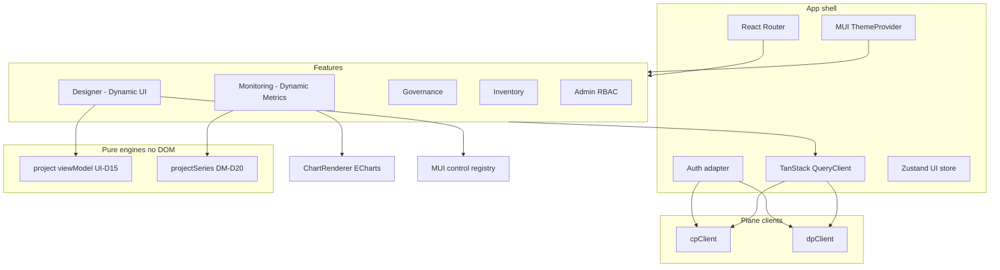
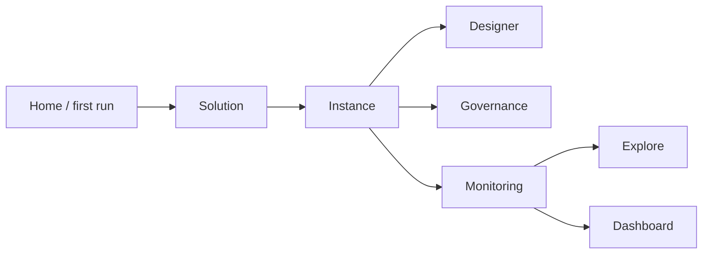
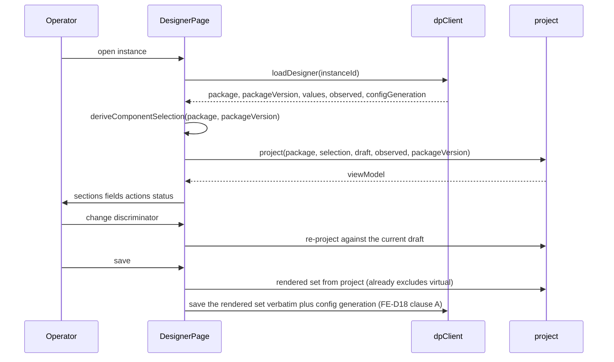
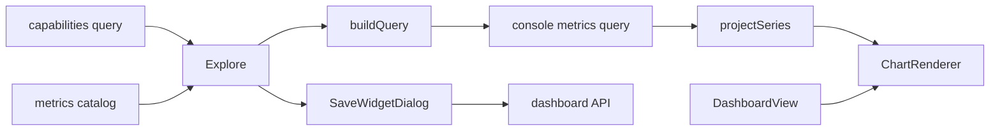
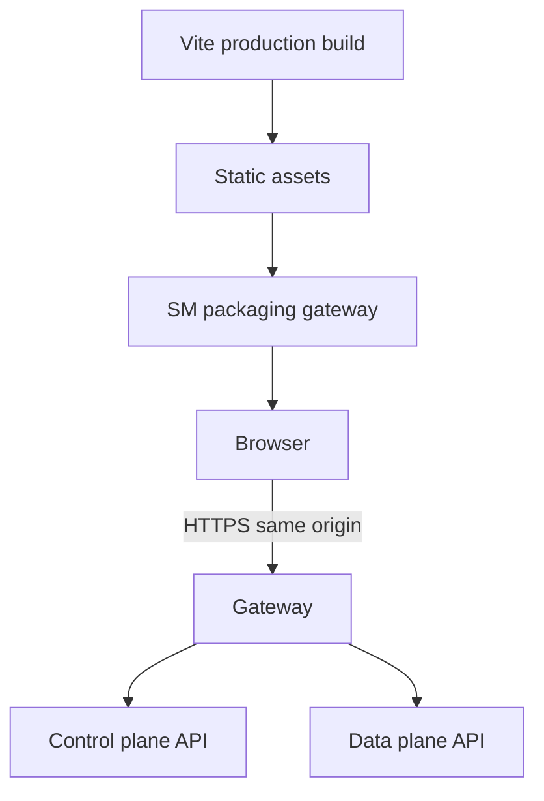

# Solution Manager — Enterprise Frontend Design

**Tracking:** open a GitHub Project issue before implementation · **Status:** DRAFT · self-review applied · **independent adversarial review R1 run 2026-08-17 (both CRITICAL findings applied) plus an internal second pass R2 (2026-08-17) — all R1 MAJOR/MINOR findings now applied, two new findings from R2 applied; see §27** · **`UI-D24` reconciliation pass R3 applied 2026-08-18 — one CRITICAL (`FE-D17` would have written virtual fields into the MI config), see §27** · **Date:** 2026-08-19 — §8.1, §18 contrast, §23 row 5, §24 and §25 amended by the design-import change (`FE-D30`, `FE-D52`); **these amendments have not been through an R4 review**

**Relationship to the rest of the design:**

| Document | Relationship |
|---|---|
| [`../architecture.md`](../architecture.md) | Binding: planes, Target model, v1 slice, capability limits. This document is the **Frontend** sub-spec named in §16. |
| [`../DECISIONS.md`](../DECISIONS.md) | Cross-cutting decisions. Cited, never restated as if this file owned them. |
| [`../dynamic-ui/design.md`](../dynamic-ui/design.md) | **Declaration + view-model contract.** This document supplies the **last-mile renderer** (`UI-D15` was written to be stack-neutral because issue `#9` / open item 19 blocked components). |
| [`../dynamic-metrics/design.md`](../dynamic-metrics/design.md) | **Consumption layer** for metrics. This document hosts `ExploreView` / `DashboardView` / `ChartRenderer` in the console shell. Where they overlap, Subsystem A wins on declaration, Dynamic Metrics wins on query/widget, this document wins on chrome, routing, and clients. |
| [`decisions.md`](decisions.md) | the `FE-D*` family. All `PROPOSED`. `FE-D26` superseded by `FE-D29`. |
| [`../../plans/frontend/`](../../plans/frontend/) | The implementation plan this document is built from, its task register, and one report per completed task. **§28 below is the as-built map between the two.** |

> 📍 **As-built, 2026-08-28.** This document is the *design*; the console now exists. Branch `dev/frontend` carries
> plan [`002`](../../plans/frontend/implementation.md) phases 0–5 — `FE-001`…`FE-067` and `FE-105`…`FE-125`, **85 of 125
> tasks** — as a fixture-backed SPA with no server behind it. **§28 maps every section of this spec to the module that
> implements it, and records where the code has moved ahead of, or behind, what is written here.** Read §28 first if you
> are picking this work up.
>
> ⚠️ **UNBASELINED.** `SM-D*` and all of `UI-D*` / `DM-D*` / `FE-D*` are `PROPOSED`. `D7` is `LOCKED`; open item **19a** is closed and **19b** is narrowed to the designer's confirmation of a now-verified palette (`FE-D52`) — theme work proceeds under the §24 gate-2 waiver, which is **unsigned**, and open item 19 still blocks brand-final visual tokens. Per `I4`, do not implement this as settled. Per architecture §16, the walking skeleton does not start until open item 19's *stack* reading is accepted: this document **upholds `D7` (React + Vite + MUI)** and treats open item 19 as a **visual-reference** question, not as permission to adopt Tailwind + Radix. The reference has since been supplied (`FE-D30`) and its palette verified (`FE-D52`), which confirms that reading rather than disturbing it.

---

## 1. Executive Summary

Solution Manager's console is a **schema-driven operations shell**, not a per-solution React app. An operator onboards Cache, later File Mesh, later DB MI by loading a Solution Package (`REQ-001`). The UI has three jobs that never become three products: **Designer** (configure), **Governance** (health), **Monitoring** (common + native metrics).

This sub-spec settles what architecture.md §16 left to Frontend: plane-split clients, state domains, the MUI harvest layer, routing, authz presentation, restart/version UX, and how Dynamic UI + Dynamic Metrics **embed** rather than fork.

**Architectural goals**

1. **Zero console releases per solution** — closed vocabularies, open data (`UI-D14`).
2. **SaaS-split cheap** — `cpClient` / `dpClient`, composition in hooks, never in leaves ([architecture.md](../architecture.md) §3.1).
3. **Honest telemetry** — gaps, pending config, inactive replicas, unverified durability are visible (`UI-D8`, `UI-D9`, `SM-D27`).
4. **Deny-by-default UX** — verbs omitted when unauthorized; limits explained when the verb exists (`D10`, `FE-D9`).
5. **One design system** — MUI theme + harvested wrappers. No second stack (`D7`, `FE-D4`).

**What this document does not do:** invent OpenAPI paths (Console REST is unwritten), invent Solace brand tokens (open item 19), implement alerting (does not exist; UI must not imply it fires), or require MI code (`I1`).

---

## 2. Existing Architecture and Decisions

### 2.1 What already binds the console

| Source | Binding on the frontend |
|---|---|
| `D7` 🔒 | React + Vite + Material-UI; harvest File Mesh wrappers; express the mockup as an **MUI theme** |
| `D1` 🔒 | Config-driven UI **plus** a custom-UI escape hatch. `UI-D21` proposes narrowing the hatch — **flagged, not resolved** |
| `D9`/`D20` 🔒 | Same SPA collapsible to a single Organization; there is no separate Tenant entity |
| `D10` 🔒 | Azure-style `resource.action`, deny-by-default. `DM-D18` adds dashboard/metrics verbs — **must be raised on `D10`**, not assumed granted |
| `D13` 🔒 | Keycloak broker; **deferred**. v1 = local auth |
| `D14` 🔒 | PostgreSQL store — the UI never speaks SQL (`DM-D1`) |
| `B/D15` 🔒 | UTC canonical; local time is display-only |
| `HC1` / `I1` | No MI development; optional telemetry degrades with a stated reason |
| `I5` / `HC2` | Organization authority never comes from client input |
| `I6` | Secrets never in diffs, exports, history, logs |
| `I7` | No CP↔DP imports in backend; UI mirrors with two clients |
| architecture §3.1 | Two API clients, independently configurable base URLs; composition in a container/hook |
| architecture §14 | **Superseded** by Dynamic UI. Do not implement §14's observed-version renderer or YAML-leaf parser |
| architecture §15 | Walking skeleton: one generated Designer screen · one graph · one role · one apply · Docker `dp-remote` |
| `UI-D*` — **the whole family, not a fixed range** (currently through `UI-D24`) | Package, renderer obligations, validation tiers, canvas as generic composer, **virtual fields** (`UI-D24`) |
| `DM-D*` — **the whole family, not a fixed range** (currently through `DM-D23`) | Query API, widgets, dashboards, ECharts, refresh, series cap, one-metric-per-widget (`DM-D23`) |

### 2.2 What does **not** exist

| Gap | Consequence for this spec |
|---|---|
| No frontend code | Greenfield Vite app; harvest is copy-with-redesign, not a CRA fork |
| No common-components spec | This document **is** that spec (`FE-D4`) |
| Console OpenAPI unwritten | Client **shape** is decided (`FE-D7`); paths wait on the backend sub-spec — §26 item 3 |
| No **designer-confirmed** visual reference | Theme structure decided; an in-repo reference exists (`FE-D30`) and **paint values are verified against product source** (`FE-D52`) — not designer-confirmed, so work runs under the §24 gate-2 waiver (open item 19b) |
| Alerting service absent | "Create alert" if shown is **seed-only** and must state that nobody is notified (`DM-D15`, architecture §16.1) |
| Composition module vs `I7` | Metrics/config screens call a **console API**. Frontend does not join schemas |

### 2.3 Flagged conflicts this spec will not silently resolve

| Conflict | This document's posture |
|---|---|
| Open item 19: MUI vs Tailwind/Radix | **Uphold `D7`.** Missing artefact is the visual reference |
| `D15` 🔒 generalize FM vs `SM-D18` greenfield | Frontend is Vite greenfield **as `D7` already required** (CRA→Vite). Harvest wrappers, not Redux-Saga |
| `UI-D21` vs `D1` 🔒 escape hatch | Implement generic renderer + composer. Keep a **named-screen registry** empty until the group decides |
| `UI-D12` vs `SM-D14` | Renderer follows **declared** version; `VERSION_UNVERIFIED` allows edit |
| `DM-D5` vs `SM-D31` personal dashboards | UI can render three scopes/layers **if** the API exists. Until ratification, v1 walking skeleton uses **instance + shared + product-default** only |
| `DM-D13` vs `D7` harvest-charts | **Uphold `DM-D13`.** MUI chrome; ECharts through `ChartRenderer` only (`FE-D16`) |
| Objective #4 / `REQ-004` vs `SM-D2` | **No artifact-deploy UI** until retirement is ratified. Designer applies **configuration**, not JARs/images |
| `UI-D23` warn-only yaml secrets vs `I6` | `I6` forbids secret values in **field-level diffs** and **exports**; `UI-D23` accepts they cannot be masked inside a `yaml` blob. This document binds the **payload** it receives (server-side redaction) and **gates `type: yaml` to Phase 2** (`FE-D23`, §26 item 14). Whether *storage* is redacted is Subsystem A's call — **flagged, not resolved** |
| `FE-D18` apply ordering vs `architecture.md` §13 | Apply/rollout generation **does not exist for `dp-remote`**, and the walking skeleton runs on `dp-remote`. Clause B of `FE-D18` is **blocked** on `DECISIONS.md` open item 1; the save half is unblocked. **Not a wire-naming question** — §10.1, §26 item 8 |
| `FE-D7` base-URL scope vs `SM-D1` UI seam | `SM-D1` names "independently configurable base URLs" for `cpClient`/`dpClient`. This document narrows that to **internal/packaging-only** configurability behind one public gateway origin (`FE-D19`) — never two public `VITE_*` URLs, which would leak plane topology to the browser and fail `REQ-003`. Consistent with the SaaS-split-cheap goal; flagged here because it is an interpretive narrowing of `SM-D1`'s wording, not a restatement of it |

---

## 3. Existing Requirements

Traced in [`../../requirements/traceability.md`](../../requirements/traceability.md). Frontend obligations:

| REQ | Frontend must |
|---|---|
| `REQ-001` DESIGNED | No per-solution screens. Package in → Designer/Governance/Monitoring out |
| `REQ-002` ACCEPTED | v1 Cache only; File Mesh/DB MI must not require a second architecture |
| `REQ-003` ACCEPTED | Organization in schema/token, not a client-authoritative request parameter. Air-gap: no phone-home telemetry from the SPA |
| `REQ-004` LOCKED / proposed retirement | Do **not** build "deploy artifact" flows |
| `REQ-005` ACCEPTED | Runtime is data on the Target/binding, not a UI branch |
| `REQ-006` ACCEPTED | Hide unauthorized verbs; never trust the client for allow/deny |
| `REQ-007` ACCEPTED, **unproven** | Time presets come from advertised capabilities (`DM-D10`). Never advertise six months as assured |
| `REQ-008` ACCEPTED | Same console serves footprint-refusing customers too: `host-local` vs `dp-remote` is data on the Target binding, not a UI branch or a separate skin |
| `REQ-009` ACCEPTED | No "please add an endpoint to the MI" empty states. Degrade with the package's stated reason |

There is **no REQ** for "reusable metrics package across multiple products" (Dynamic Metrics §9.3). This console **embeds** that package internally. Cross-product reuse stays an unbacked assumption and does not bind folder layout beyond a clean `features/monitoring` export.

---

## 4. Proposed Architecture

The console is one SPA with a **shared kernel** and **feature slices** that map to operator jobs. Dynamic UI and Dynamic Metrics are features, not sibling apps.



**Rules**

- Leaves do not `fetch`. Leaves do not import `echarts`. Leaves do not hard-code hex.
- `project` / `projectSeries` are pure and fixture-tested in this repo's CI and in backend CI (`UI-D15`, `DM-D20`).
- A screen may show CP catalog + DP config; the **hook** composes **via the gateway** (`FE-D19`). After SaaS split the browser still has one origin.

### 4.1 Operator information architecture



This matches the AWS/Azure console metaphor already in `architecture.md` §1: resource first, then configure / health / metrics. File Mesh's flow-first navigation is **not** the platform IA; the generic composer lives **inside** Designer (`UI-D20`).

---

## 5. Technology Stack

Evaluated for maturity, licence, TypeScript, and on-prem redistribution. Licences verified 2026-08-16 by WebFetch (`I2` / `L1`).

| Layer | Choice | Licence | Role |
|---|---|---|---|
| Language | TypeScript `strict` + `noUncheckedIndexedAccess` (`FE-D15`) | — | App code: no `any` |
| UI library | React — minor pinned at scaffold; not File Mesh's React 17 | MIT — [react LICENSE](https://raw.githubusercontent.com/facebook/react/main/LICENSE) | `D7` |
| Bundler | Vite | MIT — [vite LICENSE](https://raw.githubusercontent.com/vitejs/vite/main/LICENSE) | `D7` |
| Components | MUI Material UI | MIT — [material-ui LICENSE](https://raw.githubusercontent.com/mui/material-ui/master/LICENSE) | `D7`, `FE-D4` |
| Tables | `@mui/x-data-grid` Community | MIT — [MUI X licensing](https://mui.com/x/introduction/licensing/) | `FE-D11`. Pro/Premium **not** assumed |
| Charts | Apache ECharts via `ChartRenderer` | Apache-2.0 — [echarts LICENSE](https://raw.githubusercontent.com/apache/echarts/master/LICENSE) | `DM-D13`, `FE-D16` |
| Server state | TanStack Query | MIT — [query LICENSE](https://raw.githubusercontent.com/TanStack/query/main/LICENSE) | `FE-D1` |
| Client state | Zustand | MIT — [zustand LICENSE](https://raw.githubusercontent.com/pmndrs/zustand/main/LICENSE) | `FE-D2` |
| Routing | React Router — major pinned at scaffold | MIT — [react-router LICENSE](https://raw.githubusercontent.com/remix-run/react-router/main/LICENSE.md) | `FE-D6` |
| Forms | React Hook Form | MIT — [RHF LICENSE](https://raw.githubusercontent.com/react-hook-form/react-hook-form/master/LICENSE) | Designer drafts only (`FE-D17`) |
| Dates | display via `Intl` + UTC payloads | — | `B/D15` |
| Unit tests | Vitest | MIT — [vitest LICENSE](https://raw.githubusercontent.com/vitest-dev/vitest/main/LICENSE) | `FE-D12` |
| Component tests | Testing Library | MIT — [RTL LICENSE](https://raw.githubusercontent.com/testing-library/react-testing-library/main/LICENSE) | `FE-D12` |
| e2e | Playwright | Apache-2.0 — [playwright LICENSE](https://raw.githubusercontent.com/microsoft/playwright/main/LICENSE) | Walking skeleton |
| Icons | `@mui/icons-material` | MIT with MUI | status + nav. No extra icon pack in v1 |

**Rejected for v1**

| Candidate | Why not |
|---|---|
| Redux Toolkit + RTK Query | MIT ([redux-toolkit LICENSE](https://raw.githubusercontent.com/reduxjs/redux-toolkit/master/LICENSE)), mature, but **duplicates** Query and recreates File Mesh's "all server data in one store". No undo/time-travel requirement. See §6 |
| Tailwind + Radix / shadcn | Contradicts `D7` 🔒 |
| Next.js | SSR is unused on-prem; SM packaging serves a static SPA (`FE-D14`) |
| MUI X Charts as the metrics renderer | See §11. Zoom/pan documented as **Pro** ([MUI X Charts](https://mui.com/x/react-charts/)). SVG cost vs `DM-D13`'s 10×~1000 points |
| Chart.js / Highcharts | Highcharts is commercial. Chart.js is weaker at multi-series ops tooling. ECharts already decided |
| CSS-in-JS besides MUI's | Second styling runtime |

**React wrapper for ECharts:** a thin adapter in-tree. Do not take a abandoned `echarts-for-react` pin as architecture — the adapter is ours, ECharts is the dependency.

---

## 6. State Management Strategy

File Mesh: React 17 + CRA + **Redux-Saga**. Server data, UI, and sagas shared one graph. That is the anti-pattern.

No TanStack Query / Zustand / RTK exists in *this* repo (no code). Dynamic Metrics §10 already **recommended** TanStack Query and flagged it for this sub-spec.

### 6.1 Evaluation

| Need | RTK + RTK Query | Zustand alone | TanStack Query + Zustand |
|---|---|---|---|
| Cache, dedup, cancel, SWR | Yes, via RTK Query | No | Yes, Query |
| Dashboard blank-on-refresh | Preventable | Easy to get wrong | First-class `placeholderData` / `isFetching` |
| Canonical query hash (`DM` §10) | Possible | Hand-rolled | `queryKey` |
| Never retry `422` | Configurable | Hand-rolled | `retry` predicate |
| Theme, sidebar, flags | Yes, heavy | Yes | Zustand |
| Form draft / dialog / zoom | Overkill | Overkill if global | React state |
| Bundle / ceremony | Redux store + slices + API slice | Tiny | Two focused libraries |
| File Mesh harvest | Familiar, wrong shape | N/A | Clean break |

**Recommendation: TanStack Query (server) + Zustand (session UI) + React state (ephemeral).** Not three competing sources of truth — three **lifetimes**.

### 6.2 Ownership table

| State | Owner | Examples |
|---|---|---|
| Server | TanStack Query | packages, instances, draft config from DP, health, catalog, query series, dashboards, capabilities |
| Mutations | Query mutations | save config, apply, restart, save widget, type a pending metric |
| Global client | Zustand | color mode, sidebar collapsed, capability snapshot fallback, "unverified theme" banner dismissed |
| URL | React Router | solution, instance, category, dashboard id, range preset, explore draft **id**, selected instance ids (`FE-D6`, `FE-D21`) |
| Local React / RHF | component | Designer draft values (React Hook Form); dialog open, chart zoom, wizard step, advanced-fields toggle |

**Dashboard widget config when saved** is server state. **Explore draft** is `sessionStorage` or a server draft (`FE-D21`), discarded on navigate unless saved (`DM-D9`). **Dashboard range/refresh** is owned by `DashboardView` (`DM-D21`) and is also in the URL.

**Query defaults** (`FE-D20`): no window-focus refetch for metrics; never retry `422`; no optimistic apply/restart.

**Do not put selected instances only in Zustand.** Operators refresh. Instance ids belong in the URL (`FE-D6`).

---

## 7. Folder / Project Structure

Root: `frontend/` (Vite). Feature-oriented (`FE-D3`). Public API per feature is `index.ts`.

```
frontend/
  src/
    app/                 # providers, router, error boundary, env
    shared/
      api/               # cpClient, dpClient, correlation-id, error codec
      auth/
      theme/             # MUI theme, CssBaseline, ECharts theme bridge
      ui/                # common components — the design system
      charts/            # ChartRenderer only ECharts import
      i18n/              # v1: English messages file; no second locale required
      testdoubles/
    features/
      inventory/         # declared instances; bulk import is v1 remainder, not skeleton
      designer/          # control registry, composer, apply/restart UX
      governance/
      monitoring/        # Explore, Dashboard, StatCard — calls shared engines
      admin/
    generated/           # OpenAPI types — CI regenerated, not edited
  public/
```

**Import rule:** `features/x` → `shared` and `features/y` public barrel only. `app` may import features.

**Engines:** TypeScript `project()` and `projectSeries()` live under `contracts/` (or a `packages/view-models` path consumed by frontend **and** backend tests) — **not** copied into `features/`. They must not import React. Frontend CI runs the same JSON fixtures as Java (`UI-D15`, `DM-D20`).

This is the structure **when code exists**. Phase 0 landed 2026-08-19: `app/`, `shared/theme/`, `shared/state/`, `shared/ui/` and the guard scripts exist; `shared/api/`, `shared/charts/`, `shared/auth/`, `shared/store/` and every `features/` folder do not yet. ⚠️ Two paths not in the layout above were added and should be ratified into it or moved: `shared/state/` (the transcribed state vocabulary — it is neither design-system nor client, and every feature reads it) and `test/` (the Vitest setup file).

---

## 8. MUI Design System

### 8.1 Token architecture

One `createTheme` object. Feature code uses `theme.spacing`, `palette`, `typography`, `breakpoints` only (`FE-D5`).

| Token group | Notes |
|---|---|
| Palette | semantic: `primary`, `secondary`, `error`, `warning`, `info`, `success` plus **status**: `health.ok`, `health.down`, `health.restartExpected`, `health.inactiveReplica`, `pending`, `unverified` |
| Typography | **Rubik**, self-hosted — verified 2026-08-19 at Agent Mesh `lib/index.css:123` (`FE-D5`). The `Inter` / `system-ui` fallback tail is design-authored, as are the numeric size, line-height and weight scales; upstream is palette-only |
| Spacing | 8px grid via MUI spacing |
| Shape | `borderRadius` from theme |
| Elevation | MUI shadows; cards vs dialogs |
| Breakpoints | From the token layer, **not** MUI defaults — `xs 0 · sm 600 · md 905 · lg 1240 · xl 1560`, so the theme and the CSS token file cannot disagree about where a layout changes. Console is **desktop-first** but not desktop-only: filters collapse, grid stacks |
| Icons | MUI icons; status never icon-only |
| CssBaseline | yes ([MUI usage](https://mui.com/material-ui/getting-started/usage/)) |
| Viewport meta | `width=device-width, initial-scale=1` |

**Paint — verified, not designer-confirmed.** It comes from the checked-in visual reference
([`reference/`](reference/README.md), `FE-D30`): the Solace Agent Mesh DS tokens in
`reference/_ds/…/colors_and_type.css`, as applied by `reference/theme.css`. Values are transcribed in
implementation plan **Appendix B**, and verified against `SolaceLabs/solace-agent-mesh` product source
(`FE-D52`): **all 58 unique hex values appear upstream**, `accent` ramp and `darkSurface` navigation slice
included. Anchors: brand green `#00C895`, primary marine `#015B82`, navy surfaces `#03223B` / `#021B2F`,
semantic `#0591D3` / `#E94C4E` / `#FF8E2B` / `#009A80`. Method and reproduction command:
[`reference/PALETTE-PROVENANCE.md`](reference/PALETTE-PROVENANCE.md).

⚠️ The earlier interim pair — navy `#003057`, teal `#00a89e`, taken from the Dynamic Metrics screens — is
**retired and must not be used**; both values were simply wrong.

⚠️ **Three things this does not license.** (1) `FE-D5` still marks brand paint **BLOCKED** pending architect
acceptance of open item 19, so **a theme PR that treats even the `reference/` values as brand-final before that
acceptance is a defect.** (2) It does **not** close open item 19b, which assigns the visual reference to the
designer; the palette is well-provenanced but unconfirmed, and proceeding on it needs the §24 gate-2 **waiver**,
which is unsigned. (3) Only *colour* and the *font family* are verified. The numeric type scale, spacing, radii,
shadows, motion and the semantic alias layer are design-authored — upstream `solace.ts` is palette-only. A theme
PR describing those as brand-verified is a defect, as is one treating the palette as designer-signed-off.

**Light / dark:** `palette.mode` only. ECharts theme is a **pure map** from this object (`DM-D13`). No second dark palette file.

### 8.2 Component variants

Wrap, don't fork, MUI:

- `Button` — primary / secondary / danger (high-consequence: restart, force-raw, export)
- `Alert` / `Banner` — typed errors and capability-fail-closed (`DM-D10`)
- `TextField` / `Select` / `Switch` / `Autocomplete` — Dynamic UI control kinds
- `Dialog` — confirm outage, save widget, secret reveal
- Density: **comfortable** default; compact is a user preference in Zustand, not a per-page surprise

---

## 9. Common Components Architecture

There was **no** prior common-components design. This layer **is** the design system. Dynamic UI and Monitoring consume it; they do not ship their own Card/Table/Spinner.

| Component | Maps to | Notes |
|---|---|---|
| `AppShell` | header, sidebar, skip link, main landmark | Persistent nav: Home, Solutions, Targets, Admin |
| `AppHeader` | product name, Organization **display**, user menu, theme toggle | Organization string is server-provided |
| `SidebarNav` | solutions list | Collapse state in Zustand |
| `Breadcrumbs` | Solution / Instance / Category | Matches IA §4.1 |
| `PageHeader` | title, status badges, primary actions | Actions from RBAC omit list |
| `CategoryTabs` | Designer · Governance · Monitoring | Same instance context |
| `StatusBadge` | `UI-D9` states, per replica from `replicas[]` + the instance `healthRollup` | Color **and** text/icon; never color alone. A component declaring **no `health` block** is `not-declared` → **`not-applicable`**, never red — all four File Mesh fixture components are this case |
| `SecretField` | write-new secret / `secretRef` display | **Never** fetches resolved value (`FE-D23`). The `value` union (`secretRef` / `secretUnset`) has no arm that could carry one |
| `DiffView` | field-level diff | Secrets masked |
| `DataTable` | MUI X Data Grid Community | No Pro pinning/export (`FE-D11`) |
| `FilterBar` / `SearchField` | inventory and explore | |
| `EmptyState` / `SkeletonBlock` / `ErrorPanel` | named states | §16 |
| `Toast` | non-blocking mutation results | Apply/restart outcomes also persist on the instance header |
| `MetricCard` / `StatCard` | `mark: single-stat` / `gauge` chrome | Chart stays in `ChartRenderer` |
| `WidgetFrame` | title, layer badge, menu, boundary | Dynamic Metrics §9.1 |
| `ConfirmOutageDialog` | restart / apply | Architecture restart UX |

**Harvest from File Mesh:** setup-wizard *patterns*, table column habits, connection-test button placement — **after** an a11y and secret-handling audit. Do not harvest unauthenticated patterns, `orgName` from the client, or chart wrappers (`FE-D16`).

**Registration:** a `controlKind → component` map in `features/designer`. Adding a **control** is an SM release (`UI-D14`). Adding a field is data.

---

## 10. Dynamic UI Architecture

Not a separate product. Designer **is** the renderer.



⚠️ **The diagram above was corrected on 2026-08-28 to match what was built.** The original showed the package arriving
from `cpClient` and the values from `dpClient` as two reads. `FE-D33` resolved plan §16 **Q19** the other way: **one DP
read** returns the package, the instance's `packageVersion`, the values, the observed state and the generation together,
and the browser projects. The wire *encoding* of that response is still the backend sub-spec's to write — only the
frontend data flow is bound here.

**What `project()` returns — consume the contract, not the sketch (`UI-D15`).** Five properties of the view model that a first reading of Dynamic UI §6.5 gets wrong, each one load-bearing for a component in §9:

| The console consumes | **Not** | Why |
|---|---|---|
| `components[]`, each carrying its own `sections[]` | a flat `sections[]` | A File Mesh instance composes **four** components and **field keys repeat across them** — the FTP fixture carries two `COMP_SOURCE_FTP@*` components of 65 fields each. Flattening collides them |
| the explicit **`rendered`** set, plus a per-field `virtual` flag (`renderedPath: null` when virtual) | the visible field set, filtered in the console | Filtering client-side is a second implementation of the exclusion rule and the place it will drift. `project()` already computed it (`UI-D24`, `FE-D17`) |
| `metrics[]` — **declaration level only** | `graphs[]` carrying `mark` / `thresholds` / `transform` / `resolution` | The package schema declares **no** marks, thresholds or graphs. `mark` and `thresholds` are **server-stored widget config** (`DM-D12`, Dynamic Metrics §7); `transform` and `resolution` are **server-decided** (`DM-D11`, `DM-D16`, `DM-D23`). A `ChartRenderer` fed from `project()` would be reading the wrong document — Monitoring goes through `projectSeries()` (§11), never through the package view model |
| `status.config` **structured** | one scalar config state | [`../architecture.md`](../architecture.md) §6.1's *"five config states — do not collapse them"* (`architecture.md:347`): `desired` · `rendered` · `persisted` · `restart-observed` · `effective-verified`. Cache reaches `restart-observed` and is permanently `effective-unverified`; a scalar cannot say that, and `PENDING_RESTART` / `CONFIG_DIVERGED` (§10.1) both gate on which state was reached |
| `replicas[]` **plus** a `healthRollup` | one health scalar per instance | `INACTIVE_REPLICA` is a **per-replica** property (`UI-D9`) — a standby reports `UP` while processing nothing. A rollup alone loses exactly the distinction §9's `StatusBadge` exists to draw, and §10.1's per-replica progress table needs the array anyway |

Two further consequences the chrome must honour: a component that declares **no `health` block at all** is `not-declared` → rendered **`not-applicable`**, never red (**all four** File Mesh fixture components declare none, so this is the common case, not an edge); and a secret's `value` is a **discriminated union** of `secretRef` / `secretUnset` with **no arm capable of carrying a resolved value** — `masked` is a rendering hint, not the security boundary (`FE-D23`).

**Form protocol (`FE-D17`).** RHF holds the full draft, including inactive branches (`UI-D4`) **and virtual fields** (`UI-D24`). Discriminator change → `project()` → `reset` **merge** (do not drop hidden keys). **Save/apply body = the `rendered` set `project()` returns — the rendered field set *minus* every field marked `virtual` — never `getValues()`.** Bind-tier validation may use RHF; semantic warnings are `UI-D16`.

**Two exclusions, not one.** `UI-D4` excludes an inactive branch *for now*; `UI-D24` excludes a virtual field *always*, because it has no `CONFIGURATION_PATH` and does not exist in the MI. They are not interchangeable and the second is not the smaller case: the checked-in fixture [`contracts/validation/fixtures/filemesh-ftp-solace.package.json`](../../../contracts/validation/fixtures/filemesh-ftp-solace.package.json) declares **206 fields of which 54 are virtual**, and **every** File Mesh discriminator is one. Reading the payload from the *visible* set rather than from `rendered` would write 54 phantom keys per instance into a managed integration's config file — the same class of defect `FE-D17` exists to prevent, one order of magnitude larger.

**Obligations implemented here, specified in Dynamic UI §6.5:** defaults-applied `when:`; collection applicability is **not** the form's job (DP collects against `restart-observed`); inactive branches retained in draft; **virtual fields rendered, predicate-participating, draft-persisted and never submitted** (`UI-D24`); `advanced` toggle (all 1,989 FM rows); secrets never resolved in the browser (`FE-D23`); `test-connection` **server-side only**; bind-tier blocks / semantic warns; version states; canvas layout excluded from config hash.

**Control mapping** (last mile, now that `D7` is the stack this spec upholds):

| `type` / view hint | MUI control |
|---|---|
| string | `TextField` |
| int | `TextField` inputMode numeric + bind validation |
| bool | `Switch` |
| enum / options | `Select` or `Autocomplete` |
| duration | `TextField` with helper of canonical unit |
| list / map / table | `DataTable` or repeating rows |
| yaml | isolated editor + collision/secret warnings (`UI-D23`) |
| secret | `SecretField` — `value` is the `secretRef` / `secretUnset` union; no arm carries a resolved value (`FE-D23`) |
| **any `type` with `virtual: true`** (`UI-D24`) | the control its `type` already maps to above. **Renders · participates in `when:` predicates · persists in the draft · is never in the save payload** (`renderedPath: null`, excluded from `rendered`). Not a control kind of its own — a field-level obligation crossing every row |
| actions `test-connection` etc. | buttons calling DP; never with resolved secret in the browser |

**Composer (`UI-D20`):** Cache = one node. File Mesh = source + sink. Layout is presentation. **Named screen registry** exists for `D1`'s escape hatch and stays empty in v1 unless the architect group ratifies `UI-D21`.

**Permissions (`FE-D22`):**

```
viewModel = project(package, selection, draft, observed)   // no auth
chrome    = overlayRbac(viewModel, permissionSet)
```

`VERSION_DRIFT` / `UNKNOWN` block editing with a stated reason inside `project()` / observed state. `UNVERIFIED` does not. RBAC only omits or disables chrome.

### 10.1 Apply, restart, and `CONFIG_DIVERGED`

This is the architecture.md §9 / §16 frontend obligation. Default restart is **`manual`** (`SM-D15`): stage config, show `PENDING_RESTART` (*Configuration staged · restart required · N replicas pending*), wait for `restart-observed`. That is **not** convergence (`SM-D22`).

| Strategy | UI | Gating |
|---|---|---|
| `manual` | Default. Outage copy for single replica before save/stage | none |
| `rolling-health-gated` | Offered only if the package declares a health mapping **and** `mustBeUniformAcrossReplicas` is not true | **Unavailable for Cache** (open item 15 — standby reports `UP`) |
| `rolling-no-validation` | High-consequence confirm (`rolling-no-validation` verb) | omitted if unauthorized |
| `restart-all` | Full-outage confirm | verb |
| `scheduled` | Out of v1 | — |

Multi-replica **stage-everywhere-then-restart** is the default ordering so a halt leaves config uniform-but-unapplied. The picker **suppresses `rolling-*`** when `mustBeUniformAcrossReplicas` is true (Cache: forced true).

**Per-replica progress:** a table of replica × `{ rendered-config version, restart-observed, health qualifier }`. Not a single spinner.

**`CONFIG_DIVERGED`:** banner + replica table + remediation: re-stage everywhere, or restart remaining, or roll back to last uniform generation (`B/D12` config-only rollback) — shown as a `DiffView` field-level diff against the currently-staged generation **before** the operator confirms, the same pattern §7.2 requires for `VERSION_DRIFT`. A rollback is a config change like any other; it does not get a lighter confirmation path just because it is a revert. Do not offer a fake "force healthy."

**Concurrency (`FE-D18`) — two generations, not one.**

| | Mechanism | Status |
|---|---|---|
| **Save** (draft → DP configuration-of-record) | last-seen config generation on the request; `409` → refetch + field-level diff; no silent overwrite | **Unblocked.** Optimistic locking on the DP's own row — no remote host involved. Walking-skeleton scope |
| **Apply / restart** (DP → remote host) | monotonic rollout generation, idempotency key, DP-persisted in-flight state, crash-safe resume | ⚠️ **BLOCKED.** These are `B/D16` **agent↔CP** properties. [`../architecture.md`](../architecture.md) §13: they **do not exist for `dp-remote`**, and *"that apply path is best-effort and non-idempotent"*. Specifying them is [`../DECISIONS.md`](../DECISIONS.md) **open item 1 — a ratification blocker** |

**The walking skeleton runs on `dp-remote`**, so its apply CTA has no ordering or idempotency guarantee. Until
open item 1 closes, the UI must therefore treat a `dp-remote` apply as **`APPLY_INDETERMINATE` by default**:
resolve it from **observed state** (staged generation + per-replica `restart-observed`), never from the HTTP
response, and offer only **operator-initiated retry after confirming actual** — an automatic retry without an
idempotency key is a second write.

No optimistic mutation cache in either row (`FE-D20`).

**Limit, accepted:** the save-side generation does **not** protect against a concurrent *apply*. Two operators
each holding the current generation can both apply; last remote write wins, silently. The UI cannot detect this
and must not imply that it can.

**Single replica:** dialog must state *requires restart · 1 replica · expect unavailability · continue?*

**Inventory bulk import** (architecture §16): **v1 remainder**, not walking skeleton. Route: `/solutions/:solutionId/instances` with an import action omitted without the verb. Format and API wait on backend.


### 10.2 Package versions — one package file, several versions (`FE-D31`, `FE-D37`)

*Recorded 2026-08-28 from what `FE-118`…`FE-125` built. The package envelope itself is Subsystem A's to specify, and
[`../dynamic-ui/design.md`](../dynamic-ui/design.md) §3.1 has **not** been updated — see the flagged conflict in
[`decisions.md`](decisions.md) and §28.4 C1.*

A package evolves without forking into a file per version. `SolutionPackage.packageVersion` is a **non-empty ascending
array** of `PackageVersionId` (`number | string`); a component or a field declares which of those versions it belongs to
with its own optional `version` array; and an instance is configured against **exactly one** of them
(`InstanceRow.packageVersion`).

| Rule | Where it lives | Note |
|---|---|---|
| `version` **absent** = every version the package serves | `inVersion()` | What keeps a package written before versioning valid, and every pre-existing contract fixture passing |
| `version: []` = belongs to no version | rejected at load | An empty array would silently never render; far likelier a lost field than a retired one |
| A `version` member the package does not declare | rejected at load | It could never be selected, so it could never render |
| One filtering rule, never restated | `inVersion()` is **exported from the contract** and imported by every consumer | `FE-D37` |
| Filter **before** defaults are applied | `project()` | An out-of-version field must not contribute a `default` to the value map a `when:` predicate reads, or a v7-only field silently steers a v6 field's visibility |
| A component excluded by version contributes nothing | `project()` | No section, no field, no action — and no graph either, or Monitoring would chart what the Designer refuses to render |

**The threading discipline, and why it is a discipline.** `project()`'s `packageVersion` parameter is **optional, and
omitting it filters nothing** — the behaviour every caller had before versions existed, preserved so the shared fixture
suite stayed valid. That default is safe for a fixture and wrong for a screen. `FE-121` found six callers that still
omitted it, including the one that builds the **save payload**: a v6 instance would have rendered, seeded and saved a
v7-only field. The version therefore reaches the render, the defaults seeded into the draft, and the payload — and is
asserted at all three levels, in **both** directions (a field added in a later version, and one removed in a later
version). A suite checking only the *added* direction passes against an implementation that filters nothing on the
older side.

**Where the operator meets it.**

| Surface | Behaviour |
|---|---|
| Declare form | A required `Package version` select, built from the package's own array. Preselected only when the package serves **exactly one**; at two or more it starts unchosen. **No silent default to "latest"** — a wrongly-defaulted version renders a field set the instance was never configured against, with nothing on screen saying so. Two distinct errors: *unchosen* and *not a version this package serves* |
| Instance grid | A `Package version` column, between `Env` and `Where it runs` — it is identity (which schema), not observed state |
| Designer | A `pkg vN` chip in the header; the field set is filtered to that version; a version whose components are all excluded renders a stated empty state rather than a blank form |
| Governance | The log-viewer component list comes from the same version-filtered selection, so it can never offer a component the Designer does not show |

**Two versions are the operator's, and they are not the same thing.** `packageVersion` is the *schema* this instance is
configured against. `version.declared` / `version.observed` (`UI-D12`) are the *MI build* it runs. The declare form's
helper text says which is which, because two fields called "version" on one form need the difference stated rather than
inferred.

**Not built, deliberately or otherwise** — see §28.4: there is no UI to move an instance from one package version to
another, and nothing verifies that an instance's `packageVersion` is still one the package serves.

### 10.3 Role selection at declare time — authoring half of `FE-D55` (`FE-D56`)

*Recorded 2026-09-22. Closes the fixture-layer authoring gap `FE-D55` and `componentSelection.ts` both name
explicitly: "How a binding is **authored** is §16 Q10 … still open; until it closes, the fixture layer supplies
one." `§16 Q10` itself — the real declare-instance wire contract — stays open; this section defines how the
**fixture layer's own answer** is produced, not the real API.*

`UI-D26` puts `role` on the component (`source` \| `sink` \| `none`, closed vocabulary,
`contracts/solution-package.schema.json`). A package whose version-eligible components carry **two or more
distinct non-`none` roles** is one where an instance is genuinely one or the other — File Mesh's `file-source` /
`file-sink` today, and by construction any future package that reuses the same closed vocabulary. `FE-D55`
already defines how the Designer *consumes* a `componentTypes` binding; this section is what *produces* one at
declare time, generically — nothing here names `file-mesh`, `source` or `sink` (`REQ-001`).

**Mechanism, kept consistent with `FE-D33` ("the browser projects").** The dev fixture layer gains exactly one
new read: `GET */cp/solutions/:solutionId/package?packageVersion=` returns the **raw** `SolutionPackage`, resolved
through the same `devPackageStore.get(solutionId) ?? packageForSolution(solutionId)` lookup the `/designer` route
already uses. No grouping happens server-side. The dialog derives groups itself:

```ts
// frontend/src/features/inventory/instances/componentRoles.ts
export interface ComponentRoleGroup {
  role: string;
  componentTypes: readonly string[];
}

export function deriveComponentRoleGroups(
  pkg: SolutionPackage,
  packageVersion: PackageVersionId,
): readonly ComponentRoleGroup[]; // groups components by `role`, excluding `undefined`/`'none'`,
                                   // filtered to `inVersion(component.version, packageVersion)` first

export function sharedComponentTypes(
  pkg: SolutionPackage,
  packageVersion: PackageVersionId,
): readonly string[]; // version-eligible components whose role is `undefined` or `'none'`
```

Both are pure, imported from `@contracts/view-model/project`'s `inVersion` exactly as `componentSelection.ts`
already does — no restated filtering rule (`FE-D37`'s discipline extended to a second consumer).

**Where the operator meets it.** `DeclareInstanceDialog` fetches the package once `packageVersion` is chosen
(`solutionsRepository.getPackage(solutionId, packageVersion)`, enabled only then). When
`deriveComponentRoleGroups(...).length < 2`: nothing changes — no field appears, `componentTypes` stays
`undefined` on submit, byte-identical to today's behaviour (the same backward-compatibility guarantee `FE-D55`
states for the Designer side). When **two or more** groups exist: a required `Role` select appears directly under
`Package version`, options are the distinct role strings, and **there is no silent default** — the same rule
`packageVersion` already follows, for the same reason (a wrongly-defaulted role binds the wrong component,
silently). `validateDeclareForm` gains a `role` check, only active when the fetched groups warrant it. The fetch
itself never blocks the identity fields the dialog already renders (org/sub-org/environment, replicas) — only
`Role`'s own value and the submit guard depend on it; a still-loading fetch is surfaced as a validation message on
Declare, the same "press it and be told what's wrong" posture the file's header already commits to, rather than a
disabled control with no stated reason.

**On submit.** `toDeclareInput` computes, when a role was required:
`componentTypes = [...sharedComponentTypes(pkg, packageVersion), ...group.componentTypes]` for the chosen group —
package declaration order is irrelevant here, because `FE-D55`'s `deriveComponentSelection` already re-orders by
the **package's** order downstream, never the binding's. `DeclareInstanceInput` gains an optional
`componentTypes?: readonly string[]`, threaded verbatim through `devDeclaredInstances` (a new field on the stored
declaration and on `InstanceRow`, no new validation logic there — same posture as every other identity field on
this form).

**Closes a second, smaller gap found while designing this.** The `/dp/instances/:instanceId/designer` dev handler
never read `InstanceRow.componentTypes` for a **session-declared** instance — only the two hand-fixtured File Mesh
rows (`fm-source-1`/`fm-sink-1`) carried a binding, served through a different, default handler. Any instance
declared through the dialog therefore rendered every component regardless of role, silently. Fixed alongside this
feature: the declared-instance branch now includes `componentTypes: loadedInstance.componentTypes` in its
response, so a role picked at declare time actually reaches the Designer.

**Closes a third gap, found post-merge (2026-09-22).** `Composer.tsx`'s left "Component types" palette
(`ComposerPalette`, task 063) rendered `pkg.components` unfiltered — every type the package declares, regardless
of role — while the canvas nodes and inspector it sits beside already scoped to the same instance's
`componentSelection`. A `source`-bound instance's canvas correctly showed only its source node, but the palette
beside it still listed the sink type too, contradicting what the rest of the same screen showed for that instance.
Fixed by deriving the palette's list from `componentSelection` (the same `type`s, package order preserved)
instead of `pkg.components` directly — `ComposerPalette` itself needed no change, since it already just renders
whatever `ComponentDeclaration[]` it is given.

**Not this feature's scope.** The real wire contract (`§16 Q10`) — what a production declare endpoint accepts,
who resolves `role` → `componentTypes` server-side, whether the client should ever be trusted to compute a
binding at all — is unresolved and stays unresolved; this is the fixture layer's answer, exactly as `FE-D55`
anticipated one would eventually exist. Adding `file-mesh` to the sidebar `SOLUTIONS` catalog (`SolutionPackageSummary`,
separate from the real schema-shaped package this feature reads) is the pre-existing gap plan 129 recorded and is
untouched here.

---

## 11. Dynamic Metrics Architecture

Not a separate product. Monitoring **embeds** Dynamic Metrics §9.

**UI never branches on JVM vs Solace vs Tomcat.** Those names are catalog data (`DM-D3`, `UI-D14`). Spring Micrometer **Timer** is a histogram-class metric: **v1 plots `_count` / `_sum` as counters**; the histogram itself is not a `mark` (`architecture.md` / `SM-D26`). A Timer does not justify a new closed-vocabulary member.



**Chart library evaluation** (upholds `DM-D13`):

| Criterion | Apache ECharts | MUI X Charts |
|---|---|---|
| Licence | Apache-2.0, ASF | Community MIT; **zoom/pan and export are Pro**; WebGL is Premium ([docs](https://mui.com/x/react-charts/)) |
| Renderer | canvas; `large` / `progressive` | SVG Community; WebGL only on Premium |
| Time-series + many series | Strong, existing `markLine` thresholds | Line charts exist; ops density unproven at 10×1000 |
| React/TS | Official `echarts` types; we own the wrapper | First-class React |
| MUI theme | Adapter required — already specified | Native |
| a11y | Canvas is weaker; we owe a data-table alternative | SVG + better DOM a11y |
| D7 harvest | Discards FM chart wrappers — **flagged** | Closer to MUI, still not FM's wrappers |
| On-prem | No licence key in the bundle | Pro key is public-in-bundle by design; still a **procurement** event |

**Recommendation: ECharts for Monitoring.** MUI X Charts Community may be used later for **simple non-telemetry** visuals (pie of entitlement, etc.) but **not** for Dynamic Metrics, so we do not grow two time-series stacks (`FE-D16`).

**One metric, many instances (`DM-D23`).** A widget queries exactly one metric; instances are the comparison axis. The console's `MetricSelector` is **single-select** and `InstanceSelector` is multi-select to the series cap — changing the metric replaces it rather than adding a series group. Comparing two metrics is two widgets, which `DM-D21`'s one-range-per-dashboard rule keeps on the same window.

**Query lifecycle:** as Dynamic Metrics §10 — canonical hash, dedup, abort on filter change, SWR dim-not-blank, retry 5xx only, floor refresh on bucket size, pause when hidden (`DM-D17`). TanStack Query is the mechanism with **fail-closed defaults** (`FE-D1`, `FE-D20`).

**Capabilities fail closed:** conservative presets + banner (`DM-D10`). Do not label a preset "6 months" as guaranteed (`REQ-007` unproven).

---

## 12. Dashboard Architecture

Follow Dynamic Metrics §8. **Until `DM-D5` is ratified after `SM-D31`:** walking skeleton implements **instance-scoped** dashboards with `product-default` ∪ `shared`, hide-not-delete. `entity` / `organization` / `personal` are built only after ratification so we do not build RBAC surface for a scope model that is still contested between two `PROPOSED` decisions. `D20` supersedes the old proposed `tenant` spelling.

Both `SM-D31` and `DM-D5` are **`PROPOSED`**, not `LOCKED` — `DM-D5` is a proposal against a proposal
(`decisions.md` conflicts table). Building `entity`/`organization`/`personal` before that ordering resolves would mean
shipping RBAC surface for a scope model that ratification could still reject; the walking skeleton stays on the
scope both proposals already agree on (`instance` + `shared` + `product-default`).

**Layout:** 12-column grid; `{ x, y, w, h }` plus explicit `order` for keyboard and screen readers (Dynamic Metrics §8 / §18).

**Toolbar:** time range, refresh, resolution Auto/Raw (`metrics.forceRaw` omits Raw if unauthorized), layer filter. One range for all widgets (`DM-D21`).

**First run:** entity types + instance counts + Explore CTA — never an empty grid (Dynamic Metrics §11.1). If the package shipped defaults, those render.

**Edit:** widget menu → Explore prefilled → overwrite or fork. Fork-to-personal waits on `DM-D5`.

---

## 13. API Architecture

Console REST is **not written**. This section binds **shape**, not paths.

| Client | Browser base | Typical data |
|---|---|---|
| `cpClient` | **same origin** `/api/cp` | catalog, packages, entitlement, RBAC, identity |
| `dpClient` | **same origin** `/api/dp` | config-of-record, apply, health, metrics query, dashboards |

`FE-D19`: the SPA never stores a private DP URL. SM packaging (v1) and a later SaaS **gateway** terminate TLS and fan out. `config.json` at boot carries public prefix, idle minutes, and channel — not plane hostnames.

**Rules**

- Generated types from OpenAPI when the contract exists; until then, hand types colocated and **replaced**, not extended into a shadow contract (`FE-D7`).
- `queryVersion` on metrics bodies (`DM-D2`).
- Ignore unknown JSON fields.
- Client may send `X-Correlation-Id`; **response id is authoritative** (`FE-D13`).
- **Save** sends the config-of-record **generation** (`FE-D18` clause A). **Apply/restart** ordering fields are **not yet specifiable** — clause B is blocked on `DECISIONS.md` open item 1.
- The **Designer read** returns the package, the instance's `packageVersion`, the values, the observed state and the generation in **one** response; the browser projects (`FE-D33`, §10). This binds the frontend data flow only — the wire *encoding* of the package on that response is the backend sub-spec's to write.
- Streaming CSV: same-origin download so cookies work; **do not buffer** (`DM-D14`).
- Organization is never sent as a client-authoritative request parameter (`I5`); the UI only **displays** the Organization string the server returns (`D20`, `FE-D53`). No client wire mechanism carries organization as authority — there is nothing here for the server to trust.

**Error codec:** HTTP status + machine `code` (`SERIES_CAP_EXCEEDED`, `GROUP_BY_REQUIRES_AGGREGATION`, `409` conflict, version states, `CONFIG_DIVERGED`, `APPLY_INDETERMINATE`). UI switches on `code`.

---

## 14. Routing Architecture

| Route | Purpose | Walking skeleton |
|---|---|---|
| `/login` | v1 local auth | yes |
| `/` | first run / home | yes |
| `/solutions` | catalog | yes |
| `/solutions/:solutionId/instances` | inventory; bulk import **v1 remainder** | list only |
| `/solutions/:solutionId/instances/:instanceId/:category` | `designer` \| `governance` \| `monitoring` | designer + monitoring |
| `/solutions/.../monitoring/explore` | Explore; `?draft=` id, not the widget JSON | yes |
| `/solutions/.../monitoring/dashboards/:dashboardId` | dashboard; range in query | after skeleton |
| `/targets` | Target inventory | **v1 remainder** — nav omitted until then |
| `/admin` | RBAC / local users | **v1 remainder** — nav omitted until then |

**Not in the path as authority:** `organizationId`. Display only.

Guards: unauthenticated → login. Idle (`FE-D24`) → login. `VERSION_UNKNOWN` opens read-only. Missing `dashboard.view` → 403 page. Do not show Targets/Admin in the shell until those routes exist.

---

## 15. Authentication and Authorization

**v1:** local session (`D13` deferred). **Adapter** exposes `getAccessToken`, `logout`, `onSessionExpired`. Implementation swaps to OIDC/Keycloak without rewriting features (`FE-D8`). Phase 0 mock is **`DEV` only** (`FE-D24`).

**Token storage:** httpOnly **SameSite=strict** cookie from the **gateway**. CSRF token (or equivalent) on mutations. Fallback: in-memory access token only if the API cannot set cookies. **Not** `localStorage` for refresh tokens (`FE-D14`).

**Idle:** timeout from `config.json` (default 30 minutes) → login (`FE-D24`).

**Audience:** the gateway attaches the session to CP and DP. The SPA does not send a second DP audience URL (`FE-D19`). After split, token audience remains a **backend** concern; the browser still has one origin.

**RBAC presentation (`FE-D9`, `FE-D22`, `D10`)** — overlay after `project()`, never inside it.

| Situation | UI |
|---|---|
| Verb absent | Control **omitted** |
| Verb present, capability/cap blocks | Control **disabled** with reason |
| High-consequence | Confirm even when authorized: restart-all, rolling-no-validation, force-raw, streaming export, version re-declare, archive/restore |

Frontend RBAC is **cosmetic**. Every request still hits deny-by-default on the server.

**`DM-D18` verbs are ratified.** `dashboard.view` / `dashboard.edit` / `dashboard.reset` — and the five `group.*`
verbs the Groups screens gate on — are in the register as **`D18`** 🔒 (2026-09-04), which amends `D10`'s catalog
leg. *(This line previously read "wait on a `D10` catalog change".)* The dashboard buttons remain unbuilt for
their own reasons, not for want of a verb. The Groups gates are live — see `FE-D47`.

---

## 16. Error Handling

| Class | UX |
|---|---|
| Network / 5xx | `ErrorPanel` + retry; Query backoff |
| 401 | session expired → login |
| 403 | not authorized page or omit |
| 422 business | inline, no retry |
| 409 conflict | **save-side** generation mismatch → refetch + diff (`FE-D18` clause A) |
| `CONFIG_DIVERGED` | replica table + remediation §10.1 |
| Widget throw | `WidgetFrame` boundary; dashboard survives |
| Route throw | app error boundary |
| Partial fleet | banner of unavailable instances; remaining series still draw |
| Empty / gap / first-run | Dynamic Metrics §11.2 **verbatim** — never a zero line |
| Semantic validation | warn + recorded override (`UI-D16`) |
| Bind validation | block save |
| `APPLY_INDETERMINATE` | **The default outcome of a `dp-remote` apply, not an edge case** (§10.1). Block further apply until the operator confirms actual from observed state; retry is operator-initiated only. Narrows to a genuine edge case once `DECISIONS.md` open item 1 lands |

Toasts are for **acknowledgement**, not for errors that must remain on the resource.

---

## 17. Performance Strategy

| Pressure | Mitigation |
|---|---|
| Metric points | Server downsamples; `maxPointsPerSeries` ~1000; no browser rollup |
| Series | `DM-D7` cap; selector projects count |
| Widgets | `IntersectionObserver`; Query `enabled` when visible |
| Refresh | append when window slides; pause hidden |
| Bundle | route-level code split per feature; ECharts **async** import inside `ChartRenderer` |
| Lists | Data Grid virtualization |
| Forms | `project()` on discriminator change — and a discriminator's domain is `enum` **or** `bool` (load-time gate 6; Cache's flagship discriminator is the bool `solace.enabled`), so re-projection is triggered by **any discrete-domain field**, not by enums alone. Debounce applies to **free-text typing** only; a discrete choice re-projects on commit |
| SaaS split | coarse hooks already |

**Virtualize the legend**, never truncate (`DM-D13` notes).

---

## 18. Accessibility Strategy

**Bar:** [WCAG 2.2](https://www.w3.org/TR/WCAG22/) **Level AA** for chrome, forms, and navigation. Charts additionally require a **non-color** channel and a **tabular alternative**. MUI's own a11y guide URL was **not** fetchable (404 on previous paths); do not claim MUI "guarantees" a level. We test.

| Topic | Rule |
|---|---|
| Landmarks | skip link → `main`; nav labelled |
| Contrast | **cannot be signed off** until the designer confirms the palette (open item 19b). The **verified** palette (`FE-D52`) must be contrast-checked in both modes before walking-skeleton UX-accept — the retired interim navy/teal is no longer the subject. One known figure: the mockup's untokenised purple chip is 6.39:1 and the verified `accent-purple` substitute 5.80:1; both clear AA, and the choice is designer question 3 |
| Status | text + icon + color (`UI-D9`, thresholds dash+color) |
| Keyboard | all Designer fields, composer nodes, dashboard `order`, dialogs trapped, Esc closes |
| Focus | visible; after tab change focus the panel |
| Charts | `aria-label` from widget title; keyboard to data table; `prefers-reduced-motion` disables progressive animation |
| Live regions | polite "Refreshing metrics" — do not announce every poll |
| Forms | `label` + `helperText` + error `aria-describedby`; required from package |
| Hit target | 40px min on primary actions — AA 2.5.8 is 24px; this is not a claim of AAA 44px |
| i18n | English v1; no concatenated sentences in viewModel |

**Known residual:** canvas charts will fail some screen-reader chart-exploration heuristics. Mitigation is the data table and tooltip-as-text, not a fake "ECharts is accessible" claim.

---

## 19. Testing Strategy

| Layer | Tool | What |
|---|---|---|
| Pure engines | Vitest | shared JSON fixtures `UI-D15` / `DM-D20` including gaps, defaults-applied `when:`, **virtual fields excluded from `rendered` while still driving predicates** (`UI-D24`), counter rate, replica aggregation, schema migration |
| Components | Testing Library | omit-vs-disable RBAC, secret masking, empty states, advanced toggle |
| Routes | Vitest + memory router | guards, URL instance selection |
| e2e | Playwright | walking skeleton: login → Designer save with generation (`FE-D18` clause A) → one graph; assert inactive branch **and every `virtual` field** absent from the payload; assert an apply timeout renders `APPLY_INDETERMINATE`, **not** success or failure |
| Visual | **Phase 2** after tokens | |

CI fails if fixtures drift from backend copies — **one suite, two runners**.

No `any` in tests as an excuse to skip types.

---

## 20. Observability

- `X-Correlation-Id`: client may send; **server id is shown in support UI** (`FE-D13`).
- Structured `console` in development; production error shipping waits on a backend log endpoint — **do not** invent a SaaS RUM product for air-gap on-prem.
- Never log secret values, resolved `secretRef`, or full metric payloads.
- UI version in `AppHeader` for support (build-time `import.meta.env`).

Until alerting exists, drift badges are **UI-only** (architecture §16.1). Do not show a bell that implies a page.

---

## 21. Deployment Architecture

SM packaging Dockerfiles do not exist yet. Binding constraints:



Packaging obligations already decided: static SPA, same-origin `config.json` boot, no secrets in the bundle, no production auth mock (`FE-D14`, `FE-D19`, `FE-D24` — not restated here). New to this section:

- CSP: `default-src 'self'`; no `unsafe-eval` without a recorded ECharts reason.
- Air-gap: no analytics beacons (`REQ-003`).

---

## 22. Scalability Strategy

Same constraints as §17, organized by growth axis rather than by pressure — kept as a separate table because "what happens when X grows" is a different question from an implementer than "what mitigates slow Y," even where the answer cites the same decision.

| Axis | How the UI scales |
|---|---|
| New solution | Package data (`REQ-001`) |
| New metric / JVM / Solace | Catalog + typing quarantine |
| New mark / action.kind | SM release + control/chart adapter |
| Organizations | Server isolation (`I5`); no SPA change |
| Series | Cap, not infinite overlay (`DM-D7`, §17) |
| Widgets | Visibility gating (`FE-D20`, §17) |
| File Mesh field count | `advanced` + sections; virtualize long lists if needed |
| SaaS split | URL config + coarse composition (`FE-D7`, §17) |

**Limit:** this console will not paginate a six-month raw series in the browser. Export is the escape hatch (`DM-D14`).

---

## 23. Architecture Decision Records

Component ADRs are [`decisions.md`](decisions.md) (`FE-D1`…`FE-D24`). Cross-cutting IDs stay in [`../DECISIONS.md`](../DECISIONS.md).

| FE-D | One-liner |
|---|---|
| 1 | TanStack Query owns server state |
| 2 | Zustand owns session UI; React owns ephemeral |
| 3 | Feature folders + shared kernel |
| 4 | One MUI design system; harvest wrappers |
| 5 | Tokens only; paint clause superseded by `FE-D52` — palette verified, designer confirmation pending |
| 6 | Router + URL workspace — not widget JSON |
| 7 | Plane clients behind one gateway origin |
| 8 | Auth adapter; Organization authority not from client |
| 9 | Omit unauthorized; disable limits |
| 10 | Typed errors; empty ≠ success |
| 11 | Data Grid Community v1 |
| 12 | Vitest / Testing Library / Playwright + shared fixtures |
| 13 | Correlation: server id authoritative |
| 14 | Static SPA; `config.json`; no secrets in bundle |
| 15 | Strict TypeScript |
| 16 | ECharts only via `ChartRenderer` |
| 17 | RHF drafts; save = `project()`'s `rendered` set, which already excludes hidden, `virtual` and action entries (`UI-D24`) |
| 18 | Save generation + 409 → diff (unblocked); apply/rollout ordering **blocked** on open item 1 |
| 19 | Browser → gateway only |
| 20 | Fail-closed Query defaults |
| 21 | Explore documents off the URL |
| 22 | RBAC overlay after `project()` |
| 23 | No resolved secret in the browser, incl. `yaml`-embedded in diffs/exports; `type: yaml` gated to Phase 2 |
| 24 | Idle lock; no production auth mock |
| 30 | `reference/` is the visual specification of record; the reference wins on visuals |
| 52 | Verified product palette governs UI semantics; brand book governs identity |

---

## 24. Implementation / Migration Plan

This is **phasing**, not an approved `docs/plans/frontend/` plan. Do not start code until: (1) independent review of this spec, (2) open item 19 tokens *or* an explicit "walk with unverified interim theme" waiver, (3) Console OpenAPI for the walking-skeleton endpoints, (4) `SM-D*` ratification enough to not build a discarded plane.

**Gate status, 2026-08-19:**

| Gate | State |
|---|---|
| (1) Independent review | ⚠️ **Met for the R3 state only.** R1/R2 2026-08-17, R3 2026-08-18 (§27). The 2026-08-19 design-import change amended §8.1, §18, §23, §24 and §25 and added `FE-D30`/`FE-D52` — **none of which R1–R3 saw.** An adversarial pass on that change corrected three of its claims; a further R4 on this document is outstanding |
| (2) Tokens **or** waiver | ⏳ **Waiver arm required.** The palette is now verified against Solace product source (`FE-D5`), which is materially better than the "unverified interim theme" this arm anticipated — but open item 19b assigns the reference to the **designer**, so the *tokens* arm is not met and this gate is **not** satisfied by verification alone. The waiver is a developer decision: see [`GATE-2-WAIVER.md`](GATE-2-WAIVER.md) |
| (3) Console OpenAPI | ❌ **Not met.** No API contract exists (§26 item 3). Constrains any plan to fixture-backed clients; forbids freezing shadow endpoints as the contract (§25) |
| (4) `SM-D*` ratified | ❌ **Not met.** Work may proceed only where nothing plane-specific is built; each plan must state what it builds that ratification could discard, including dependencies on `PROPOSED` `UI-D*` such as `UI-D12` |

| Phase | Frontend delivers | Depends on |
|---|---|---|
| 0 | Vite app, theme shell, **DEV-only** auth mock, gateway-shaped clients | — |
| Walking skeleton | `project()` Designer for Cache, **generation on save** (`FE-D18` clause A), one graph, **manual** apply CTA rendering **`APPLY_INDETERMINATE` by default**, one role | Package, one query API, save API with generation. ⚠️ **Not** an apply API with rollout ordering — that is blocked on `DECISIONS.md` open item 1 |
| v1 remainder | Inventory + bulk import, `CONFIG_DIVERGED` + strategy picker + per-replica progress, dashboards instance-scope, CSV export, Targets/Admin, RBAC omit, idle lock | `D10` verbs including `DM-D18`; apply protocol |
| Phase 2 | File Mesh composer at scale, broker metrics as catalog data, OIDC, named-screen hatch if ratified, PNG export, URL share | FM package, alerting still optional |
| Phase 3 | DB MI — **no new architecture** | package only |

**Migration from File Mesh UI:** there is no in-tree FM app to migrate in place. Harvest is a **checklist**, not a git subtree.

---

## 25. Risks and Mitigations

| Risk | Mitigation |
|---|---|
| Open item 19b — palette not designer-confirmed, contrast fail | **Signed §24 gate-2 waiver** before any theme work, Figma or designer confirmation before UX-accept. Palette is verified against product source (`FE-D52`), so the risk is now "right values, unconfirmed authority" rather than "invented values". No approval-grade visual baselines until 19b closes |
| Console API late | Skeleton against fixture servers; do not freeze shadow endpoints as the contract |
| ECharts a11y gap | Data table + reduced motion |
| `DM-D5` ratification flips personal dashboards | Skeleton without personal layer |
| `D1` hatch vs generic composer | Registry exists, empty |
| MUI X Pro accidentally imported | CI grep `@mui/x-data-grid-pro` / `x-charts-pro` |
| Secret in yaml field reaching a **diff or export** | **Not an accepted risk — a gate.** Payload redacted server-side; `type: yaml` does not ship until then (`FE-D23`, §26 item 14). Phase 2 only: Cache declares no yaml field |
| Six-month preset over-promises | Copy from capabilities only |
| Dual engines diverge | Shared fixtures in `contracts/`; one suite two CIs |
| File Mesh harvest copies XSS / orgName | Audit gate before merge |
| Browser reaches private DP | Forbidden — gateway only (`FE-D19`) |
| Stale config overwrite **on save** | Generation + 409 (`FE-D18` clause A) |
| **Concurrent apply races on `dp-remote`** — two operators both holding the current generation both apply; last remote write wins silently | **Unmitigated.** No rollout generation or idempotency key exists for `dp-remote` (`architecture.md` §13). Blocked on `DECISIONS.md` open item 1. UI shows `APPLY_INDETERMINATE` and must not imply it can detect the race |
| **Apply reported as success when it is indeterminate** — a timeout may still have landed on the host | `APPLY_INDETERMINATE` by default; resolve from observed state, not the HTTP response; operator-initiated retry only (§10.1) |
| RHF submits hidden fields | Save via `project()`'s `rendered` set (`FE-D17`) |
| **Virtual fields written into the MI's config file** — 54 of the FTP fixture's 206 fields, every File Mesh discriminator among them | Payload is `rendered`, which already excludes `virtual` (`renderedPath: null`). **Consume the set, do not re-derive it** (`UI-D24`, `FE-D17`). e2e asserts absence (§19) |
| Query focus-refetch storms | `FE-D20` |
| Streaming export auth | Same-origin cookie download |

---

## 26. Open Questions and Decisions Required

1. **Architect group:** ratify `D7` vs open item 19 as **"MUI + a reference now in-repo, pending designer confirmation"** (`FE-D30`, `FE-D52`), not a stack reopen. 19a is already closed.
2. **Designer confirmation of the verified palette** — the reference is now in-repo (`FE-D30`) and its palette verified (`FE-D52`); **four** questions are outstanding against open item 19b and they gate brand/contrast sign-off and any visual-regression baseline. Theme work proceeds meanwhile under the §24 gate-2 waiver.
3. **Write Console OpenAPI** — blocking for types (`contracts` table).
4. **Raise `DM-D18` verbs on `D10`**.
5. **Ratify the `DM-D5` successor after `SM-D31`** before entity/organization/personal UI.
6. **Ratify `UI-D21` vs `D1`** before any package-supplied module loader.
7. **Gateway vs two public URLs** — packaging must terminate `/api/cp` and `/api/dp` on one origin (`FE-D19` / `RT-D*`).
8. ⚠️ **The `dp-remote` apply-side generation contract does not exist** — this is **not** a field-naming question. `architecture.md` §13 states `dp-remote` apply has no generation ordering, idempotency key, lease or crash-safe resume, and `DECISIONS.md` **open item 1 (ratification blocker)** is where it gets specified. **The walking skeleton runs on `dp-remote`.** `FE-D18` clause B cannot be implemented until item 1 closes; until then apply is `APPLY_INDETERMINATE` by default (§10.1). *Separately* and much more cheaply: name the **save-side** generation field on the Console OpenAPI (clause A, unblocked).
9. **CSRF mechanism** for cookie mutations (`FE-D24`).
10. ~~**CSP** vs ECharts — recorded exception if `unsafe-eval` is required.~~ — **answered 2026-09-02 by `FE-D41`** (`FE-100`). ECharts needs **no** `unsafe-eval`: the production bundle contains zero `eval(`/`new Function(`, and a real chart renders from the real built echarts chunk under the shipped policy with zero violations. The policy ships as a `<meta>` in `index.html` (`default-src 'self'`), with one recorded relaxation — `style-src 'unsafe-inline'` for Emotion — and `npm run verify:csp` failing the build on any unrecorded one. **Still open for SM packaging:** serve the same policy as a header and add `frame-ancestors 'none'`, which a `<meta>` delivery ignores.
11. ~~**Independent adversarial review** (`L2`)~~ — **done 2026-08-17.** Both CRITICAL findings applied; remaining findings triaged in §27. A **second** round is warranted once items 1–10 close, since this round's fixes changed `FE-D18`'s shape (`L2`: fixes introduce defects).
12. **Owner** for the frontend module (`new-module.md`).
13. **Idle timeout** default 30 minutes — confirm with operations.
14. ⚠️ **Server-side redaction of `yaml`-embedded secrets in diff / export / history payloads** (`FE-D23`, `I6` vs `UI-D23` §3.7 item 3). **Gates Phase 2, not v1** — `type: yaml` exists for File Mesh's 12 fields and Cache declares none, so no yaml field ships in the v1 Cache slice. **No `type: yaml` field ships in this console until this is met.** Requires a Subsystem A decision on whether *stored* values are also redacted; this document binds only the payload it receives. Route to the architect group with the `UI-D*` set.

---

## Principal UI/UX review (self-pass)

Reviewed as an operations-console IA, not a marketing site. Walking the walking-skeleton and v1 flows against Dynamic Metrics screens and Designer obligations:

| Check | Result |
|---|---|
| Job-to-be-done: find instance → change config → know health → overlay metrics | IA §4.1 supports it; no deploy-artifact dead-end |
| First-run not an empty grid | Specified |
| Refresh ≠ outage | SWR dim specified |
| Gap ≠ zero | Inherited, called out in chrome |
| Standby ≠ healthy green | `StatusBadge` states |
| Restart SM caused ≠ "down" | `RESTART_EXPECTED` |
| 132-field FTP form | `advanced` + sections required, not optional polish |
| 10 overlapping series | Tooltip shared-axis + scrolling legend; series cap |
| Save vs unauthorized | Omit, not puzzle-disable |
| Incident URL | Range, instance selection and dashboard id are reload-safe and shareable via the URL. **Not** the ad-hoc Explore document — that lives in per-tab `sessionStorage` (`FE-D21`), so a shared Explore link before it is saved lands a second operator on an empty screen, not the sender's view |
| Alerting implied | Explicitly forbidden to fake |
| Contrast / brand | **Fail until tokens** — correctly blocked |
| Canvas keyboard | Data table required or the chart fails AA for non-visual users |
| Composer vs FM flow editor | Generic composer; no pretend DAG routing |

**Senior engineering pass (2026-08-16)** applied in-document: apply/restart/`CONFIG_DIVERGED` (§10.1); gateway-only topology; generation/`409`; RHF vs rendered save; Query defaults; explore state off URL; RBAC overlay; no resolved secrets; idle lock; bulk import routed; Targets/Admin not shown until built.

⚠️ **Two rows in the table above were overturned by independent review** — see §27. "Incident URL" overstated what survives sharing (finding 3), and the senior pass's `generation`/`409` claim was **half wrong** (finding 1). Both rows are corrected above (the R1/R2 fixes recorded in §27); a self-review passing itself is exactly what `L2` predicts, which is the reason this document runs Pass 2 at all.

---

## 27. Independent adversarial review — R1 and R2 (2026-08-17)

**R1** run per [`../../checklists/spec-review.md`](../../checklists/spec-review.md) **Pass 2**: an independent reviewer with the predecessor documents, briefed that a "looks good" verdict is a failed review, and instructed to verify external facts by WebFetch rather than from memory (`L1`, `L2`). Eight findings; both CRITICAL fixed same-day, six MAJOR/MINOR left open pending a second pass.

**R2**, same day: re-verified every citation in this document against `architecture.md`, `DECISIONS.md`, `dynamic-ui/decisions.md`, `dynamic-metrics/decisions.md` and `requirements/traceability.md` directly (not from memory), closed all six of R1's open findings, and surfaced two new ones (findings 9–10) — an unflagged conflict and a checklist gap on decision rationale. One check worth recording as a **non-finding**: `VERSION_UNVERIFIED`'s blocking behaviour looked contradictory against `architecture.md` §7.2 at first read, until `UI-D12`'s explicit, flagged supersession of `SM-D14` on that exact point was confirmed — this document's §2.3 citation is correct.

**Disposition is explicit per finding, as the checklist requires.**

| # | Sev | Class | Finding | Disposition |
|---|---|---|---|---|
| 1 | CRITICAL | FALSE SETTLEMENT | `FE-D18`'s generation/`409` presented as settled machinery, but the walking skeleton runs on `dp-remote`, which `architecture.md` §13 says has **no** generation ordering, idempotency, lease or crash-safe resume. §26 item 8 framed it as *"what is the field called"* | **FIXED NOW.** `FE-D18` split into clause A (save — unblocked) and clause B (apply/rollout — **blocked** on `DECISIONS.md` open item 1). §10.1, §13, §16, §19, §24, §25, §26 item 8 updated. Interim `APPLY_INDETERMINATE`-by-default obligation added |
| 2 | CRITICAL | DESIGN DEFECT | `yaml`-embedded secrets reach `DiffView` / exports in clear — surfaces `I6` names explicitly — filed as an accepted risk with mitigation *"warn; cannot mask"* | **FIXED NOW, with two corrections to the finding.** (a) Severity is **Phase 2**, not live: `type: yaml` exists for File Mesh's 12 fields; Cache declares none, so no yaml field ships in v1. (b) The fix is **not** a client-side masker — that contradicts `FE-D23`'s own principle by putting the credential in the browser. Bound as a **server-side payload** obligation + a **Phase-2 gate** (`FE-D23`, §26 item 14). Storage remains Subsystem A's call — **flagged, not resolved** (`I4`) |
| 3 | MAJOR | DESIGN/FALSE SETTLEMENT | The "incident URL" self-review row overstates what survives sharing — the widget lives in `sessionStorage` (per-tab), so a shared link lands a second operator on an empty Explore | **FIXED NOW (R2).** Self-pass table row corrected to distinguish what the URL carries (range, instances, dashboard id — genuinely shareable) from the ad-hoc Explore document (`sessionStorage`, not shareable pre-save) |
| 4 | MAJOR | FALSE SETTLEMENT | §12 calls `SM-D31` a *"LOCKED-intent rejection"*; it is `PROPOSED` per the ratification matrix | **FIXED NOW (R2).** §12 corrected to state both `SM-D31` and `DM-D5` are `PROPOSED`, and that the v1 walking skeleton uses the scope both proposals already agree on rather than pre-building RBAC surface for a contested model |
| 5 | MAJOR | DESIGN DEFECT | `CONFIG_DIVERGED` offers "roll back to last uniform generation" with no diff-preview requirement, unlike the parallel `VERSION_DRIFT` path | **FIXED NOW (R2).** §10.1 now requires the rollback to render as a `DiffView` field-level diff against the currently-staged generation before the operator confirms — the reviewer's call was correct: `DiffView` is explicitly reused, not implicitly |
| 6 | MINOR | DOCUMENTATION | §13's former Tenant-header wording described a header no other section says the SPA sends | **FIXED.** Organization authority is never a client request parameter; the UI only displays the server-returned Organization (`D20`, `FE-D53`). |
| 7 | MINOR | DOCUMENTATION | `REQ-008` paraphrase (*"locus is not a theme"*) does not read back to "no-footprint customers" | **FIXED NOW (R2).** §3 paraphrase now names footprint-refusing customers explicitly and ties "locus is not a theme" to the Target binding it actually means |
| 8 | MINOR | STRUCTURE | §21/§22 restate `FE-D14`/`FE-D19` and §17; ~40 lines mergeable | **FIXED NOW (R2), partially.** §21's three purely-restating bullets collapsed to one cross-reference line; §22 kept as a separate axis-based view (deliberate, not an oversight — noted inline) but its two most-duplicative rows now cross-reference §17 instead of restating it |
| 9 | MINOR | UNFLAGGED CONFLICT | `FE-D7` narrows `SM-D1`'s "independently configurable base URLs" (`cpClient`/`dpClient`) to internal/packaging-only, never two public `VITE_*` URLs — a defensible interpretation, but not listed in the §2.3 / `decisions.md` conflicts tables the way every other narrowing is | **FIXED NOW (R2).** Added to both conflicts tables (§2.3 here, `decisions.md`'s equivalent) with the same disposition already in force: internal-only, behind `FE-D19`'s gateway |
| 10 | MINOR | DOCUMENTATION | 14 of 24 `FE-D` decisions (`FE-D10`–`13`, `15`, `17`–`24`) had no self-contained **Rationale** paragraph, though `spec-review.md` Pass 1 requires one per decision; substance existed but was scattered across the surrounding prose rather than in the entry | **FIXED NOW (R2).** A `**Rationale.**` paragraph added to each entry in `decisions.md`, drawn from existing document content — no new facts introduced |

**Confirmed sound** (reviewer expected defects, found none): licence claims verified independently — Playwright **Apache-2.0** not MIT, MUI X Charts zoom/pan **and** export Pro-gated with WebGL Premium, Data Grid column resize genuinely Community; `FE-D22`'s RBAC-overlay/`project()` composition cannot produce a misleadingly-permissive state; the `UI-D12` vs `SM-D14` citation is accurate.

**Raised against a document this spec does not own** — not fixed here, reported upstream: [`../DECISIONS.md`](../DECISIONS.md) `B/D16` points its `dp-remote` gap at *"open item 3"*, which is now the migration-DDL item; it should be **open item 1**. The open items were renumbered and this cross-reference went stale — the exact failure `CLAUDE.md` warns about.

**Not verifiable in this round:** the sibling reference repos (`solace-cache-engine`, `file-mesh-ui`, `pubsubplus-connector-file-common`) are **not present on this machine**, so Cache- and File-Mesh-specific claims cited secondhand from `architecture.md` / `dynamic-ui` could not be checked against source. `react-hook-form.com` returned 403 to WebFetch; `FE-D17`'s `shouldUnregister: false` claim was corroborated from bundled source instead — a secondary source.

### R3 — `UI-D24` reconciliation (2026-08-18)

This document was branched before `UI-D24` (virtual fields) existed and before the consolidated `project()` obligation spec reconciled `UI-D15` / `DM-D20` / `FE-D*`. Audit findings, all applied in the same unratified cycle:

| # | Sev | Finding | Disposition |
|---|---|---|---|
| 11 | CRITICAL | `FE-D17` / §10's *"save = rendered field set from `project()`"* predated virtual fields, where "rendered" meant only "not in an inactive branch". Taken literally it writes **54 phantom keys per instance** — the FTP fixture's virtual count, including **every** File Mesh discriminator — into a managed integration's config file: a larger instance of the exact bug `FE-D17` exists to prevent | **FIXED.** Payload is now the explicit **`rendered`** set `project()` returns, which already excludes `virtual` (`renderedPath: null`). The console **consumes** that set rather than filtering the visible one — filtering client-side would be a second implementation of the rule. `FE-D17`, §10 form protocol, sequence diagram, control-mapping table, §19 e2e assertion, §23 one-liner and a new §25 risk row |
| 12 | MAJOR | Six citations of *"§3.6"* for yaml-embedded secrets went stale when `UI-D24` was inserted as Dynamic UI §3.6 and pushed yaml to §3.7 — one of them carrying `FE-D23`'s shipping gate | **FIXED.** Verified against current headings: **five** live occurrences (§26 item 14 here; `decisions.md` conflicts table, `FE-D23` body ×2, and the Phase-2 gate) retargeted to **§3.7**. §2.3's `UI-D23` row cites the decision without a section and needed no change |
| 13 | MAJOR | §2.1 and the reuse list bounded the binding sets at `UI-D23` / `DM-D22`, omitting precisely the two decisions that change the save path (`UI-D24`) and the widget contract (`DM-D23`) | **FIXED**, and restated as **families rather than ranges** so the next addition does not re-break the claim |
| 14 | MINOR | §17's *"debounce only free-text, not enums"* assumed discriminators are enums; load-time gate 6 accepts `enum \| bool` and Cache's flagship discriminator `solace.enabled` is the bool case | **FIXED.** Reworded to *any discrete-domain field*, citing gate 6 |
| 15 | MAJOR | Prose assumed a `project()` shape the obligation spec corrected: `graphs[]`/`transform`/`resolution` (none are emitted — `mark`/`thresholds` are server-stored widget config, `transform`/`resolution` server-decided), flat `sections[]`, scalar `status.config`, scalar health, and a secret `value` that could carry a resolved arm | **FIXED.** New *"What `project()` returns"* table in §10 binds the corrected shape; `StatusBadge` and `SecretField` rows in §9 updated; `not-declared` → **`not-applicable`** stated as the common case, since **all four** File Mesh fixture components declare no `health` block |

**A further round is warranted** once §26 items 1–10 close, since decisions gated on those items (`FE-D18` clause B, `FE-D23`'s Phase-2 gate, `DM-D5`/`SM-D31` scope) cannot be finally checked until the thing they are gated on exists. Nothing in R2 touched `FE-D18`'s shape, so the R1 finding that fixes introduce defects does not itself recur here — but the project's history (R3 elsewhere found four such) is reason enough to run Pass 2 again after the next substantive change, not to treat this round as final.

---

## 28. As-built map (2026-09-03)

**Read this section first if you are picking the frontend up.** §1–§27 are the *design*; this section is what exists,
where it lives, and where the two disagree. It is a map, not a second specification — where it and a numbered section
above differ, the difference is itself the finding, and it is listed in §28.4.

### 28.1 What exists

Branch **`dev/frontend`**, built from [`../../plans/frontend/implementation.md`](../../plans/frontend/implementation.md)
(plan `002`/`003`). **All 125 tasks are built** — phases 0–5 (`FE-001`…`FE-067`, `FE-105`…`FE-125`), phase 6
(Monitoring, `FE-068`…`FE-089`, `FE-109`), phase 7 (Admin/Targets, `FE-090`…`FE-095`) and phase 8 (hardening,
`FE-096`…`FE-104`, `FE-110`). Two carry a qualifier in the task list rather than a plain tick: `FE-095` **Targets
preview** is read-only by design (there is no wire half for a screen that never writes), and `FE-043` **bulk restart
confirmation** is UX-only and still `BLOCKED`. Per-task status is
[`task-list.md`](../../plans/frontend/task-list.md); per-task detail is one report per task in
[`reports/`](../../plans/frontend/reports/).

**Three follow-on plans have since been executed on top of the 125**, and neither `task-list.md` nor
`execution.md`'s register covers them — `reports/` is their only per-task record:

| Plan | Tasks | What it did |
|---|---|---|
| [`126`](../../plans/frontend/126-monitoring-ui-reference-alignment.md) | `FE-126`–`FE-132` | Monitoring repair: the `useEcharts` StrictMode race, the ECharts theme shape, chart legibility, widget sizing, the Dashboards/Explore sub-tabs, toolbar and save flow |
| [`127`](../../plans/frontend/127-hierarchy-drop-tenant-level.md) | `FE-133`–`FE-139` | Dropped the Tenant level; data mapping later corrected by `D20` 🔒 and recorded in `FE-D53` |
| [`128`](../../plans/frontend/128-groups-rbac-ratification.md) | `FE-140`–`FE-147` | Groups/RBAC against `D18` 🔒 / `D19` 🔒 (`FE-D47`…`FE-D50`) |

`FE-148` (three shell/monitoring defects found on screen) and issue #131 (the vitest flake) were executed outside any
plan and are recorded only in [`reports/`](../../plans/frontend/reports/).

⚠️ **Built is not ratified, and the plan closing did not change that.** `FE-104` closed the plan; `I4` still holds, every
`SM-D*` and every `FE-D*` is `PROPOSED`, and phase 7 was executed while the phase itself stayed *not scheduled* — its
issues exist for tracking, not as a readiness signal.

**There is no server.** Every screen runs against MSW fixtures in `frontend/src/shared/testdoubles/`, plus a **DEV-only**
handler set in `frontend/src/app/dev/` that serves packages an operator drops on the running console. Console REST is
still unwritten (§13 stands unchanged), so every repository module carries a `CONTRACT: TBD` header naming the plan
question it is waiting on. `§16 Q10` (the packages/declare endpoints) and `§16 Q8`/`Q9` (the generation field name, the
`409` body) are the ones that bite.

**The stack is the one §5 specifies**, at the versions in `frontend/package.json`: React 19 · Vite · TypeScript strict ·
MUI 9 · MUI X Data Grid **Community** 9 · TanStack Query 5 · Zustand 5 · React Router 7 · React Hook Form 7 · ECharts 6
(reached **only** through `features/monitoring/chart/ChartRenderer.tsx` and the theme bridge in
`shared/theme/echartsTheme.ts`, with a lint fixture proving the `FE-D16` restriction and `verify:bundle` proving the
library stays out of the initial payload) · Vitest + Testing Library + Playwright. No second UI library was added
(`FE-D4`).

**Verification, run 2026-09-03 on `dev/frontend`.** Phase 8 added six gates to this table; all ten are required CI
jobs, and `frontend/README.md` carries the same list with what each proves. **Rows marked ✅ 2026-09-15 were
re-measured on that date; the rest still carry their 2026-09-03 figures and have not been re-run since.**

| Command | Result | Owner |
|---|---|---|
| `npm run typecheck` | clean (both projects) — ✅ 2026-09-15 | — |
| `npm run lint` | clean at `--max-warnings=0`, boundaries policy included | `FE-009` |
| `npm test` | **2395 passed / 2395**, 337 files, zero failures — ✅ 2026-09-15 (was 2172/2172 over 324 files on 2026-09-03) | — |
| `npm run e2e` | **168 passed**, two Playwright projects (`preview` = production build, `fixture` = dev server) | `FE-099` |
| `npm run build` | clean | — |
| `npm run verify:production` | **7/7 assertions** against the written artefact, after a 12-check self-test | `FE-101` |
| `npm run verify:csp` | **17 passed** — policy shape, built bundle, zero egress at runtime | `FE-100` |
| `npm run verify:palette` | **173 passed** (was 169 before `fieldFocusBorder`, 2026-09-23) — WCAG 2.2 AA in both themes, plus the contrast maths' own tests | `FE-097` |
| `npm run verify:perf` | **75 passed** — dedup, visibility gating, refresh policy, legend, debounce, render budgets | `FE-103` |
| `npm run verify:reflow` | 320 px reflow + real-`axe` over every screen, both themes | `FE-110` |
| `npm run verify:bundle` | initial JS **134.7 KiB** gzip against a 160 KiB ceiling | `FE-096` |
| `npm run lint:fixtures:assert` | **13 fixtures** each still failing on the rule they exist to violate — ✅ 2026-09-15 | `FE-009` |
| `npm run check:forbidden-deps` | no MUI X Pro/Premium in `package.json` or the lockfile — ✅ 2026-09-15 | `FE-020` |

**The full-suite flake recorded in the 2026-08-28 pass is fixed** — see §28.4 M1. It was two defects: an
oversubscribed worker pool (`maxWorkers` now `'50%'`; per-test latency roughly halves at identical wall clock) and a
stale per-test timeout override that had silently become a *lowering* when `FE-098` raised the project default.

### 28.2 Spec section to module

| Section | Implemented in (`frontend/`) | Note |
|---|---|---|
| §5 Stack · §21 deployment | `package.json`, `vite.config.ts` (SM packaging is `runtime/`'s) | `FE-D14` static SPA; runtime config injected at boot (`src/app/boot/RuntimeConfig.tsx`) |
| §6 State | TanStack Query per repository · `src/shared/state/` (Zustand) · RHF inside `designer/form/` | `FE-D1`/`FE-D2`/`FE-D17` ownership table holds as written |
| §7 Folders | `src/app` · `src/features` · `src/shared` · `contracts/` | Enforced in CI by `eslint.config.js`'s `boundaries` policy, with lint fixtures in `src/test/lint-fixtures/` proving each disallowed edge |
| §8 Tokens and theme | `src/shared/theme/` | Paint still blocked on open item 19 (`FE-D5`); `FE-D30`'s `reference/` supplies the interim values |
| §9 Common components | `src/shared/ui/` — 32 wrappers incl. `DataTable`, `Dialog`, `SecretField`, `DiffView`, `Toaster`, plus `layout/` primitives | The MUI harvest layer of `FE-D4`; features import these, not MUI's own controls |
| §10 Dynamic UI | `contracts/solution-package/` (canonical browser validation + one normalization boundary) · `contracts/view-model/{types,project}.ts` (the older internal engine input) · `src/features/designer/**` | The upload validator compiles the root JSON Schema directly and runs semantic gates before `project()` sees data. `project()` stays pure and is covered by the language-neutral fixture suite. |
| §10.1 Apply / restart | `designer/{StrategyPicker,RestartConfirm,ApplyOutcomePanel,RolloutCard,DivergedBanner,RollbackDialog}` + `applyRepository.ts` | Ships **UX only**: `APPLY_INDETERMINATE` by default, open item 1 unchanged |
| §10.2 Package versions | `inVersion()` in `contracts/view-model/project.ts` · `DesignerPage/componentSelection.ts` · `designer/form/{useDesignerDraft,mergeReset}.ts` · `inventory/instances/declareForm.ts` | `FE-D31`/`FE-D37` |
| §11 Metrics · §12 Dashboards | `src/features/monitoring/` — `{metrics,dashboard}Repository.ts`, `MonitoringTabs`, `chart/` (`ChartRenderer`, `useEcharts`, `ChartDataTable`, `GaugeMark`, `SingleStatMark`), `explore/`, `dashboard/`, `widget/` | **Built.** Phase 6 (`FE-068`–`FE-089`, `FE-109`) shipped the screens; plan `126` (`FE-126`–`FE-132`) then repaired the chart, the theme bridge, widget sizing, the sub-tabs and the save flow |
| §13 API | `src/shared/api/` — `cpClient`/`dpClient` from one `planeClientFactory`, `ApiError`, correlation ids, retry, query keys | Hand-typed contracts in `shared/api/contracts/`, to be **replaced** by generated types (`FE-D7`) |
| §14 Routing | `src/app/router.tsx` + `src/app/routes.ts` | Paths match §14 exactly; see §28.3 for which have real bodies |
| Resource hierarchy | `src/shared/testdoubles/data/hierarchy.ts` (the fixture) · `src/shared/hierarchy/` (`HierarchyRepository`) · `inventory/instances/{declareForm,DeclareInstanceDialog}.tsx` (the cascade) · `shared/testdoubles/data/rbac.ts` (`SCOPE_TREE`, derived) | **`D20` 🔒 / `FE-D53`** — synthetic `All organizations` (`[]`) → `Organization → Sub-organization → Environment → Instance`. `Acme Financial` is the Organization; Payments/Trading/etc. are Sub-organizations; Ledger/Quotes/etc. are removed. `Identity.organization` is display-only and server-derived. |
| §15 Auth | `src/shared/auth/` + `src/features/auth/` | v1 local session; `RequireAuth`; idle lock (`FE-D24`) |
| §16 Errors | `src/app/errors/`, `shared/ui/ErrorPanel`, `shared/api/errorCodes.ts` | Typed `code` switching as specified |
| §18 Accessibility | axe suites beside each screen (`*.a11y.test.tsx`), reflow harness from `FE-105` | 320 px floor (`FE-D29`) verified per screen, not globally — `FE-110` (CI conformance) is phase 8 |
| §19 Testing | 337 test files (2026-09-15); `contracts/fixtures/view-model/run.test.ts` is the cross-language suite | `FE-D12` |

### 28.3 Screens as built

| Route | Body | Data | Notes |
|---|---|---|---|
| `/login` | `LoginPage` | fixture auth | real |
| `/` | `HomePage` | `/cp/home/summary` | real |
| `/solutions` | `SolutionsPage` + `SolutionCard` + `LoadPackageDialog` + `PackageValidationSummary` | `/cp/solutions` | real; accepts canonical JSON, validates schema and semantic gates client-side, shows exact paths/counts, and requires explicit confirmation. Each valid component row is also clickable, expanding in place to its declared fields (key/type/required/secret, default withheld for secret fields), actions and metrics — sourced from the already-parsed `package` half of the same validation result, no raw-JSON inspection needed (added post-125-tasks, 2026-09-22). DEV additionally holds the parsed package locally; production byte upload remains TBD. |
| `/solutions/:solutionId/instances` | `InstancesPage` | `/dp/solutions/:id/instances` | real: grid, env filter, URL selection, declare, undeclare, bulk-restart (UX only) |
| `.../:instanceId/designer` | `DesignerPage` -> `DesignerForm` or `Composer` | `/dp/instances/:id/designer` | real, end to end: projection, validation tiers, save + generation, `409`, version blocking, rollout/apply (UX only) |
| `.../:instanceId/governance` | `GovernancePage` | `/dp/instances/:id/{health,config-ladder,logs}` | real: health hero, replica cards, config ladder, log viewer |
| `.../:instanceId/monitoring` | `MonitoringTabs` → Dashboards · Explore | `/api/console/v1/metrics/*`, `/dashboards/*` | real: sub-tabs, dashboard grid, widget cards, Add widget, save flow |
| `.../monitoring/explore`, `.../dashboards/:id` | `ExploreRoute` → `ExplorePage`/`ExploreResult` · `DashboardRoute` → `DashboardGrid` | metrics + dashboard repositories | real: catalog select, chart render, data-table affordance, widget placement |
| `/targets`, `/admin` | `TargetsRoute` → `TargetsPreview` · `AdminRoute` (five tabs) | `/cp/*` | **Built** (phase 7). `RouteStub` no longer exists in the tree. Neither is in v1 nav — both are reachable from `AccountMenu`'s DEV-only preview links. `/targets` is read-only by design (`FE-095`). *Superseded in the as-built map (§28): `/admin` is built, five tabs. Q4 (the verb catalog) is closed by `D18` 🔒 and Q5's bootstrap model by `D19` 🔒; what stays TBD is the wire contract, not the policy.* |

### 28.4 Where code and spec disagree — carried forward

From an as-built verification pass on 2026-08-28. Nothing below was changed in code *by that pass*; each item is
stated so the next developer inherits it deliberately rather than discovering it.

**Struck-through rows have since been fixed**, with the fix named in the row. Everything not struck through is still
open — in particular `C1` and `C2`, which phase 6 has now been built on top of without either being addressed.

| # | Sev | Item |
|---|---|---|
| ~~**C1**~~ | ~~CRITICAL~~ | **CLOSED by `UI-D25` (PROPOSED), 2026-09-10.** The owning Dynamic UI family, root JSON Schema, shared projector and frontend now agree: one package carries an ordered non-empty `packageVersion` array, while components and fields optionally declare version membership. The historical scalar rule remains visible in superseded `UI-D11`; it was not silently edited. |
| **C2** | CRITICAL | **Nothing checks that an instance's `packageVersion` is one the package still serves.** `loadDesigner()` returns the pair and every consumer trusts it. Against a version-scoped package the Designer renders a stated empty state that blames the package; against a package with **no** component/field `version` arrays (the internal `file-mesh` projection fixture) it renders **every field with no warning**, and builds the save payload from it. Reachable today: re-dropping an edited package replaces it in the dev store, stranding instances declared against a retired version. Fix: one membership check at the load boundary, rendering the `BlockedBanner` pattern |
| **I1** | Important | `project()` resolves a component by `type` alone and *then* tests the version (`project.ts:360`); `projectGraphs()` puts the version in the predicate (`project.ts:316`). Two rules in one file. For a package declaring one `type` twice across versions, sections and graphs disagree — and `deriveComponentSelection` emits two entries with the same `instanceId`, colliding in `DraftValues`. Nothing forbids duplicate types. Fix: make `type` unique and enforce it in the loader, or unify both predicates |
| **I2** | Important | Two consumers ask *which fields exist* without `inVersion()` — `isDiscriminatorField` (`form/useDesignerDraft.ts:97`) and `fieldOwnerMap` (`DesignerPage/DesignerForm.tsx:98`). Harmless today, but `FE-D37` claims a discipline the code does not fully have |
| **I3** | Important | The Declare action is gated only on `solutionsQuery.isPending`. If the catalog query **errors**, the dialog opens with an empty required `Package version` select the operator can never satisfy. Fix: gate on error/absent-solution too, with the stated reason the tooltip pattern already uses |
| **I4** | Important | **Fixture layer:** an instance declared against a baked-in solution (Cache) 404s on its Designer and Governance screens — the dev handler finds no package for it and the default handler looks only in `CACHE_INSTANCES`. The declare flow's own demonstration path dead-ends. Fix: resolve a declared instance's package through `testdoubles/data/packages.ts`'s `packageForSolution` |
| **I5** | Important | `PackageVersionId` is restated three times (`testdoubles/data/solutions.ts`, `shared/api/contracts/instances.ts`, `instances/declareForm.ts`), one carrying a comment — *"`shared/**` may not import `contracts/**`"* — that `FE-D34` made false. Its sibling `testdoubles/data/instances.ts` imports the real type |
| ~~**M1**~~ | ~~Minor~~ | ~~Two `InstancesPage` tests time out under full-suite load and pass in isolation; the `FE-125` report's "all green" no longer holds at 1370 tests~~ — **FIXED 2026-09-03** (issue #131). Two causes, neither a raised timeout: the worker pool was oversubscribed (`maxWorkers` defaulted to the CPU count, and a jsdom worker running `axe` is not one core's worth of work — capping to `'50%'` roughly halves per-test latency at *identical* wall clock), and `InstancesPage.a11y.test.tsx` carried a `15000` per-test override that was a raise when written and became the suite's only *downward* override once `FE-098` set the project default to `20_000`. Verified by three consecutive full runs at 2172/2172 |
| **M2** | Minor | The loader accepts `packageVersion` in any order, while `derivePackageInstance` depends on `.at(-1)` being the newest. "Ascending" is asserted in prose and unenforced |
| **M3** | Minor | The cross-language fixture suite proves only the *added-in-a-later-version* direction. An implementation reading `version` as a minimum passes all three fixtures and still renders a retired field. The removed direction is asserted only in the TypeScript hook test |
| **M4** | Minor | Save is a **whole-set replace** of visible in-version fields; a stored value for an out-of-version field is dropped on the next save. Probably right — but patch-vs-replace is an unrecorded assumption with data-loss consequences once a version re-bind exists |
| **M5** | Minor | There is **no UI to move an instance from one package version to another**. `FE-D31` binds an instance to one version and nothing migrates it; `FE-D32`'s example package exercises both directions of a version change that no screen can perform |

### 28.5 Picking it up

1. **This codebase documents its reasoning in the module header, not in the design doc.**
   `contracts/view-model/project.ts`, `designer/form/useDesignerDraft.ts` and `app/dev/parsePackage.ts` are the three
   worth reading before changing anything.
2. `npm ci && npm run dev` gives a working console against fixtures. The Solutions catalog's **Load package** dialog
   accepts canonical multi-version documents such as `frontend/contracts/packages/db-designer/package.json`, validates
   them and requires confirmation. (`cache/` and `file-mesh/` remain internal projection fixtures with legacy
   presentation metadata; they are not upload examples.) Confirming a valid package yields a card, an instance and a
   version-filtered Designer with zero per-solution SM code.
3. The plan is authoritative for task content ([`implementation.md`](../../plans/frontend/implementation.md)); the
   register in [`execution.md` §7](../../plans/frontend/execution.md#7-task-register--all-125) is authoritative for
   status.
4. **The plan is finished; the next work is not in it.** All 125 tasks are built and `FE-104` closed the plan, so
   there is no "next scheduled task". What is queued instead:
   - **§28.4's `C1` and `C2`, still open and now more expensive.** Phase 6 has been built on top of the contract
     divergence `C1` names, and `C2`'s missing membership check is still reachable through the dev package store.
     Both were flagged as worth taking *before* phase 6; they were not.
   - ~~**Open bugs**, notably a StrictMode double-invoke race in `useEcharts.ts`~~ — **FIXED by `FE-126`**
     (plan `126`). The hook now survives StrictMode's double-invoke; see `useEcharts.ts`'s module header.
   - **The gate list in §28.1's verification table** is the definition of "green" now. `npm test` alone runs eight of
     the ten past you.
5. **Nothing here is ratified.** `I4` holds; every `SM-D*` and `FE-D*` is `PROPOSED`. Code written against a proposed
   decision does not ratify it, and neither did closing the plan.

---

## Recommended Final Stack

React + TypeScript strict + Vite + MUI + MUI X Data Grid **Community** + Apache ECharts via `ChartRenderer` + TanStack Query + Zustand + React Router + React Hook Form + Vitest / Testing Library / Playwright.

## Existing Decisions Reused

`D7`, `D1` (hatch flagged), `D9`, `D10`, `D13` (deferred), `I1`–`I7`, architecture §3.1 clients, §15 walking skeleton, the whole `UI-D*` family (renderer obligations, not a second Dynamic UI — including `UI-D24` virtual fields), the whole `DM-D*` family except **v1 UI postpones `DM-D5` extra scopes** until ratification, `DM-D13` ECharts upheld. **Stated as families, not ranges**, so a new `UI-D`/`DM-D` does not silently fall outside the reuse claim.

## New Architectural Decisions

`FE-D1`…`FE-D44` in [`decisions.md`](decisions.md). After senior review: gateway-only (`FE-D19`), rendered save (`FE-D17`), generation (`FE-D18`), Query defaults (`FE-D20`), explore off-URL (`FE-D21`), RBAC overlay (`FE-D22`), no resolved secrets (`FE-D23`), idle/no-mock (`FE-D24`). After independent review R1: `FE-D18` split into an unblocked save clause and a **blocked** apply clause; `FE-D23` extended to `yaml` with a Phase-2 gate.

## Open Questions / Risks

⚠️ **Two blockers outrank the rest, both raised by R1 (§27):** the **`dp-remote` apply protocol** (`DECISIONS.md` open item 1 — `FE-D18` clause B cannot be built, and the walking skeleton runs on that locus), and **server-side redaction of `yaml`-embedded secrets** (gates `type: yaml`, i.e. Phase 2 / File Mesh).

Then: open item 19 tokens; unwritten Console OpenAPI including the **save-side** generation field; `D10` vs `DM-D18`; `DM-D5` / `UI-D21` / `SM-D14`; `I7` composition behind the gateway; CSP vs ECharts; alerting absent; `REQ-007` unproven; R1's six MAJOR/MINOR findings still open; a **second** independent round warranted once items 1–10 close.
